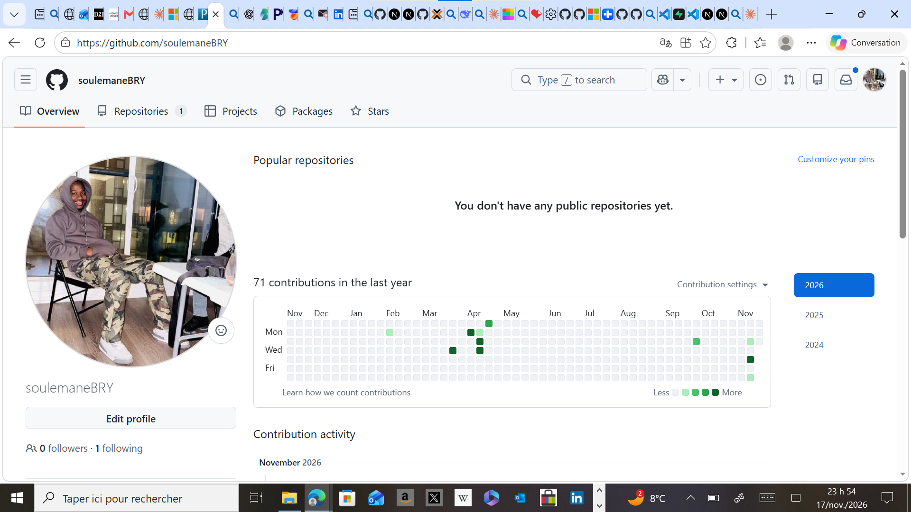
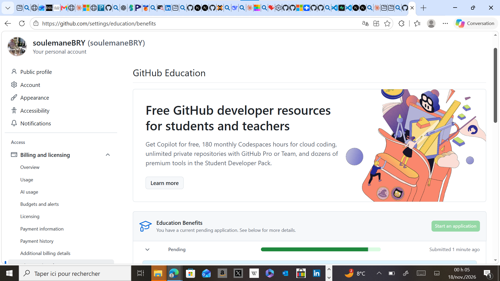
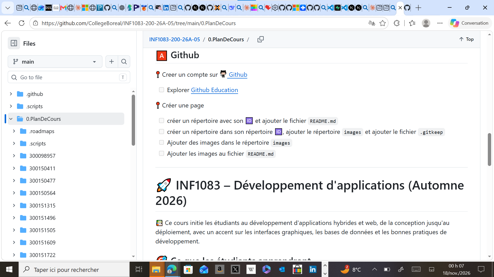

# Plan de cours INF1083 - 300141685

**Étudiant :** Souleymane Barry
**Numéro étudiant :** 300141685
**Programme :** Systèmes informatiques, Collège Boréal
**Cours :** INF1083 - Développement d'applications (Automne 2026)

## 🎯 Objectif du travail

Ce travail présente les premières étapes du cours : créer mon compte GitHub, explorer GitHub Education et lire le plan de cours. Il m'a aussi permis de pratiquer la structure de dépôt demandée : un répertoire à mon numéro, un fichier `README.md` et un répertoire `images` contenant un fichier `.gitkeep` et mes captures d'écran.

## 🅰️ Mon compte GitHub

GitHub est la plateforme utilisée dans ce cours pour remettre les travaux. Mon nom d'utilisateur est **soulemaneBRY**. La capture ci-dessous montre mon profil, avec 71 contributions sur la dernière année.

## 🎓 GitHub Education

J'ai exploré la page GitHub Education de mon compte (Settings > Education benefits). Elle présente les ressources gratuites offertes aux étudiants et aux enseignants grâce au Student Developer Pack : GitHub Copilot gratuit, 180 heures de Codespaces par mois pour programmer dans le nuage, des dépôts privés illimités avec GitHub Pro ou Team, et des dizaines d'outils professionnels. J'ai soumis une demande d'avantages étudiants, qui est actuellement en attente d'approbation (statut « Pending »).

## 📚 Plan de cours

Cette capture montre la page `0.PlanDeCours` du dépôt du cours. En haut, la section GitHub liste les étapes demandées : créer un compte, explorer GitHub Education, puis créer un répertoire à mon numéro avec un `README.md`, un répertoire `images` et un fichier `.gitkeep`, y ajouter des images et les afficher dans le README.

Plus bas, la page présente le cours INF1083, une introduction au développement d'applications hybrides et web, de la conception jusqu'au déploiement. Il se divise en trois blocs :

- **Applications hybrides :** comprendre les différences entre applications web, natives et hybrides, créer un projet, utiliser les outils de compilation et de débogage, et rédiger une documentation technique.
- **Design d'interfaces graphiques :** concevoir des maquettes, choisir les bons contrôles graphiques, programmer les interactions et tester les interfaces.
- **Applications connectées aux données :** connecter une application à une base de données, lire, ajouter et modifier des données, valider les entrées et comprendre le modèle client-serveur.

L'évaluation comprend des laboratoires, un quiz sur le référentiel et deux projets d'application qui valent chacun 25 % de la note. La note de passage est de 60 %. Le plan de cours complet est disponible en PDF dans le même dossier du dépôt.

## ✅ Conclusion

Ce travail m'a permis de me familiariser avec l'organisation du dépôt du cours, avec GitHub Education et avec les attentes générales du cours. Je sais maintenant comment structurer et remettre un travail sur GitHub.