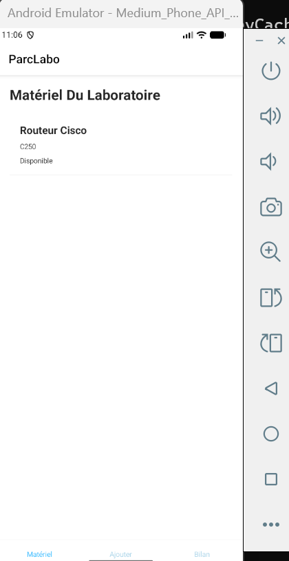
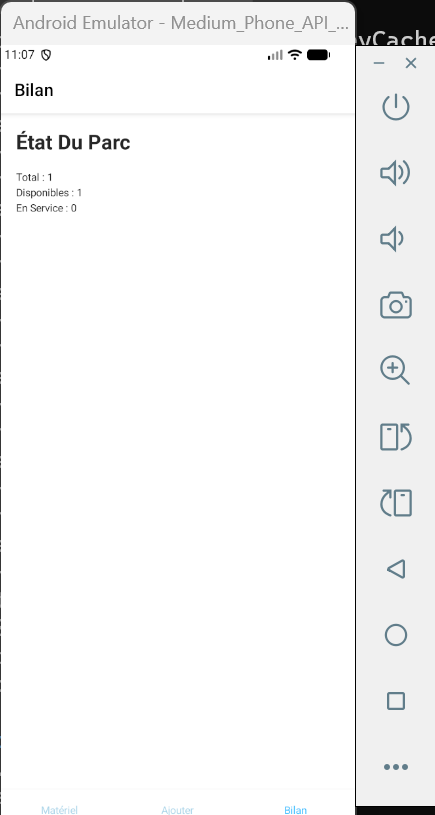

# Lyes Medjahed

Numéro étudiant : 300153676  
Cours : INF1083 — Développement d’applications, automne 2026

Dans mon projet ParcLabo, je peux enregistrer le matériel d’une salle informatique et consulter le nombre d’appareils disponibles.

