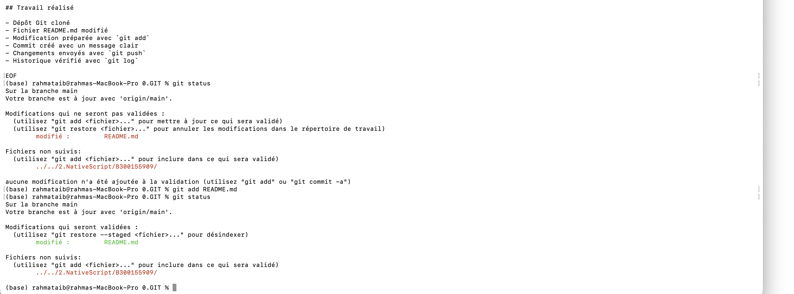
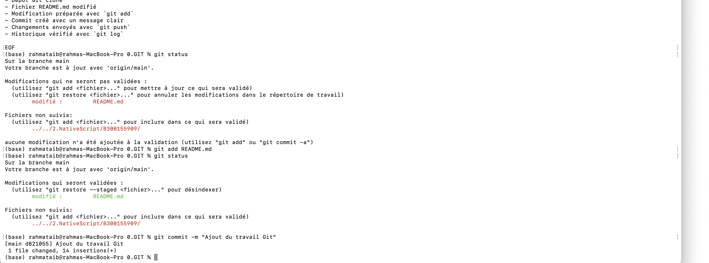
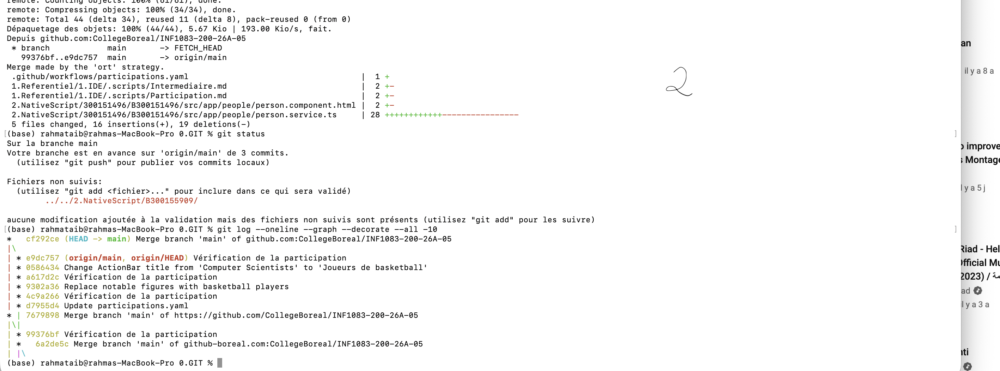

# TP Git - Rahma Taib

## Travail réalisé

- Dépôt Git cloné
- Fichier README.md modifié
- Modification préparée avec `git add`
- Commit créé avec un message clair
- Changements envoyés avec `git push`
- Historique vérifié avec `git log`


# TP Git — Rahma Taib

## Travail réalisé

### 1. Vérification du dépôt avec Git Status

Cette étape permet de vérifier l'état du dépôt et les fichiers suivis/non suivis.



### 2. Vérification de l'historique avec Git Log

L'historique des commits a été vérifié avec la commande `git log`.



### 3. Synchronisation avec GitHub

Les modifications distantes ont été récupérées avec `git pull --no-rebase origin main`.


### 4. Envoi des modifications vers GitHub

Les commits locaux ont été envoyés vers GitHub avec `git push origin main`.



## Commandes Git utilisées

```bash
git status
git log --oneline --graph --decorate --all -10
git pull --no-rebase origin main
git push origin main
