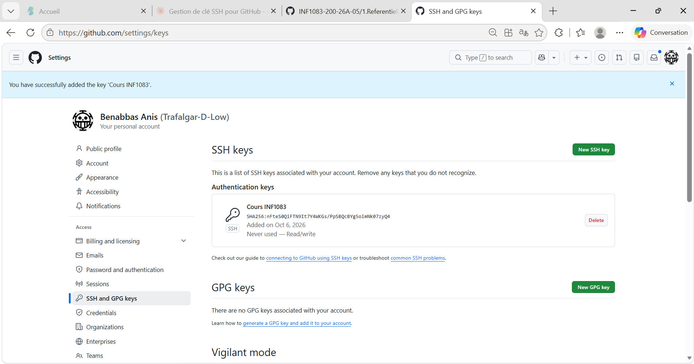
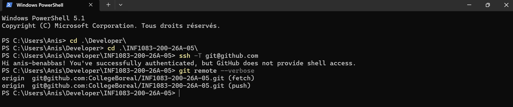

# 300150477 - Laboratoire 1 : IDE, Git et SSH

## Objectif

Configurer Git, SSH et Visual Studio Code sur Windows pour soumettre mon travail sur GitHub.

## Environnement

- Système : Windows
- Terminal : PowerShell
- Éditeur : Visual Studio Code

## 1. Git

Clonage du dépôt du cours et création de mon répertoire `300150477` avec son `README.md` :

```powershell
mkdir Developer
cd Developer
git clone https://github.com/CollegeBoreal/INF1083-200-26A-05.git
cd INF1083-200-26A-05\1.Referentiel\1.IDE
mkdir 300150477
git add 300150477
git status
```

Configuration de mon identité et de l'éditeur, puis premier commit :

```powershell
git config --global core.editor "nano"
git config --global --edit
git commit --message ":star: Mon premier commentaire"
```

## 2. Clé SSH

Génération de la clé, puis renommage des fichiers dans `~/.ssh` :

```powershell
ssh-keygen -t ed25519 -C "mon_courriel"
cd ~/.ssh
mv id_ed25519 ma_cle.pk
mv id_ed25519.pub ma_cle.pub
```

Contenu du fichier `~/.ssh/config` :

```text
Host github.com
    HostName github.com
    User git
    IdentityFile ~/.ssh/ma_cle.pk
```

Ma clé publique `ma_cle.pub` a été ajoutée à mon compte GitHub (Settings → SSH and GPG keys) :



## 3. Dépôt du cours en SSH

```powershell
git remote set-url origin git@github.com:CollegeBoreal/INF1083-200-26A-05.git
git remote --verbose
ssh -T git@github.com
git pull --no-edit
git push
```

La connexion SSH est réussie et le dépôt utilise bien l'adresse SSH :



## 4. IDE

Visual Studio Code est installé :

```powershell
code --version
```

## Conclusion

Git, SSH et Visual Studio Code sont configurés. Je peux envoyer mon travail vers le dépôt du cours avec `git push`.