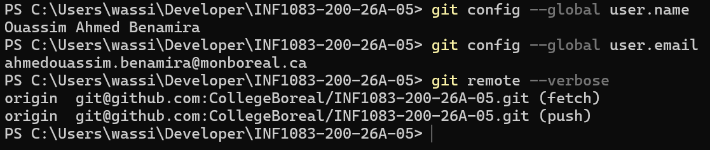
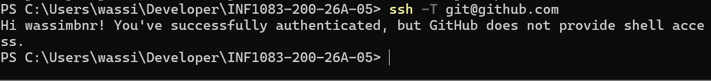
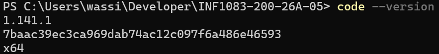

# 🧰 INF1083 — IDE, Git et SSH

## 👤 Étudiant

**Nom :** Ouassim Ahmed Benamira  
**Matricule :** 300150564  
**Programme :** TSIQ — Techniques des systèmes informatiques  
**Cours :** INF1083 — Développement d'applications  
**Session :** Automne 2026  

---

## 🎯 Objectif

L'objectif de cette activité est de préparer mon environnement de développement pour le cours INF1083.

Le travail comprend la configuration de Git, l'utilisation du dépôt GitHub du cours, la configuration de l'accès SSH et la vérification de Visual Studio Code.

---

## 📁 Répertoire de développement

Le dépôt du cours est placé dans mon répertoire `Developer` sous Windows.

```text
C:\Users\wassi\Developer\INF1083-200-26A-05
```

Le répertoire utilisé pour cette activité est :

```text
1.Referentiel\1.IDE\300150564
```

Structure de mon travail :

```text
300150564/
├── README.md
└── images/
    ├── .gitkeep
    ├── 01-git-configuration.png
    ├── 02-ssh-github.png
    └── 03-vscode-version.png
```

---

## 1️⃣ Configuration de Git

Git est configuré avec mon nom et mon adresse courriel du Collège Boréal.

```powershell
git config --global user.name
git config --global user.email
```

Configuration vérifiée :

- **Nom :** Ouassim Ahmed Benamira
- **Courriel :** ahmedouassim.benamira@monboreal.ca

J'ai également vérifié le dépôt distant avec :

```powershell
git remote --verbose
```

Le dépôt utilise l'adresse SSH :

```text
git@github.com:CollegeBoreal/INF1083-200-26A-05.git
```

### 📸 Vérification Git



---

## 2️⃣ Configuration SSH avec GitHub

SSH permet de communiquer de façon sécurisée avec GitHub sans utiliser l'URL HTTPS pour chaque opération Git.

La connexion peut être testée avec :

```powershell
ssh -T git@github.com
```

Résultat obtenu :

```text
Hi wassimbnr! You've successfully authenticated, but GitHub does not provide shell access.
```

Ce résultat confirme que ma clé SSH est reconnue par GitHub et que l'authentification fonctionne correctement.

### 📸 Vérification SSH



---

## 3️⃣ Dépôt distant GitHub

L'adresse du dépôt distant a été vérifiée avec :

```powershell
git remote --verbose
```

La configuration actuelle utilise SSH pour les opérations `fetch` et `push`.

```text
origin  git@github.com:CollegeBoreal/INF1083-200-26A-05.git (fetch)
origin  git@github.com:CollegeBoreal/INF1083-200-26A-05.git (push)
```

Cette configuration permet notamment d'utiliser :

```powershell
git pull
git push
```

pour synchroniser le dépôt local avec GitHub.

---

## 4️⃣ Visual Studio Code

Visual Studio Code est l'éditeur utilisé pour travailler sur les fichiers du cours.

Sous Windows, le cours présente notamment son installation avec Chocolatey :

```powershell
choco install vscode
```

Sur mon ordinateur, l'installation a été vérifiée avec :

```powershell
code --version
```

Version vérifiée lors de cette activité :

```text
1.141.1
x64
```

### 📸 Vérification de Visual Studio Code



---

## 5️⃣ Commandes Git principales

Voici quelques commandes utilisées dans cette activité :

| Commande | Utilité |
|---|---|
| `git clone` | Cloner un dépôt Git |
| `git status` | Vérifier l'état des fichiers |
| `git add` | Ajouter les changements à la zone de staging |
| `git commit` | Enregistrer les changements |
| `git pull` | Récupérer les changements distants |
| `git push` | Envoyer les commits vers GitHub |
| `git remote --verbose` | Vérifier le dépôt distant |
| `ssh -T git@github.com` | Tester l'authentification SSH |
| `code --version` | Vérifier Visual Studio Code |

---

## ✅ Résultat

À la fin de cette activité :

- Git est installé et configuré.
- Mon identité Git est configurée.
- Le dépôt INF1083 est disponible localement.
- Le dépôt distant utilise SSH.
- L'authentification avec GitHub fonctionne.
- Visual Studio Code est installé et fonctionnel.
- Mon répertoire étudiant `300150564` contient le README et les captures nécessaires.

---

## 📝 Conclusion

Cette activité m'a permis de préparer mon environnement de développement pour INF1083. J'ai vérifié la configuration de Git, la connexion SSH avec GitHub et l'installation de Visual Studio Code.

Ces outils seront utilisés pour gérer, documenter et envoyer les prochains travaux du cours.

---

**🚀 INF1083 — Développement d'applications | 300150564**