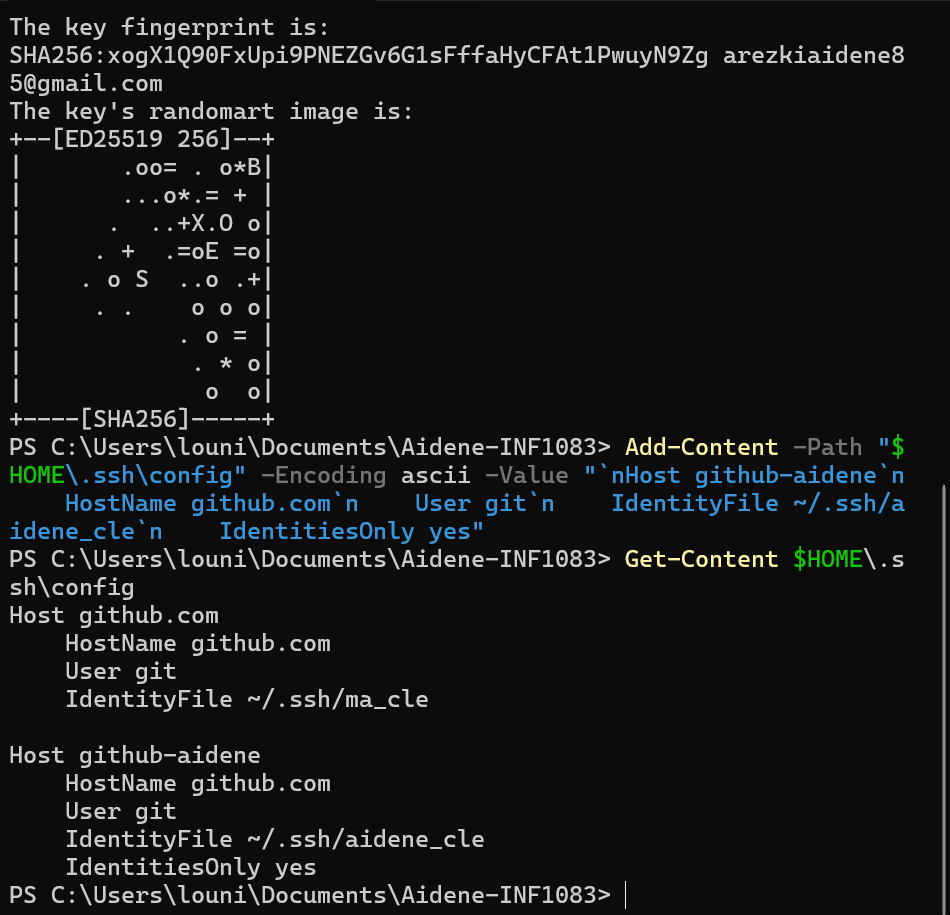
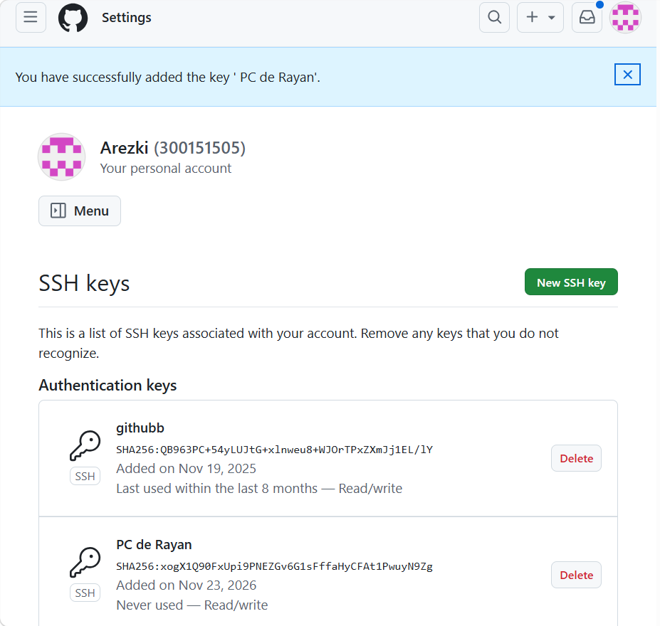
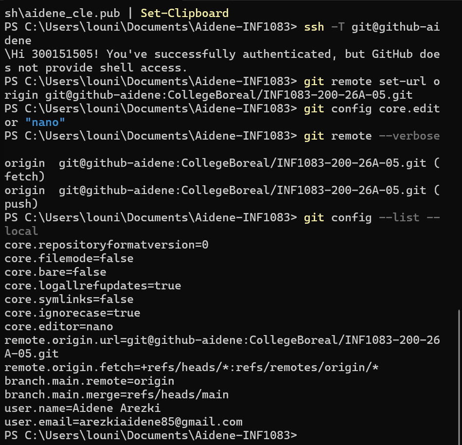

# 🧰 INF1083 — IDE, Git et SSH

## 👤 Étudiant

**Nom :** Aidene Arezki  
**Matricule :** 300151505  
**GitHub :** [300151505](https://github.com/300151505)  
**Cours :** INF1083 — Développement d'applications  
**Session :** Automne 2026  

> ℹ️ Mon ordinateur n'avait plus assez d'espace : j'ai fait ce travail sur l'ordinateur d'un ami (session Windows `louni`). J'ai utilisé **mon propre clone du dépôt**, **ma propre clé SSH** et **mon identité Git**, pour que tout soit envoyé avec mon compte GitHub.

---

## 🎯 Objectif

Configurer Git, créer une clé SSH, l'ajouter à mon compte GitHub et utiliser l'adresse SSH du dépôt du cours.

Dépôt cloné dans :

```text
C:\Users\louni\Documents\Aidene-INF1083
```

---

## 1️⃣ Clone du dépôt et identité Git

```powershell
cd ~\Documents
git clone https://github.com/CollegeBoreal/INF1083-200-26A-05.git Aidene-INF1083
cd Aidene-INF1083
git config user.name "Aidene Arezki"
git config user.email "arezkiaidene85@gmail.com"
```

> J'ai utilisé `git config` **sans `--global`** : l'identité est enregistrée seulement dans mon dépôt, sans changer celle du propriétaire de l'ordinateur.

## 2️⃣ Génération de ma clé SSH

```powershell
ssh-keygen -t ed25519 -C "arezkiaidene85@gmail.com" -f "$HOME\.ssh\aidene_cle"
```

- Aucune *passphrase* (touche `Entrée`).
- Résultat : la clé privée `aidene_cle` et la clé publique `aidene_cle.pub`.

## 3️⃣ Fichier de configuration SSH `~/.ssh/config`

Comme l'ordinateur a déjà une clé pour `github.com`, j'ai créé un **alias** `github-aidene` qui utilise **ma** clé :

```powershell
Add-Content -Path "$HOME\.ssh\config" -Encoding ascii -Value "`nHost github-aidene`n    HostName github.com`n    User git`n    IdentityFile ~/.ssh/aidene_cle`n    IdentitiesOnly yes"
```

```text
Host github-aidene
    HostName github.com
    User git
    IdentityFile ~/.ssh/aidene_cle
    IdentitiesOnly yes
```

- `IdentitiesOnly yes` : SSH utilise **uniquement** ma clé pour cet alias.



## 4️⃣ Ajout de la clé publique sur GitHub

```powershell
Get-Content $HOME\.ssh\aidene_cle.pub | Set-Clipboard
```

Clé ajoutée dans **GitHub → Settings → SSH and GPG keys → New SSH key** (titre `PC de Rayan`), sur mon compte **Arezki (300151505)**.



## 5️⃣ Test SSH, dépôt distant et vérification

```powershell
ssh -T git@github-aidene
git remote set-url origin git@github-aidene:CollegeBoreal/INF1083-200-26A-05.git
git config core.editor "nano"
git remote --verbose
git config --list --local
```

- `Hi 300151505! You've successfully authenticated` ✅ — GitHub reconnaît ma clé.
- `origin` utilise maintenant `git@github-aidene:...` (SSH avec ma clé).
- `user.name=Aidene Arezki`, `user.email=arezkiaidene85@gmail.com`, `core.editor=nano`.



---

## 📋 Commandes Git utilisées

| Commande | Utilité |
|---|---|
| `git clone` | Copier le dépôt du cours sur l'ordinateur |
| `git config user.name / user.email` | Définir mon identité (dans mon dépôt seulement) |
| `git status` | Voir l'état des fichiers |
| `git add` | Mettre les changements en scène |
| `git commit -m` | Enregistrer les changements avec un message |
| `git pull` | Récupérer les changements de GitHub |
| `git push` | Envoyer mes commits vers GitHub |
| `git remote set-url` | Changer l'adresse du dépôt distant (HTTPS → SSH) |
| `ssh -T git@github-aidene` | Tester l'authentification SSH |

## ✅ Résultat

- Clé SSH `ed25519` personnelle créée et associée à mon compte GitHub.
- Alias SSH `github-aidene` pour utiliser ma clé sur un ordinateur partagé.
- Dépôt du cours configuré en SSH avec mon identité Git.
