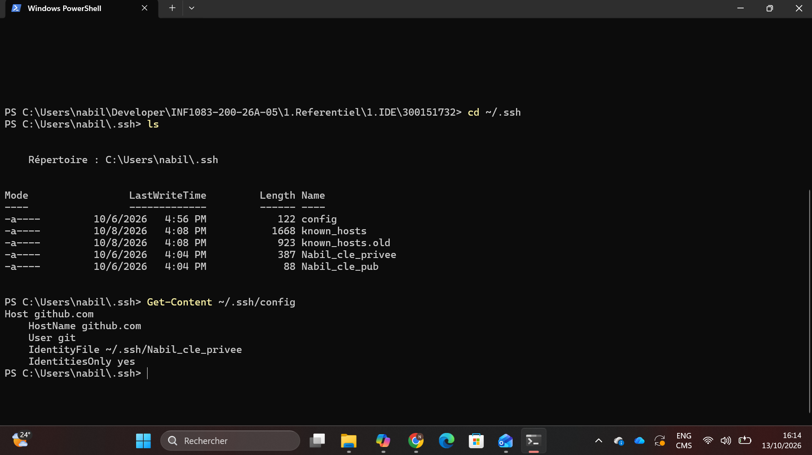
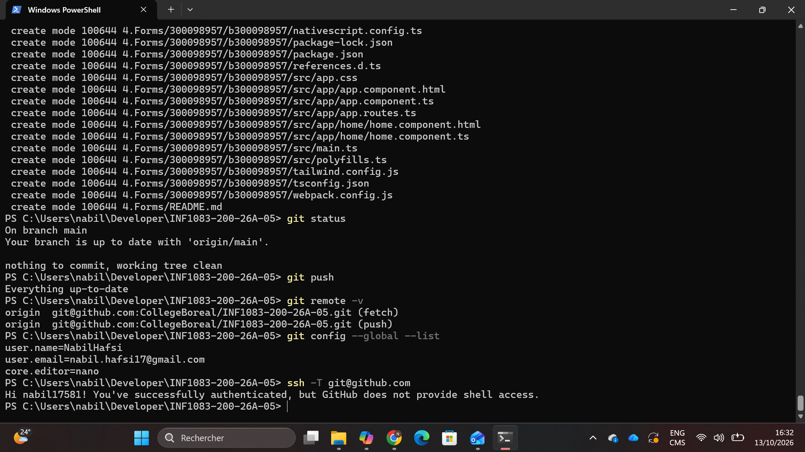
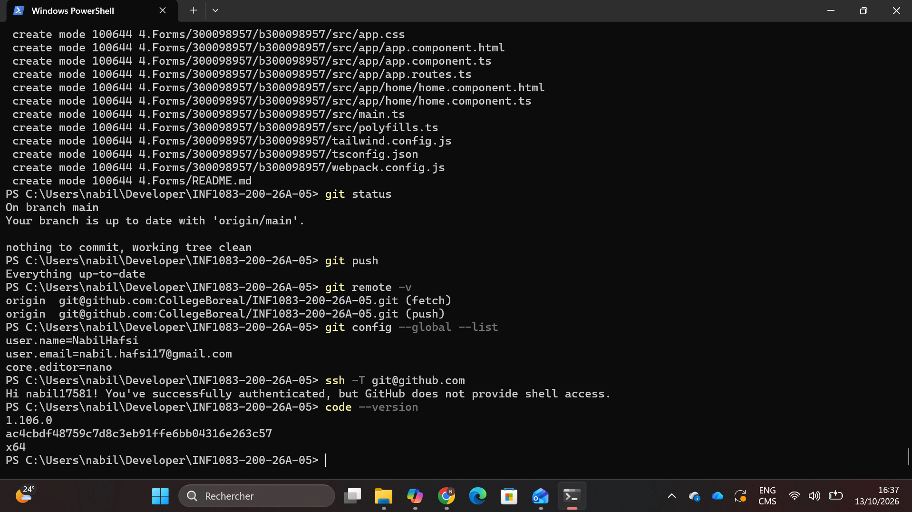

# Référentiel — IDE : Git, SSH et Visual Studio Code

Ce projet est réalisé dans le cadre du cours Développement d'applications (INF1083-200-26A-05).

| | |
|---|---|
| **Étudiant** | Nabil Hafsi |
| **Numéro d'étudiant** | 300151732 |
| **Système** | Windows (PowerShell) |

## 1. Premiers pas avec Git

Création du dossier de développement et clonage du dépôt du cours :

```powershell
mkdir Developer
cd Developer
git clone https://github.com/CollegeBoreal/INF1083-200-26A-05.git
cd INF1083-200-26A-05/1.Referentiel/1.IDE
```

## 2. Création de mon répertoire

Création du répertoire à mon identifiant, ajout du `README.md`, puis mise en scène :

```powershell
mkdir 300151732
cd 300151732
nano README.md
cd ..
git add 300151732
git status
```

## 3. Configuration de Git et premier commit

```powershell
git config --global core.editor "nano"
git config --global --edit
```

Contenu de la configuration :

```ini
[core]
    editor = nano

[user]
    name = 300151732
    email = 300151732@monboreal.ca
```

Premier commit, puis mise à jour du dépôt local :

```powershell
git commit --message ":star: Mon premier commentaire"
git pull --no-edit
```

## 4. Génération de la clé SSH

```powershell
ssh-keygen -t ed25519 -C "300151732@monboreal.ca"
```

Pas de phrase secrète (touche Entrée). Les fichiers par défaut sont ensuite renommés dans `~/.ssh` :

```powershell
cd ~/.ssh
mv id_ed25519 Nabil_cle_privee
mv id_ed25519.pub Nabil_cle_pub
```



## 5. Fichier de configuration SSH

Contenu de `~/.ssh/config` :

```text
Host github.com
    HostName github.com
    User git
    IdentityFile ~/.ssh/Nabil_cle_privee
    IdentitiesOnly yes
```

Le dossier `~/.ssh` contient la clé privée, la clé publique et le fichier `config` :



## 6. Ajout de la clé publique à GitHub

La clé **publique** (`Nabil_cle_pub`) est ajoutée dans GitHub : *Settings → SSH and GPG keys → New SSH key*. La clé privée reste sur mon ordinateur et n'est jamais partagée.

Test de la connexion :

```powershell
ssh -T git@github.com
```

```text
Hi nabil17581! You've successfully authenticated, but GitHub does not provide shell access.
```

## 7. Dépôt distant en SSH et envoi

```powershell
git remote set-url origin git@github.com:CollegeBoreal/INF1083-200-26A-05.git
git remote --verbose
git push
```

Résultat de la vérification du dépôt distant :

```text
origin  git@github.com:CollegeBoreal/INF1083-200-26A-05.git (fetch)
origin  git@github.com:CollegeBoreal/INF1083-200-26A-05.git (push)
```

## 8. IDE : Visual Studio Code

Installation avec Chocolatey (PowerShell ouvert en administrateur) :

```powershell
choco install vscode
code --version
```

Version installée : 1.146.0.



## Structure du répertoire

```text
300151732/
├── README.md
└── images/
    ├── .gitkeep
    ├── cle-ssh.png
    ├── SSH.png
    └── VisuelCode.png
```

## Références

- [Tutoriel sur Git](https://github.com/CollegeBoreal/Tutoriels/tree/main/0.GIT)
- [Générer une clé SSH](https://docs.github.com/en/authentication/connecting-to-github-with-ssh/generating-a-new-ssh-key-and-adding-it-to-the-ssh-agent)
- [Ajouter une clé SSH à GitHub](https://docs.github.com/en/authentication/connecting-to-github-with-ssh/adding-a-new-ssh-key-to-your-github-account)