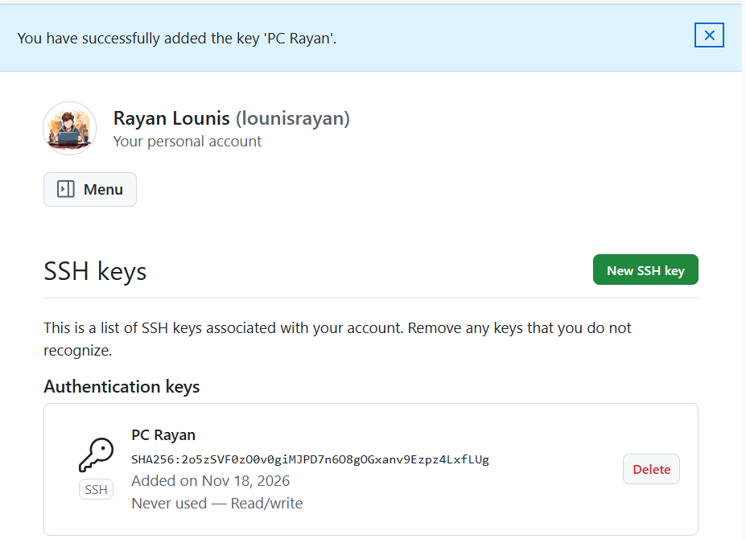
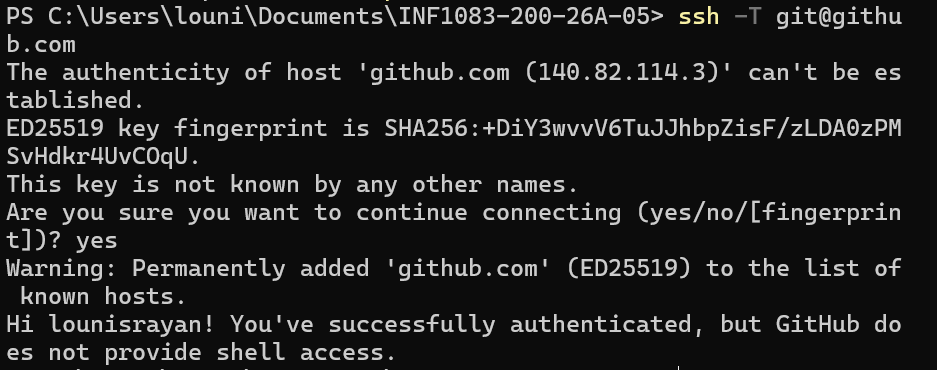
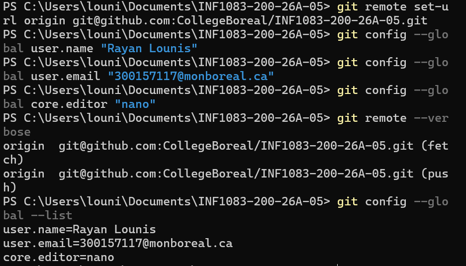

# 🧰 INF1083 — IDE, Git et SSH

## 👤 Étudiant

**Nom :** Rayan Lounis  
**Matricule :** 300157117  
**GitHub :** [lounisrayan](https://github.com/lounisrayan)  
**Cours :** INF1083 — Développement d'applications  
**Session :** Automne 2026  

---

## 🎯 Objectif

Préparer mon environnement de développement pour le cours : configurer Git, créer une clé SSH, l'ajouter à mon compte GitHub et utiliser l'adresse SSH du dépôt du cours.

Le dépôt du cours est cloné sur mon ordinateur (Windows, PowerShell) :

```text
C:\Users\louni\Documents\INF1083-200-26A-05
```

---

## 1️⃣ Génération de la clé SSH

```powershell
mkdir $HOME\.ssh -Force
ssh-keygen -t ed25519 -C "300157117@monboreal.ca" -f "$HOME\.ssh\ma_cle"
```

- Aucune *passphrase* (touche `Entrée`).
- Résultat : la clé privée `ma_cle` et la clé publique `ma_cle.pub` dans `~/.ssh`.

## 2️⃣ Fichier de configuration SSH `~/.ssh/config`

```text
Host github.com
    HostName github.com
    User git
    IdentityFile ~/.ssh/ma_cle
```

## 3️⃣ Ajout de la clé publique sur GitHub

```powershell
Get-Content $HOME\.ssh\ma_cle.pub | Set-Clipboard
```

La clé a été collée dans **GitHub → Settings → SSH and GPG keys → New SSH key** avec le titre `PC Rayan`.



## 4️⃣ Test de la connexion SSH

```powershell
ssh -T git@github.com
```

Résultat : `Hi lounisrayan! You've successfully authenticated` ✅ — ma clé est reconnue par GitHub.



## 5️⃣ Dépôt distant en SSH et configuration de Git

```powershell
git remote set-url origin git@github.com:CollegeBoreal/INF1083-200-26A-05.git
git config --global user.name "Rayan Lounis"
git config --global user.email "300157117@monboreal.ca"
git config --global core.editor "nano"
git remote --verbose
git config --global --list
```



---

## 📋 Commandes Git utilisées

| Commande | Utilité |
|---|---|
| `git clone` | Copier le dépôt du cours sur mon ordinateur |
| `git status` | Voir l'état des fichiers |
| `git add` | Mettre les changements en scène (staging) |
| `git commit -m` | Enregistrer les changements avec un message |
| `git pull` | Récupérer les changements de GitHub |
| `git push` | Envoyer mes commits vers GitHub |
| `git remote --verbose` | Voir l'adresse du dépôt distant |
| `ssh -T git@github.com` | Tester l'authentification SSH |

## ✅ Résultat

- Clé SSH `ed25519` créée et configurée.
- Clé publique ajoutée à mon compte GitHub.
- Connexion SSH avec GitHub fonctionnelle.
- Dépôt du cours configuré en SSH.
- Identité Git configurée (nom, courriel, éditeur `nano`).
