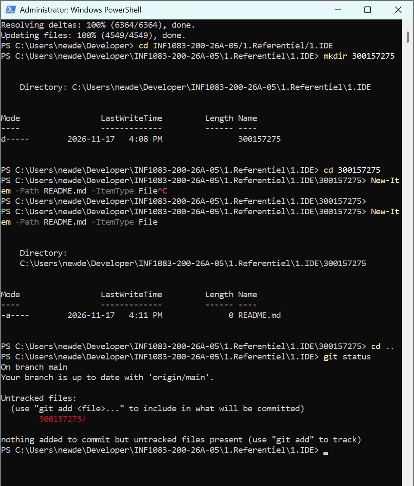
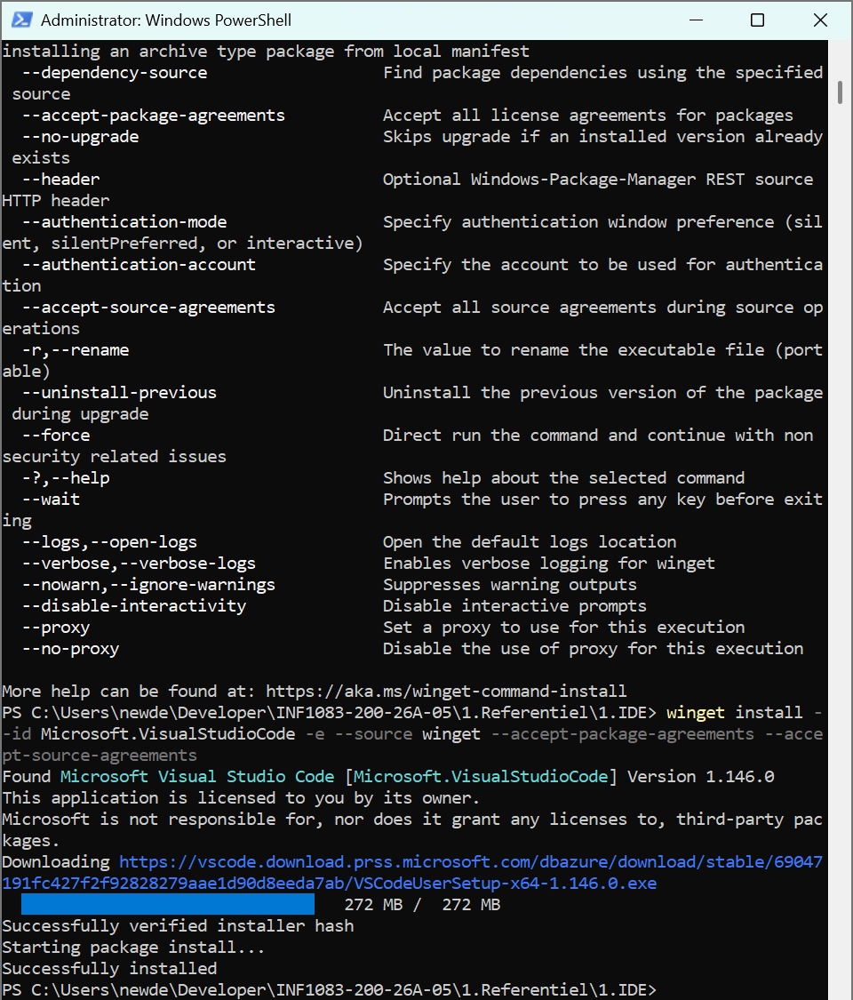
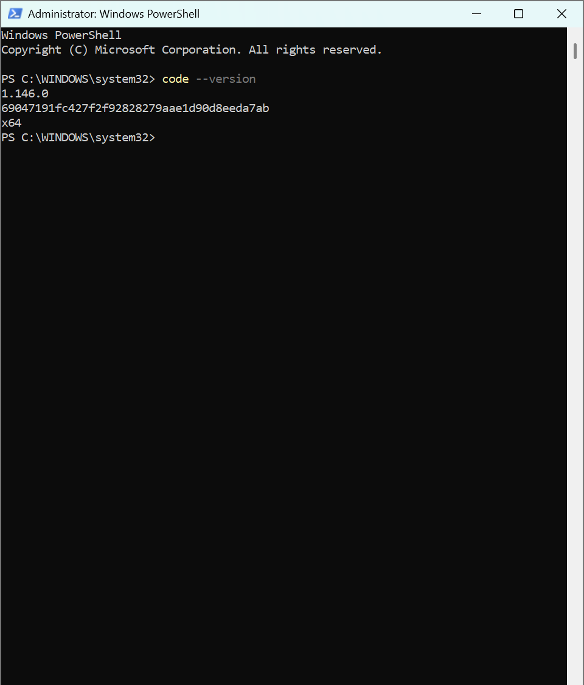
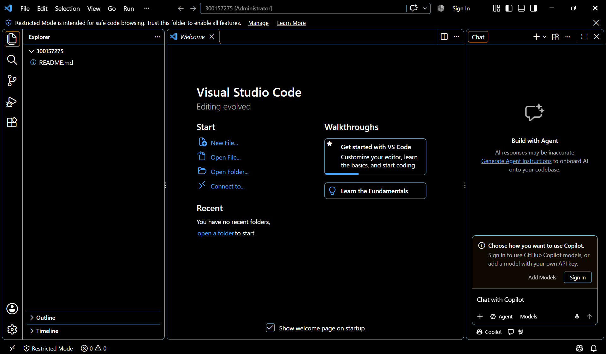

# TP — Environnement de développement (IDE)

**Cours :** INF1083 — Développement d'applications  
**Étudiant :** Yahia Benkara  
**Identifiant étudiant :** 300157275  
**Établissement :** Collège Boréal  
**Date :** 17 novembre 2026  
**Référence :** https://github.com/CollegeBoreal/INF1083-200-26A-05/tree/main/1.Referentiel/1.IDE

## Objectif

Préparer un environnement de développement Windows en utilisant PowerShell, Git, GitHub et Visual Studio Code.

## Étapes réalisées

1. Vérification de Git : version `2.56.0.windows.4`.
2. Clonage du dépôt `CollegeBoreal/INF1083-200-26A-05` dans `C:\Users\newde\Developer`.
3. Création du dossier `1.Referentiel/1.IDE/300157275`.
4. Création du fichier `README.md` dans ce dossier.
5. Configuration de l'identité Git : nom et adresse courriel.
6. Ajout du dossier avec `git add 300157275/`.
7. Création du commit `e40115f` : `Ajout du dossier etudiant 300157275`.
8. Vérification avec `git status` : branche `main` en avance d'un commit sur `origin/main`, répertoire de travail propre.
9. Installation de Visual Studio Code avec `winget` : version `1.146.0`.
10. Vérification de VS Code avec `code --version` et ouverture du dossier étudiant.
11. Création du dossier `images` pour les captures du TP.

## Commandes principales

```powershell
git --version
cd $HOME\Developer
git clone https://github.com/CollegeBoreal/INF1083-200-26A-05.git
cd INF1083-200-26A-05/1.Referentiel/1.IDE
mkdir 300157275
cd 300157275
New-Item -Path README.md -ItemType File
cd ..
git status
git add 300157275/
git commit -m "Ajout du dossier etudiant 300157275"
git status
winget install --id Microsoft.VisualStudioCode -e --source winget --accept-package-agreements --accept-source-agreements
code --version
```

## Captures d'écran

### Détection du dossier étudiant par Git



### Installation de Visual Studio Code



### Vérification de la version



### Ouverture du dossier étudiant



## Étapes restant à vérifier

- Configuration SSH et connexion GitHub, si exigées par le TP.
- Vérification des droits d'écriture sur le dépôt distant.
- Publication des commits sur GitHub, uniquement après confirmation des droits d'accès.

## Conclusion

L'environnement local a été préparé : Git est fonctionnel, le dossier étudiant et son README ont été créés, un commit local a été enregistré, et Visual Studio Code est installé et opérationnel. La publication distante et la configuration SSH ne sont pas encore confirmées.
