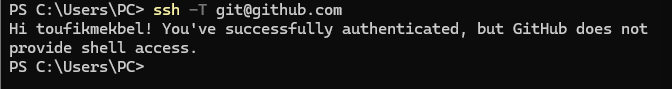

# 🛠️ Référentiel — Git, VS Code et SSH

**Numéro étudiant** · 300157330

## 📝 Travail avec Git et VS Code

J’utilise Visual Studio Code pour modifier les fichiers du cours et Git pour enregistrer mes changements. J’ai mis à jour le README du plan de cours, récupéré les changements du dépôt et publié mon commit sur GitHub.

## 🔑 Connexion SSH à GitHub

J’ai créé une paire de clés SSH Ed25519 sur Windows. J’ai ajouté ma clé publique à mon compte GitHub et configuré OpenSSH pour sélectionner automatiquement la clé associée.

J’ai ensuite testé la connexion dans PowerShell :

```powershell
ssh -T git@github.com
```

GitHub a confirmé l’authentification de mon compte `toufikmekbel`.

