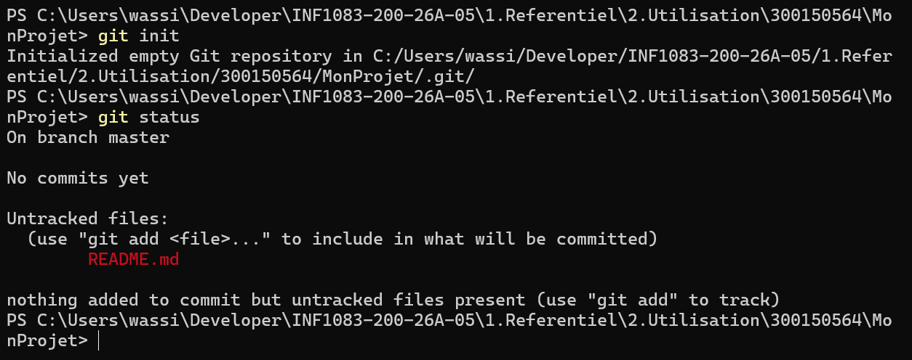
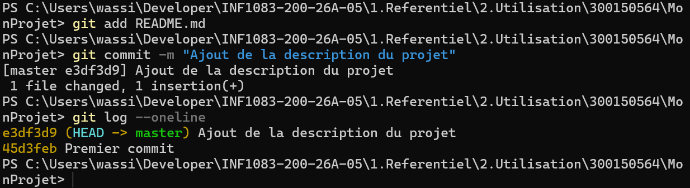
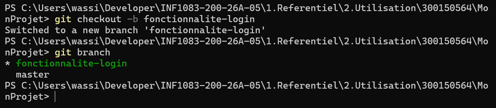
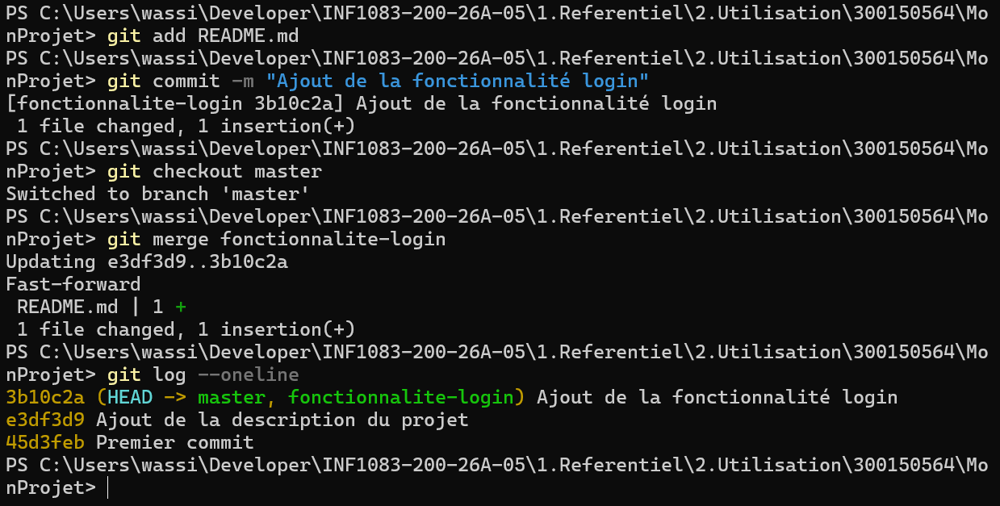
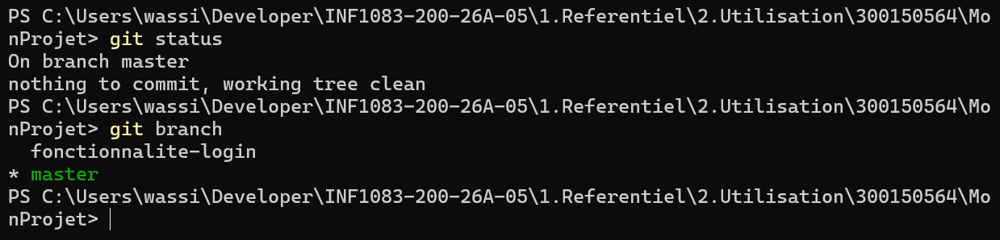

# 🚀 INF1083 — Utilisation de Git

**Étudiant :** Ouassim Ahmed Benamira  
**Matricule :** 300150564  
**Programme :** TSIQ — Techniques des systèmes informatiques  
**Cours :** INF1083 — Développement d'applications  

---

## 🎯 Objectif

L'objectif de ce laboratoire est d'apprendre à utiliser Git pour gérer les versions d'un projet de développement.

Pendant cet exercice, j'ai pratiqué les opérations suivantes :

- Créer un projet et initialiser un dépôt Git.
- Ajouter des fichiers à l'index.
- Créer et consulter des commits.
- Modifier des fichiers et examiner les différences.
- Créer et utiliser des branches.
- Fusionner une branche dans la branche principale.
- Vérifier l'état du dépôt.
- Découvrir les commandes permettant de connecter un projet à GitHub.

## 📁 Structure du travail

```text
300150564/
│
├── README.md
│
├── images/
│   ├── 01-git-init-status.png
│   ├── 02-premiers-commits.png
│   ├── 03-creation-branche.png
│   ├── 04-merge-branche.png
│   └── 05-git-status-final.png
│
└── MonProjet/
    ├── .git/
    └── README.md
```

---

## 1. 📁 Création du projet

J'ai commencé par créer un répertoire nommé `MonProjet`.

Ensuite, j'ai créé un fichier `README.md` contenant une première description :

```text
# Mon premier projet
```

Ce projet a servi à pratiquer les différentes commandes Git pendant le laboratoire.

## 2. 🔧 Initialisation du dépôt Git

Pour commencer à utiliser Git, j'ai initialisé un dépôt local avec :

```powershell
git init
```

Ensuite, j'ai vérifié son état :

```powershell
git status
```

Git a créé un nouveau dépôt local sur la branche `master`.

Le fichier `README.md` apparaissait comme **Untracked**, ce qui signifie qu'il n'était pas encore suivi par Git.



## 3. ➕ Ajouter un fichier à l'index

Pour préparer le fichier avant son enregistrement, j'ai utilisé :

```powershell
git add README.md
```

J'ai ensuite vérifié son état :

```powershell
git status
```

Le fichier est apparu dans la section `Changes to be committed`.

Cela signifie qu'il est maintenant dans la zone de préparation (*Staging Area*).

## 4. 💾 Créer le premier commit

J'ai enregistré la première version du projet avec :

```powershell
git commit -m "Premier commit"
```

Pour consulter l'historique des versions, j'ai utilisé :

```powershell
git log --oneline
```

Le premier commit obtenu était :

```text
45d3feb Premier commit
```

Un commit permet de sauvegarder un état précis du projet dans l'historique Git.

## 5. ✏️ Modifier un fichier

J'ai ensuite ajouté une nouvelle ligne dans le fichier `README.md` :

```powershell
"Bienvenue dans INF1083" | Add-Content "README.md" -Encoding UTF8
```

Pour vérifier les changements, j'ai exécuté :

```powershell
git status
git diff
```

La commande `git diff` permet de visualiser les modifications effectuées depuis le dernier commit.

Dans mon cas, elle a affiché la nouvelle ligne ajoutée au fichier.

## 6. 💾 Enregistrer les modifications

Après avoir vérifié les changements, j'ai ajouté le fichier à l'index :

```powershell
git add README.md
```

Puis j'ai créé un deuxième commit :

```powershell
git commit -m "Ajout de la description du projet"
```

J'ai consulté l'historique :

```powershell
git log --oneline
```

Résultat obtenu :

```text
e3df3d9 Ajout de la description du projet
45d3feb Premier commit
```

Les deux versions sont maintenant enregistrées dans l'historique Git.



---

## 7. 🌿 Créer une branche

Les branches permettent de développer de nouvelles fonctionnalités sans modifier directement la branche principale.

J'ai créé une branche appelée `fonctionnalite-login` avec :

```powershell
git checkout -b fonctionnalite-login
```

Ensuite, j'ai affiché les branches disponibles :

```powershell
git branch
```

Résultat :

```text
* fonctionnalite-login
  master
```

L'astérisque indique la branche actuellement active.



## 8. 💻 Effectuer une modification dans la branche

Une fois dans la branche `fonctionnalite-login`, j'ai ajouté une nouvelle ligne au fichier `README.md` :

```powershell
"Fonctionnalité de connexion ajoutée" | Add-Content "README.md" -Encoding UTF8
```

J'ai ensuite enregistré cette modification :

```powershell
git add README.md
git commit -m "Ajout de la fonctionnalité login"
```

Le nouveau commit obtenu était :

```text
3b10c2a Ajout de la fonctionnalité login
```

Cette étape montre comment travailler sur une fonctionnalité dans une branche indépendante.

## 9. 🔀 Fusionner une branche

Après avoir terminé le travail dans la branche `fonctionnalite-login`, je suis retourné sur la branche principale :

```powershell
git checkout master
```

J'ai ensuite fusionné la branche :

```powershell
git merge fonctionnalite-login
```

Git a effectué une fusion de type `Fast-forward`.

Cela signifie que la branche principale a avancé directement jusqu'au dernier commit de la branche fusionnée.

L'historique final contient les trois commits :

```text
3b10c2a Ajout de la fonctionnalité login
e3df3d9 Ajout de la description du projet
45d3feb Premier commit
```



## 10. ☁️ Connecter un projet à GitHub

GitHub permet d'héberger un dépôt Git en ligne et de partager le travail avec d'autres développeurs.

Pour connecter un projet local à un dépôt GitHub, on peut utiliser :

```powershell
git remote add origin https://github.com/utilisateur/monprojet.git
```

Pour vérifier la connexion :

```powershell
git remote -v
```

Pour publier le projet pour la première fois :

```powershell
git push -u origin main
```

Ces commandes sont des exemples de connexion et de publication sur GitHub. Elles ne font pas partie des opérations exécutées sur le dépôt de démonstration `MonProjet`.

## 11. 📥 Télécharger et récupérer des modifications

Git propose plusieurs commandes pour récupérer du contenu depuis un dépôt distant.

**Récupérer les modifications :**

```powershell
git pull
```

**Télécharger une copie complète d'un projet :**

```powershell
git clone https://github.com/utilisateur/monprojet.git
```

Ces commandes facilitent le travail collaboratif et permettent de synchroniser les projets entre plusieurs ordinateurs.

---

## 12. 🧠 Résumé des commandes essentielles

| Commande | Utilité |
|---|---|
| `git init` | Initialiser un dépôt |
| `git status` | Vérifier l'état du dépôt |
| `git add .` | Ajouter les fichiers à l'index |
| `git commit -m "message"` | Enregistrer une version |
| `git log --oneline` | Consulter l'historique |
| `git diff` | Voir les modifications |
| `git branch` | Afficher les branches |
| `git checkout -b nom` | Créer une branche |
| `git checkout master` | Revenir sur master |
| `git merge nom` | Fusionner une branche |
| `git remote -v` | Vérifier les dépôts distants |
| `git push` | Envoyer les modifications |
| `git pull` | Récupérer les modifications |
| `git clone URL` | Cloner un dépôt |

## 13. 🏆 Workflow Git réalisé

Voici le déroulement des opérations effectuées pendant le laboratoire :

```text
       📁 Création du projet
                |
                ▼
          git init
                |
                ▼
           git add
                |
                ▼
         Premier commit
                |
                ▼
       ✏️ Modification README
                |
                ▼
        Deuxième commit
                |
                ▼
       🌿 Création branche
                |
                ▼
      Travail sur la branche
                |
                ▼
       Commit fonctionnalité
                |
                ▼
        🔀 git merge
                |
                ▼
       Vérification finale
                |
                ▼
       ✅ Dépôt propre
```

## 14. ✅ Vérification finale

Pour terminer, j'ai vérifié l'état du dépôt :

```powershell
git status
```

Résultat obtenu :

```text
On branch master
nothing to commit, working tree clean
```

J'ai également vérifié les branches :

```powershell
git branch
```

Résultat :

```text
  fonctionnalite-login
* master
```

Cela confirme que :

- La branche `master` est active.
- La branche `fonctionnalite-login` existe.
- La fusion a été effectuée.
- Les modifications ont été enregistrées.
- Le dépôt ne contient aucune modification en attente.



---

## 📝 Conclusion

Ce laboratoire m'a permis de comprendre le fonctionnement de Git et son importance dans le développement d'applications.

J'ai appris à créer un dépôt, suivre les modifications, enregistrer plusieurs versions, travailler avec des branches et fusionner les fonctionnalités dans la branche principale.

J'ai également découvert les principales commandes utilisées pour collaborer avec GitHub.

Ces connaissances seront utiles pour gérer les projets de développement et travailler efficacement en équipe.

---

<p align="center">
  <b>🚀 INF1083 — Utilisation de Git | 300150564</b>
</p>