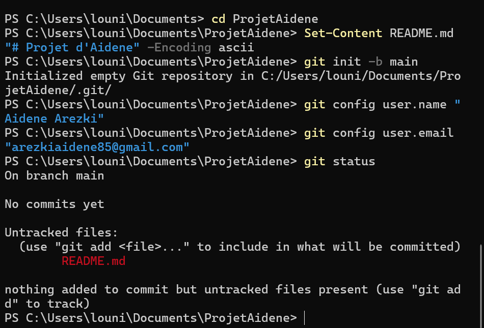
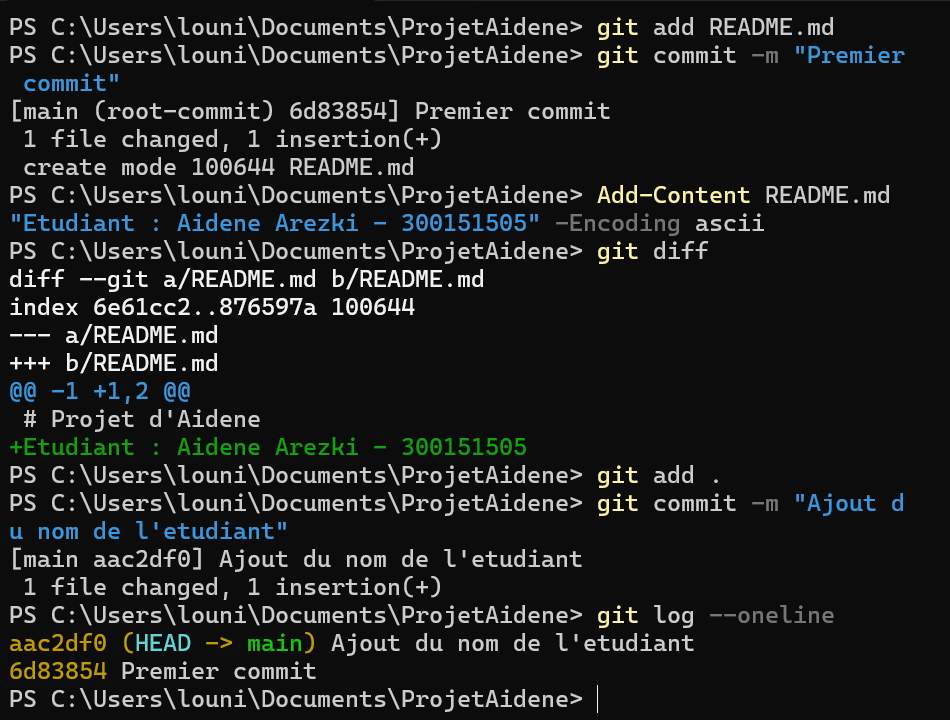
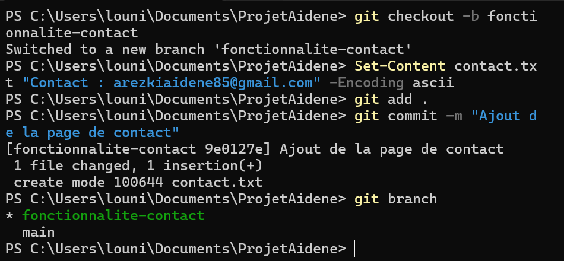
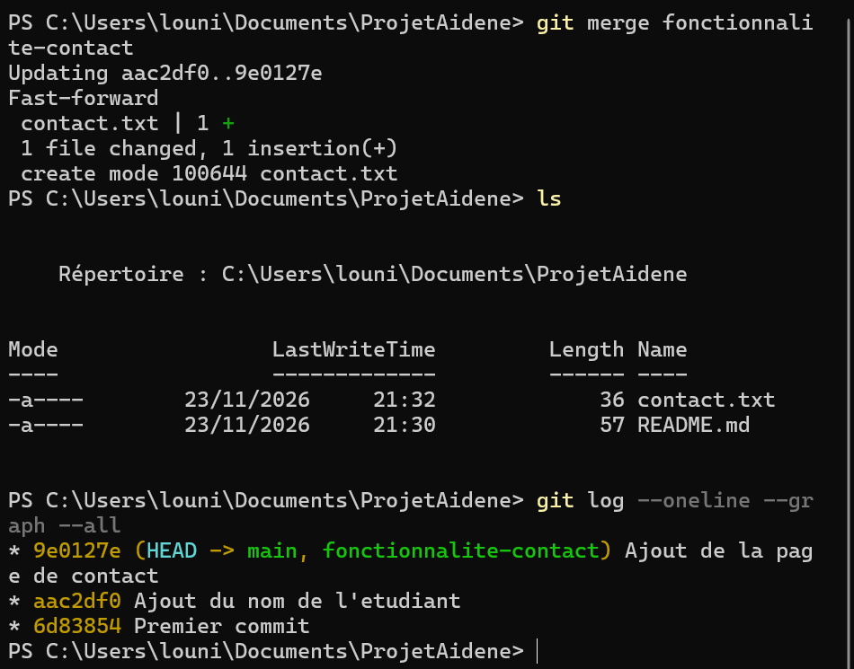

# 🚀 INF1083 — Utilisation de Git

**Étudiant :** Aidene Arezki  
**Matricule :** 300151505  
**GitHub :** [300151505](https://github.com/300151505)  
**Cours :** INF1083 — Développement d'applications  
**Session :** Automne 2026  

> ℹ️ Travail fait sur l'ordinateur d'un ami (session Windows `louni`), dans mon propre projet `ProjetAidene` et avec mon identité Git (`git config user.name "Aidene Arezki"`).

---

## 🎯 Objectif

Pratiquer le flux de travail Git sur un petit projet : création du dépôt, commits, différences, branche et fusion.

## 📁 Structure du travail

```text
300151505/
├── README.md
├── images/
│   ├── 01-git-init-status.png
│   ├── 02-premiers-commits.png
│   ├── 03-creation-branche.png
│   └── 04-merge-branche.png
└── ProjetAidene/
    ├── README.md
    └── contact.txt
```

> Le projet a été créé dans `C:\Users\louni\Documents\ProjetAidene` ; seuls ses fichiers sont copiés ici (pas le dossier `.git`).

---

## 1. 📁 Création du projet et initialisation de Git

```powershell
cd ~\Documents
mkdir ProjetAidene
cd ProjetAidene
Set-Content README.md "# Projet d'Aidene" -Encoding ascii
git init -b main
git config user.name "Aidene Arezki"
git config user.email "arezkiaidene85@gmail.com"
git status
```

Git crée un dépôt vide sur la branche `main`. `README.md` est en rouge dans **Untracked files** : Git le voit mais ne le suit pas encore.



## 2. 💾 Premiers commits et `git diff`

```powershell
git add README.md
git commit -m "Premier commit"
Add-Content README.md "Etudiant : Aidene Arezki - 300151505" -Encoding ascii
git diff
git add .
git commit -m "Ajout du nom de l'etudiant"
git log --oneline
```

- `git diff` affiche en vert la ligne ajoutée : `+Etudiant : Aidene Arezki - 300151505`.
- `git log --oneline` affiche les 2 commits.



## 3. 🌿 Création d'une branche

```powershell
git checkout -b fonctionnalite-contact
Set-Content contact.txt "Contact : arezkiaidene85@gmail.com" -Encoding ascii
git add .
git commit -m "Ajout de la page de contact"
git branch
```

La branche `fonctionnalite-contact` est créée et devient active (`*`). Le fichier `contact.txt` existe seulement dans cette branche.



## 4. 🔀 Fusion de la branche dans `main`

```powershell
git checkout main
ls
git merge fonctionnalite-contact
ls
git log --oneline --graph --all
```

- Avant la fusion, `contact.txt` n'existe pas dans `main`.
- `git merge` fait un **Fast-forward** : `main` avance jusqu'au commit de la branche.
- Après la fusion, `contact.txt` est présent et l'historique contient 3 commits.



---

## 🧠 Résumé des commandes

| Commande | Utilité |
|---|---|
| `git init -b main` | Créer un dépôt avec la branche `main` |
| `git config user.name / user.email` | Définir l'auteur des commits |
| `git status` | Voir l'état des fichiers |
| `git add` | Ajouter des fichiers à l'index |
| `git commit -m` | Enregistrer une version |
| `git diff` | Voir les modifications non enregistrées |
| `git log --oneline` | Afficher l'historique |
| `git checkout -b` | Créer une branche et s'y déplacer |
| `git branch` | Lister les branches |
| `git merge` | Fusionner une branche |

## ✅ Conclusion

J'ai pratiqué le flux de travail Git complet : créer un dépôt, enregistrer des versions, voir les différences, développer dans une branche séparée et la fusionner dans `main`.
