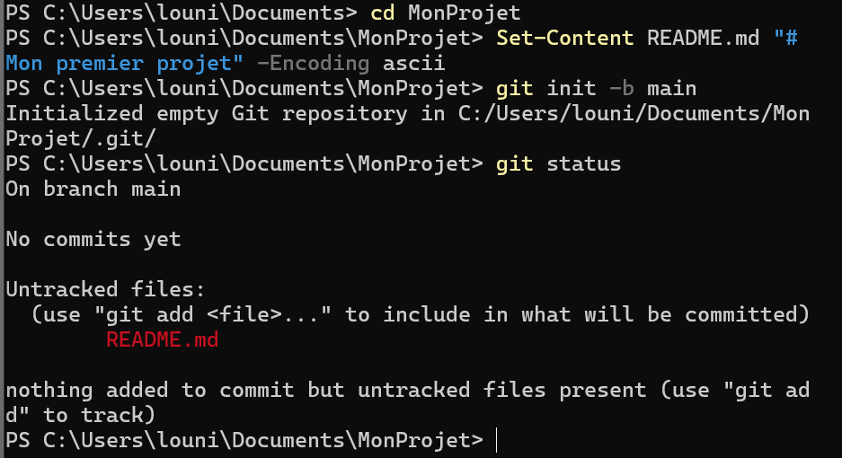
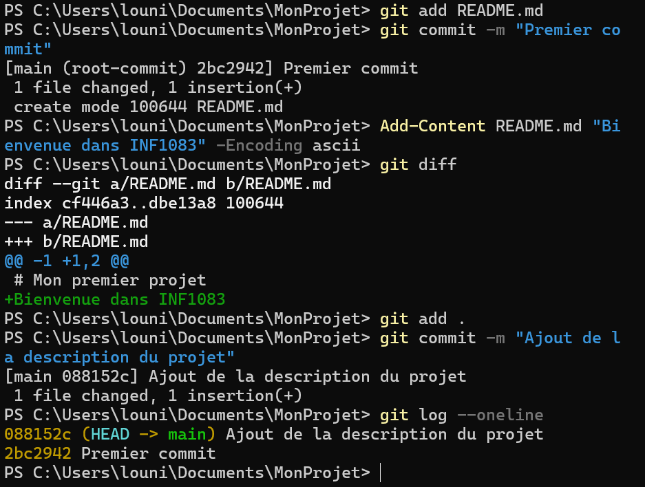
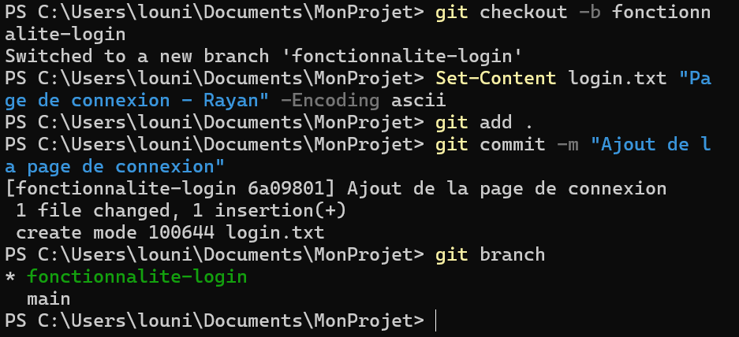
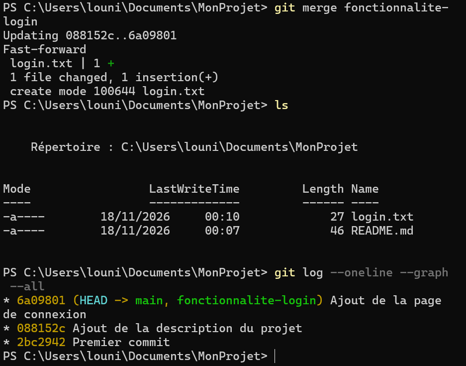

# 🚀 INF1083 — Utilisation de Git

**Étudiant :** Rayan Lounis  
**Matricule :** 300157117  
**GitHub :** [lounisrayan](https://github.com/lounisrayan)  
**Cours :** INF1083 — Développement d'applications  
**Session :** Automne 2026  

---

## 🎯 Objectif

Pratiquer le flux de travail Git complet sur un petit projet : création du dépôt, commits, différences, branche et fusion.

## 📁 Structure du travail

```text
300157117/
├── README.md
├── images/
│   ├── 01-git-init-status.png
│   ├── 02-premiers-commits.png
│   ├── 03-creation-branche.png
│   └── 04-merge-branche.png
└── MonProjet/
    ├── README.md
    └── login.txt
```

> Le projet `MonProjet` a été créé dans `C:\Users\louni\Documents\MonProjet` (son dossier `.git` n'est pas copié ici, seulement ses fichiers).

---

## 1. 📁 Création du projet et initialisation de Git

```powershell
cd ~\Documents
mkdir MonProjet
cd MonProjet
Set-Content README.md "# Mon premier projet" -Encoding ascii
git init -b main
git status
```

Git crée un dépôt vide sur la branche `main`. Le fichier `README.md` apparaît en rouge dans **Untracked files** : Git le voit mais ne le suit pas encore.



## 2. 💾 Premiers commits, modification et `git diff`

```powershell
git add README.md
git commit -m "Premier commit"
Add-Content README.md "Bienvenue dans INF1083" -Encoding ascii
git diff
git add .
git commit -m "Ajout de la description du projet"
git log --oneline
```

- `git diff` affiche en vert la ligne ajoutée (`+Bienvenue dans INF1083`).
- `git log --oneline` affiche les 2 commits du projet.



## 3. 🌿 Création d'une branche

```powershell
git checkout -b fonctionnalite-login
Set-Content login.txt "Page de connexion - Rayan" -Encoding ascii
git add .
git commit -m "Ajout de la page de connexion"
git branch
```

La branche `fonctionnalite-login` est créée et devient la branche active (`*`). Le fichier `login.txt` est enregistré seulement dans cette branche.



## 4. 🔀 Fusion de la branche dans `main`

```powershell
git checkout main
git merge fonctionnalite-login
ls
git log --oneline --graph --all
```

- Avant la fusion, `login.txt` n'existe pas dans `main`.
- `git merge` fait un **Fast-forward** : `main` avance jusqu'au commit de la branche.
- Après la fusion, `login.txt` est présent et l'historique contient les 3 commits.



---

## 🧠 Résumé des commandes

| Commande | Utilité |
|---|---|
| `git init -b main` | Créer un dépôt Git avec la branche `main` |
| `git status` | Voir l'état des fichiers |
| `git add` | Ajouter des fichiers à l'index |
| `git commit -m` | Enregistrer une version |
| `git diff` | Voir les modifications non enregistrées |
| `git log --oneline` | Afficher l'historique |
| `git checkout -b` | Créer une branche et s'y déplacer |
| `git branch` | Lister les branches |
| `git checkout main` | Revenir sur la branche principale |
| `git merge` | Fusionner une branche |

## 🏆 Flux de travail réalisé

```text
📁 Créer le projet → 🔧 git init → ➕ git add → 💾 git commit
→ 🌿 git checkout -b → 💻 développer → 💾 git commit → 🔀 git merge
```

## ✅ Conclusion

J'ai pratiqué le flux de travail Git utilisé dans les équipes de développement : créer un dépôt, enregistrer des versions, examiner les changements, développer dans une branche séparée et la fusionner dans `main`.
