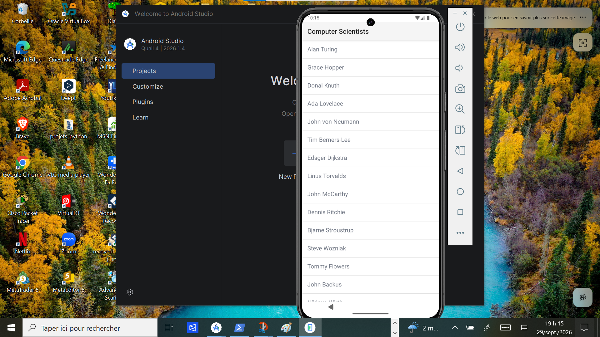
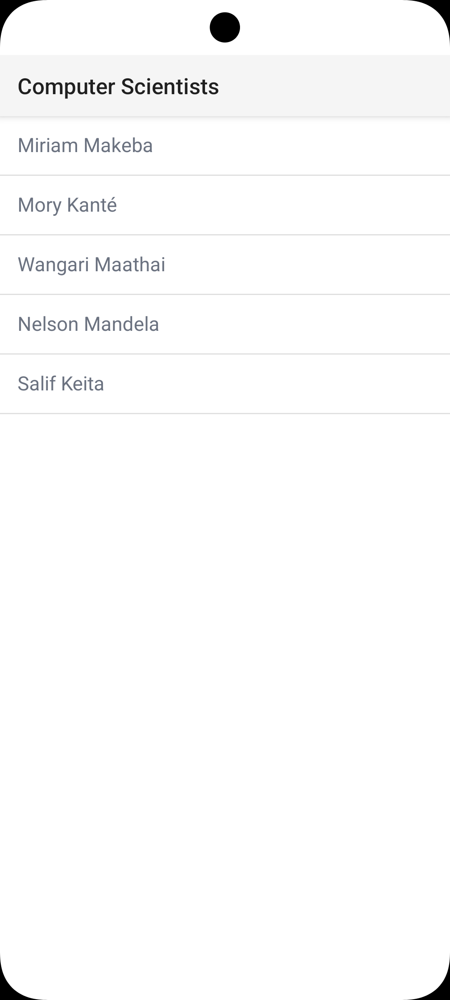
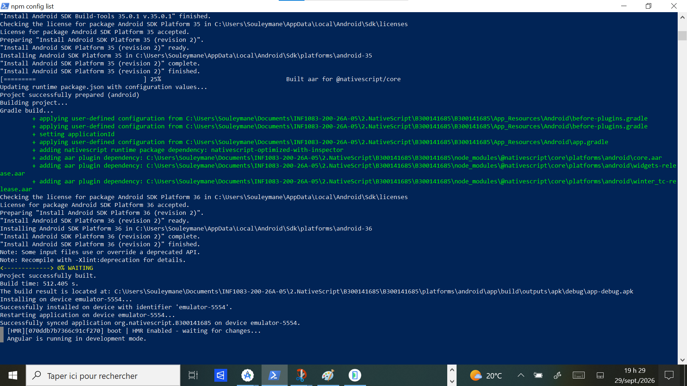

# B300141685 - Première application NativeScript

## Ce que j'ai fait
1. Installation de Node.js, NativeScript CLI, JDK 17 et Android Studio
2. Configuration de ANDROID_HOME et création de l'émulateur Pixel 8 (API 35)
3. Création du projet avec `ns create B300141685` (Angular, Hello World)
4. Lancement avec `ns run android`
5. Modification de la liste : j'ai remplacé les Computer Scientists par 5 personnalités africaines (Miriam Makeba, Mory Kanté, Wangari Maathai, Nelson Mandela, Salif Keita)

## Code
Le code du projet se trouve dans le dossier [B300141685](./B300141685).

La liste est définie dans le fichier [person.service.ts](./B300141685/src/app/people/person.service.ts).

## Liste originale (Computer Scientists)

## Liste modifiée

## Résultat dans PowerShell
