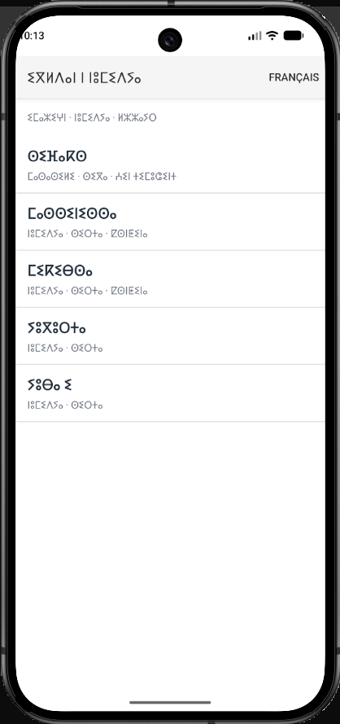
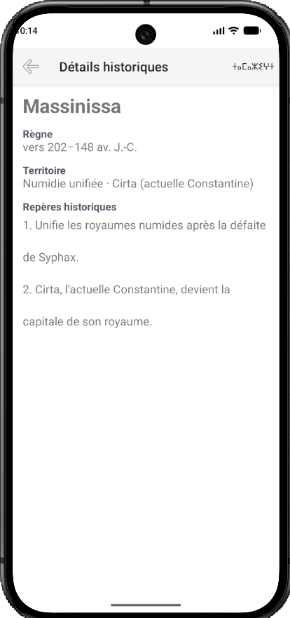
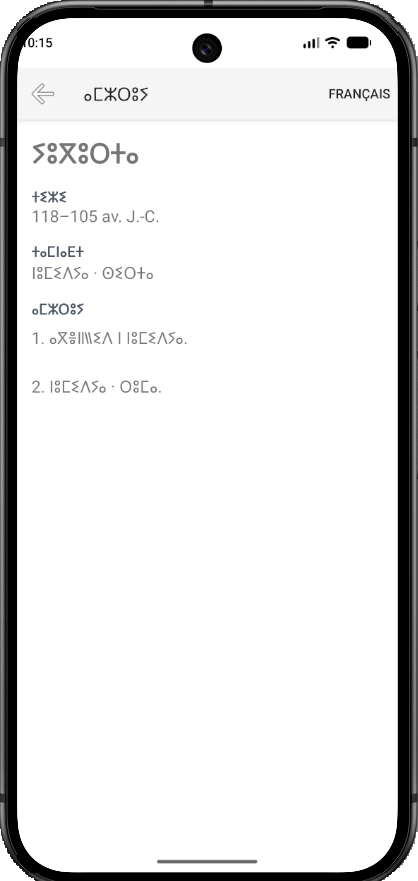

# B300150477 — Rois amazighs de Numidie

## Présentation

Cette application mobile NativeScript et Angular présente cinq souverains numides associés à l’histoire de l’actuelle Algérie : Syphax, Massinissa, Micipsa, Jugurtha et Juba Ier.

La liste permet d’ouvrir une fiche détaillée pour chaque souverain. L’application propose une interface en français et en tamazight affiché en tifinagh. Le choix de langue est mémorisé lorsqu’on ferme puis rouvre l’application.

## Captures d’écran

### Liste en français



### Liste en tifinagh


### Fiche de Massinissa en français



### Fiche de Jugurtha en tifinagh



## Lancer l’application

Ouvrir PowerShell dans le dossier du projet `B300150477`, puis exécuter :

```powershell
ns run android
```

## Sources

- [Musée central de l’Armée algérien — l’Antiquité numide](https://www.mdn.dz/site_principal/sommaire/presentation/mca/visite2_fr.php)
- [The Metropolitan Museum of Art — Western North Africa, 1000 B.C.–1 A.D.](https://artistproject.metmuseum.org/toah/ht/04/afw.html)
- [Library of Congress — tableau de romanisation du tamazight et du tifinagh](https://www.loc.gov/catdir/cpso/romanization/tamazight.pdf)
