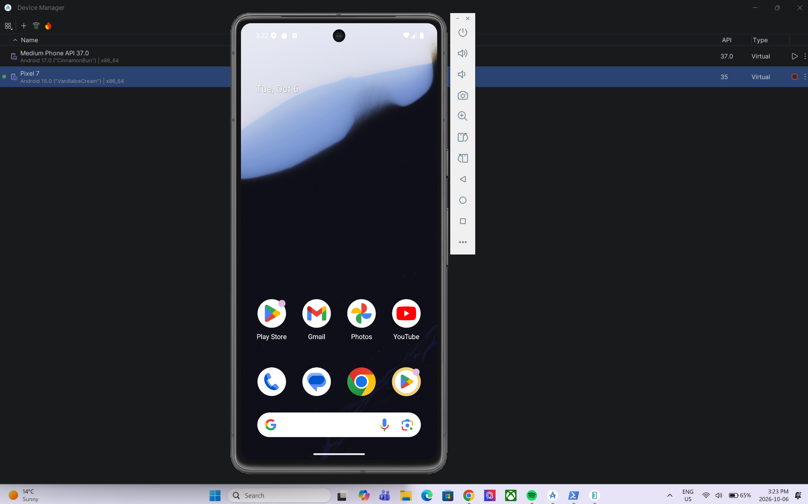
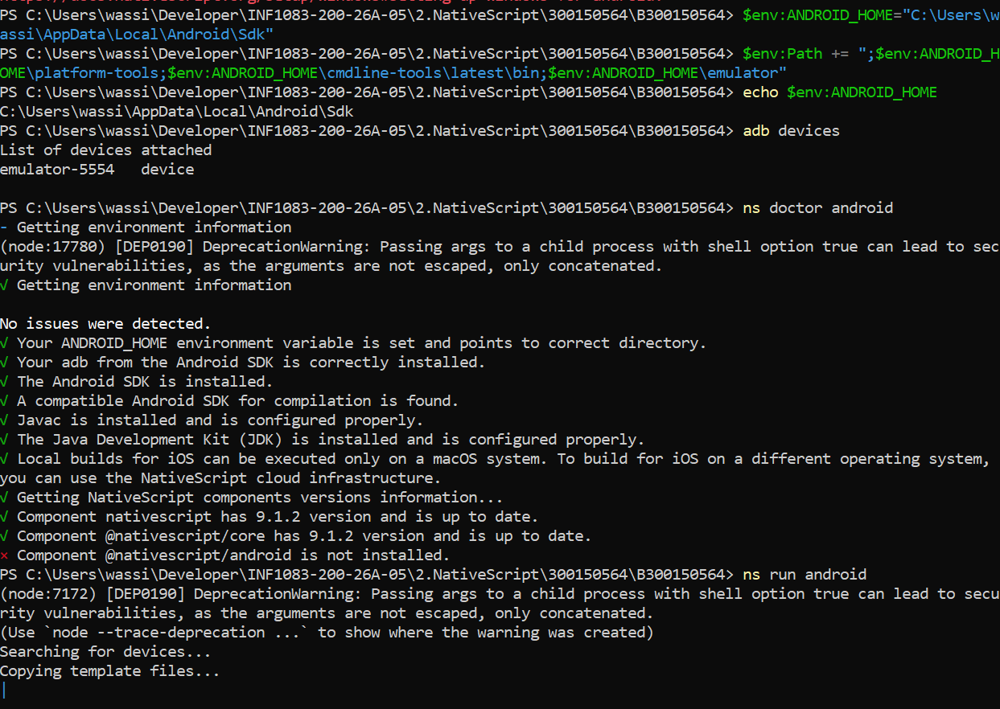
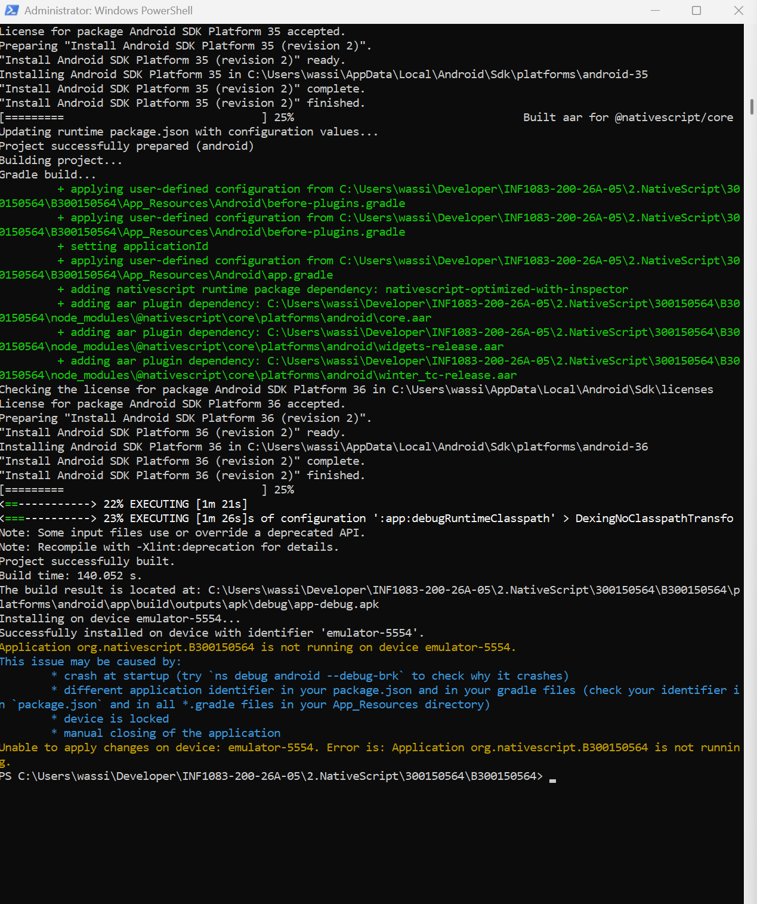
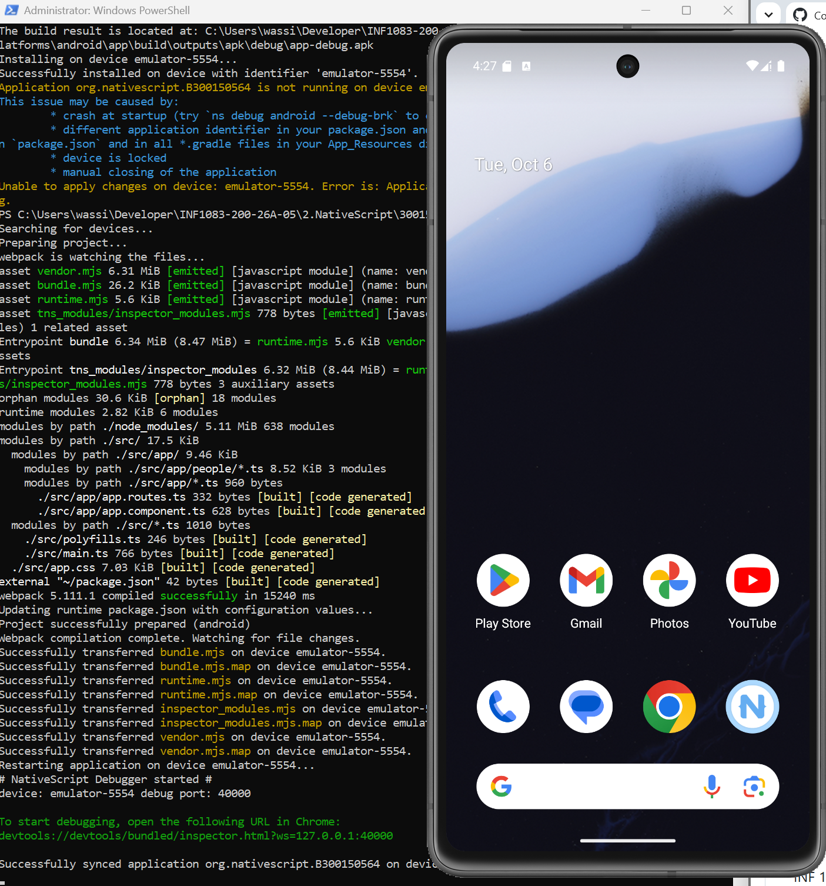
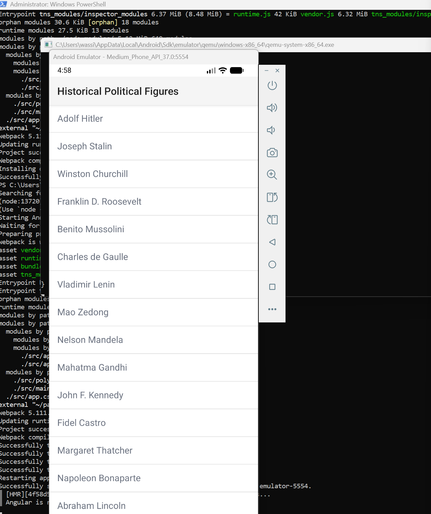

# 📱 NativeScript — INF1083

**Étudiant :** Ouassim Ahmed Benamira  
**Matricule :** 300150564  
**Programme :** TSIQ — Techniques des systèmes informatiques  
**Cours :** INF1083 — Développement d'applications  

---

## 🎯 Objectif

L'objectif de ce laboratoire est de créer, configurer et exécuter une application **NativeScript avec Angular** sur un émulateur Android.

Le projet réalisé est :

```text
B300150564
```

---

## 🏗️ Création du projet

Dans mon répertoire étudiant `300150564`, j'ai créé le projet avec la commande demandée dans le laboratoire :

```powershell
ns create B300150564
```

Lors de la création, j'ai sélectionné les options suivantes :

- **Style du projet :** Angular
- **Template :** Hello World

Le projet a été créé dans :

```text
2.NativeScript/300150564/B300150564
```

Je me suis ensuite déplacé dans le projet :

```powershell
cd B300150564
```

---

## 🛠️ Environnement de développement

Pour réaliser le laboratoire, j'ai utilisé :

- 🟢 Node.js et npm
- 🚀 NativeScript CLI
- ☕ Java JDK 17
- 🤖 Android SDK
- 📱 Android Studio
- 📲 Google Pixel 7 virtuel — Android 15 / API 35

NativeScript permet de développer des applications mobiles natives, notamment pour **Android et iOS**, avec des technologies comme Angular et TypeScript.

---

## 📱 Configuration de l'émulateur Android

Pour tester l'application, j'ai créé un émulateur **Google Pixel 7** utilisant **Android 15 (API 35)** dans Android Studio.

<p align="center">
  
</p>

<p align="center">
  <em>Figure 1 — Configuration de l'émulateur Google Pixel 7.</em>
</p>

---

## 🔗 Vérification ADB

J'ai vérifié que l'émulateur était correctement détecté par Android Debug Bridge avec :

```powershell
adb devices
```

Résultat obtenu :

```text
emulator-5554    device
```

Cela confirme que l'émulateur Android est connecté et disponible pour exécuter l'application.

<p align="center">
  
</p>

<p align="center">
  <em>Figure 2 — Vérification de la connexion avec l'émulateur Android.</em>
</p>

---

## 🩺 Vérification de NativeScript

J'ai également vérifié la configuration de l'environnement NativeScript avec :

```powershell
ns doctor android
```

Cette commande permet de vérifier les principaux composants nécessaires au développement Android, notamment Java, Android SDK et ADB.

---

## 🚀 Compilation et exécution

Conformément aux consignes du laboratoire, j'ai exécuté l'application sur Android avec :

```powershell
ns run android
```

NativeScript compile le projet, prépare l'application Android puis l'installe sur l'émulateur.

La compilation a réussi et l'application a été installée sur l'appareil virtuel :

```text
Project successfully built.
Successfully installed on device with identifier 'emulator-5554'.
```

<p align="center">
  
</p>

<p align="center">
  <em>Figure 3 — Compilation et installation du projet NativeScript.</em>
</p>

---

## 🐞 Test en mode Debug

NativeScript permet également de lancer l'application en mode Debug.

J'ai utilisé :

```powershell
ns debug android --debug-brk
```

Le mode Debug permet d'exécuter l'application tout en facilitant l'analyse de son fonctionnement pendant le développement.

<p align="center">
  
</p>

<p align="center">
  <em>Figure 4 — Exécution de l'application en mode Debug.</em>
</p>

---

## 🔄 Personnalisation de l'application

Après avoir vérifié le fonctionnement du projet, j'ai personnalisé l'application.

Les données utilisées par l'application se trouvent dans :

```text
src/app/people/person.service.ts
```

La liste originale des **Computer Scientists** a été remplacée par une liste de **15 figures politiques et historiques**.

Le titre affiché par l'application a également été modifié dans :

```text
src/app/people/person.component.html
```

Le nouveau titre est :

```text
Historical Political Figures
```

Après les modifications, j'ai recompilé et exécuté l'application avec :

```powershell
ns run android
```

---

## ✅ Résultat final

L'application fonctionne correctement sur l'émulateur Android et affiche la nouvelle liste de figures politiques et historiques.

<p align="center">
  
</p>

<p align="center">
  <em>Figure 5 — Résultat final de l'application NativeScript personnalisée.</em>
</p>

---

## ⚠️ Problème rencontré et solution

Pendant le laboratoire, la compilation utilisait initialement **Java 8**.

Cette version était trop ancienne pour la version de Gradle utilisée par le projet. La compilation Android ne pouvait donc pas se terminer correctement.

Pour résoudre le problème, j'ai utilisé **JDK 17** et configuré la variable `JAVA_HOME` :

```powershell
$env:JAVA_HOME="C:\Program Files\Eclipse Adoptium\jdk-17.0.17.10-hotspot"
```

Après cette modification, Java 17 a été correctement détecté et la compilation Android a fonctionné.

Cette étape m'a permis de comprendre l'importance de la compatibilité entre **Java, Gradle et l'environnement Android**.

---

## 📋 Résumé des étapes réalisées

Le projet **B300150564** a été :

- ✅ créé avec `ns create B300150564`
- ✅ configuré avec **Angular**
- ✅ créé avec le template **Hello World**
- ✅ configuré pour Android
- ✅ vérifié avec ADB
- ✅ vérifié avec `ns doctor android`
- ✅ compilé et exécuté avec `ns run android`
- ✅ installé sur un Google Pixel 7 virtuel
- ✅ testé en mode Debug
- ✅ personnalisé avec de nouvelles données
- ✅ recompilé et testé après les modifications

---

## 📝 Conclusion

Ce laboratoire m'a permis de créer et d'exécuter une application **NativeScript avec Angular** sur Android.

J'ai appris à utiliser les principales commandes NativeScript, à vérifier l'environnement avec ADB et `ns doctor`, à compiler l'application avec `ns run android` et à tester le projet sur un émulateur Android.

J'ai également personnalisé les données de l'application et résolu un problème de compatibilité Java rencontré pendant la compilation.

---

<p align="center">
  <b>📱 INF1083 — NativeScript | 300150564</b>
</p>