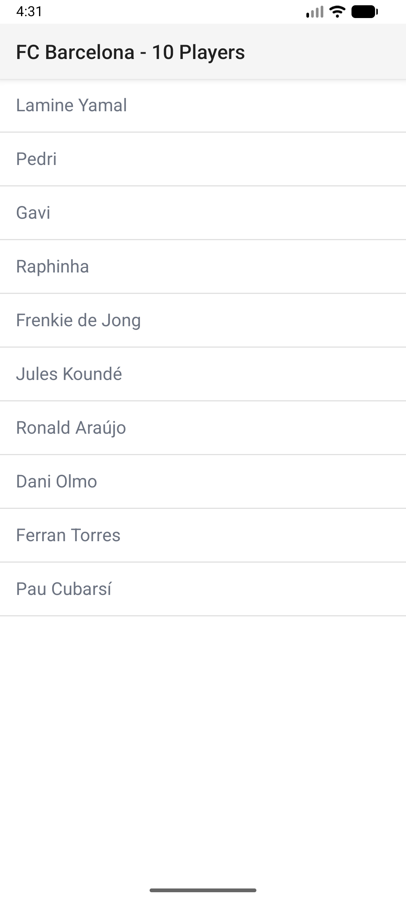
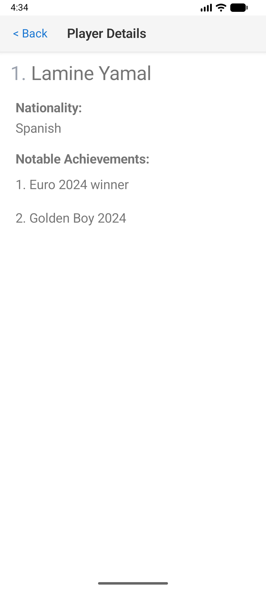

# NativeScript - FC Barcelona

## Informations

- Identifiant : 300151449
- Cours : INF1083-200-26A-05
- Projet : B300151449
- Framework : NativeScript Angular
- Plateforme : Android

## Objectif

Développer une application mobile présentant 10 joueurs
du FC Barcelone, leurs nationalités et leurs réalisations.

## Environnement de développement

- Windows
- Node.js et npm
- NativeScript 9.1.2
- Java JDK 17
- Android Studio
- Android SDK
- PowerShell

## Vérification de l'environnement

```powershell
ns.cmd doctor android
```

Résultat : No issues were detected.

## Création du projet

```powershell
ns.cmd create B300151449
cd B300151449
```

Modèle sélectionné : Angular - Hello World.

## Liste des joueurs

| ID | Joueur | Nationalité |
|---|---|---|
| 1 | Lamine Yamal | Espagne |
| 2 | Pedri | Espagne |
| 3 | Gavi | Espagne |
| 4 | Raphinha | Brésil |
| 5 | Frenkie de Jong | Pays-Bas |
| 6 | Jules Koundé | France |
| 7 | Ronald Araújo | Uruguay |
| 8 | Dani Olmo | Espagne |
| 9 | Ferran Torres | Espagne |
| 10 | Pau Cubarsí | Espagne |

## Code source

- [Service des joueurs](B300151449/src/app/people/person.service.ts)
- [Modèle de données](B300151449/src/app/people/person.ts)
- [Interface principale](B300151449/src/app/people/person.component.html)
- [Page de détails](B300151449/src/app/people/person-detail.component.html)

## Exécution de l'application

```powershell
ns.cmd run android
```

La compilation et l'installation sur l'émulateur Android
ont été réalisées avec succès.

## Captures d'écran

### Liste des joueurs



### Détails de Lamine Yamal



## Conclusion

Ce laboratoire a permis de découvrir NativeScript et Angular,
la configuration Android, la gestion des données et la
navigation entre les écrans d'une application mobile.

## Références

- https://nativescript.org
- https://angular.dev
- https://developer.android.com/studio

