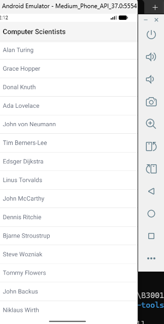

# INF1083 – NativeScript

Nom : Aidene
Prénom : Arezki
Numéro étudiant : 300151505

## Code source de l'application

[Cliquer ici pour accéder au code NativeScript](https://github.com/CollegeBoreal/INF1083-200-26A-05/tree/main/2.NativeScript/300151505/code)
INF1083 – NativeScript

Numéro étudiant : 300151505

1. Objectif

L'objectif de ce travail est de créer et d'exécuter une première application mobile avec NativeScript.

2. Présentation du projet

Nom de l'application : B300151505

Framework : NativeScript avec Angular

Modèle : Hello World

Système utilisé : Windows 11

Environnement : PowerShell et Android Studio

Émulateur : Medium Phone API 37.0

3. Création de l'application

J'ai installé Node.js, npm et NativeScript pour préparer mon environnement de développement.

J'ai ensuite créé le projet avec la commande :

ns create B300151505

J'ai sélectionné Angular et le modèle Hello World.

4. Configuration Android

J'ai installé Android Studio et les composants Android SDK nécessaires.

J'ai ajouté la plateforme Android avec la commande :

ns platform add android

J'ai également configuré Java JDK 17 pour résoudre une erreur de compatibilité avec Gradle.

5. Compilation et installation

J'ai compilé mon application Android avec Gradle.

La compilation a généré le fichier app-debug.apk.

J'ai ensuite installé ce fichier sur mon émulateur Android avec ADB. L'installation s'est terminée avec le message Success.

6. Résultat

Mon application fonctionne sur l'émulateur Android.

Elle affiche une liste intitulée Computer Scientists avec plusieurs scientifiques connus, notamment Alan Turing, Grace Hopper et Ada Lovelace.

Capture de l'application

7. Difficultés rencontrées

Pendant le travail, j'ai rencontré plusieurs problèmes :

Installation et configuration d'Android SDK

Incompatibilité entre Java 25 et Gradle

Plantage de Gradle pendant la compilation

Démarrage difficile de l'émulateur Android

J'ai résolu ces problèmes en utilisant Java 17, en limitant les ressources de Gradle et en configurant correctement Android SDK.

8. Conclusion

Ce travail m'a permis de découvrir NativeScript et de comprendre les étapes nécessaires pour créer, compiler et tester une application mobile Android.

J'ai réussi à installer et à exécuter mon application sur un téléphone virtuel.
