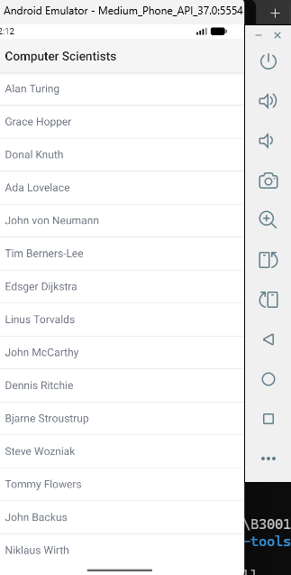
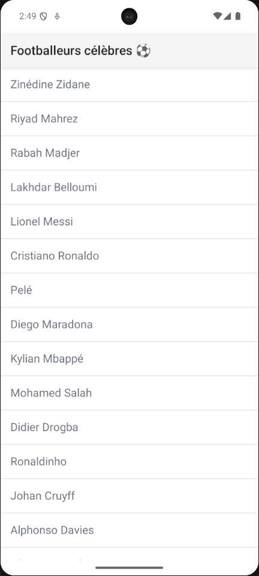
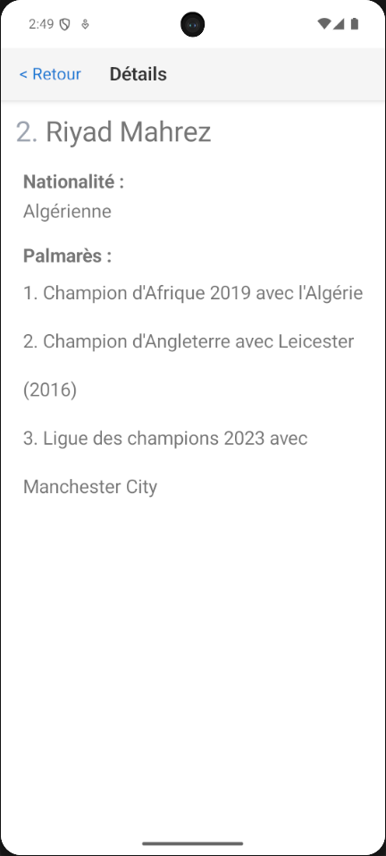

# 📱 INF1083 – NativeScript

**Étudiant :** Aidene Arezki  
**Numéro étudiant :** 300151505  
**Cours :** INF1083 — Développement d'applications  
**Session :** Automne 2026  

---

## 1. 🎯 Objectif

Créer et exécuter une première application mobile avec **NativeScript + Angular**, puis **modifier la liste** affichée par l'application.

## 2. 📋 Présentation du projet

| Élément | Valeur |
|---|---|
| Nom de l'application | `B300151505` |
| Framework | NativeScript 9 avec Angular 22 |
| Modèle | Hello World (Angular) |
| Système | Windows 11 — PowerShell |
| Émulateurs | Medium Phone API 37 (1ʳᵉ version), Pixel 7 API 35 (liste modifiée) |

## 3. 📁 Où est le code ?

Le code complet du projet est dans le dossier **[`code/`](code)** :

```text
2.NativeScript/300151505/
├── README.md
├── images/
└── code/                                   ← projet NativeScript B300151505
    ├── package.json
    ├── nativescript.config.ts
    ├── App_Resources/
    └── src/app/people/
        ├── person.service.ts               ← ✏️ liste modifiée
        ├── person.component.html           ← ✏️ titre modifié
        └── person-detail.component.html    ← ✏️ page de détails en français
```

## 4. ▶️ Exécuter le code

```powershell
cd 2.NativeScript\300151505\code
npm install
ns run android
```

- `npm install` télécharge les dépendances (`node_modules` n'est pas dans GitHub).
- `ns run android` compile le projet et l'installe sur l'émulateur.

> 💡 Si le message `Application ... is not running` apparaît au premier lancement, relancer `ns run android`, ou ouvrir l'application avec :
> ```powershell
> adb shell monkey -p org.nativescript.B300151505 -c android.intent.category.LAUNCHER 1
> ```

---

## 5. 🏗️ Création de l'application

J'ai installé Node.js, npm et NativeScript, puis créé le projet :

```powershell
ns create B300151505
```

J'ai choisi **Angular** et le modèle **Hello World**. J'ai ensuite installé Android Studio et le SDK Android, ajouté la plateforme Android (`ns platform add android`) et configuré **Java JDK 17** pour régler une erreur de compatibilité avec Gradle.

Première version (liste d'origine *Computer Scientists*) :



---

## 6. ✏️ Modification de la liste

J'ai remplacé la liste des **Computer Scientists** par une liste de **15 footballeurs célèbres** ⚽, dont des joueurs algériens et canadiens.

**`src/app/people/person.service.ts`** (extrait) :

```ts
// Liste modifiée par Aidene Arezki (300151505) : Footballeurs célèbres
items = signal<Person[]>([
  { id: 1, name: 'Zinédine Zidane', nationality: 'Française (origine kabyle, Algérie)', notableAchievements: ['Champion du monde 1998', "Ballon d'Or 1998", '3 Ligues des champions comme entraîneur du Real Madrid'] },
  { id: 2, name: 'Riyad Mahrez', nationality: 'Algérienne', notableAchievements: ["Champion d'Afrique 2019 avec l'Algérie", "Champion d'Angleterre avec Leicester (2016)", 'Ligue des champions 2023 avec Manchester City'] },
  { id: 3, name: 'Rabah Madjer', nationality: 'Algérienne', notableAchievements: ["Talonnade célèbre en finale de Coupe d'Europe 1987 (FC Porto)", "Champion d'Afrique 1990"] },
  // ...
  { id: 15, name: 'Christine Sinclair', nationality: 'Canadienne', notableAchievements: ["Meilleure buteuse de l'histoire en sélection (hommes et femmes)", 'Championne olympique 2021'] },
]);
```

| # | Joueur | Nationalité |
|---|---|---|
| 1 | Zinédine Zidane | Française (origine kabyle, Algérie) |
| 2 | Riyad Mahrez | Algérienne |
| 3 | Rabah Madjer | Algérienne |
| 4 | Lakhdar Belloumi | Algérienne |
| 5 | Lionel Messi | Argentine |
| 6 | Cristiano Ronaldo | Portugaise |
| 7 | Pelé | Brésilienne |
| 8 | Diego Maradona | Argentine |
| 9 | Kylian Mbappé | Française |
| 10 | Mohamed Salah | Égyptienne |
| 11 | Didier Drogba | Ivoirienne |
| 12 | Ronaldinho | Brésilienne |
| 13 | Johan Cruyff | Néerlandaise |
| 14 | Alphonso Davies | Canadienne |
| 15 | Christine Sinclair | Canadienne |

**Titre et page de détails :**

- `person.component.html` : `Computer Scientists` → **`Footballeurs célèbres ⚽`**
- `person-detail.component.html` : **`Détails`**, **`< Retour`**, **`Nationalité :`**, **`Palmarès :`**

## 7. ✅ Résultat

| Liste modifiée | Détails de Riyad Mahrez |
|---|---|
|  |  |

> ℹ️ La liste modifiée a été testée sur l'ordinateur d'un ami (mon ordinateur n'avait plus d'espace), avec le même code du dossier `code/`.

---

## 8. ⚠️ Difficultés rencontrées

| Problème | Solution |
|---|---|
| Installation et configuration du SDK Android | Installation par Android Studio et variables `ANDROID_HOME` |
| Incompatibilité entre Java 25 et Gradle | Utilisation de **Java JDK 17** |
| Plantage de Gradle pendant la compilation | Limitation des ressources de Gradle |
| Démarrage difficile de l'émulateur | Configuration du SDK et de l'émulateur |
| `Application ... is not running` après l'installation | Relancer `ns run android` ou ouvrir l'app avec `adb shell monkey` |

## 9. 📝 Conclusion

Ce travail m'a permis de découvrir NativeScript : créer, compiler et tester une application mobile Android, puis personnaliser ses données (`person.service.ts`) et son interface (fichiers `.html`) avec Angular.
