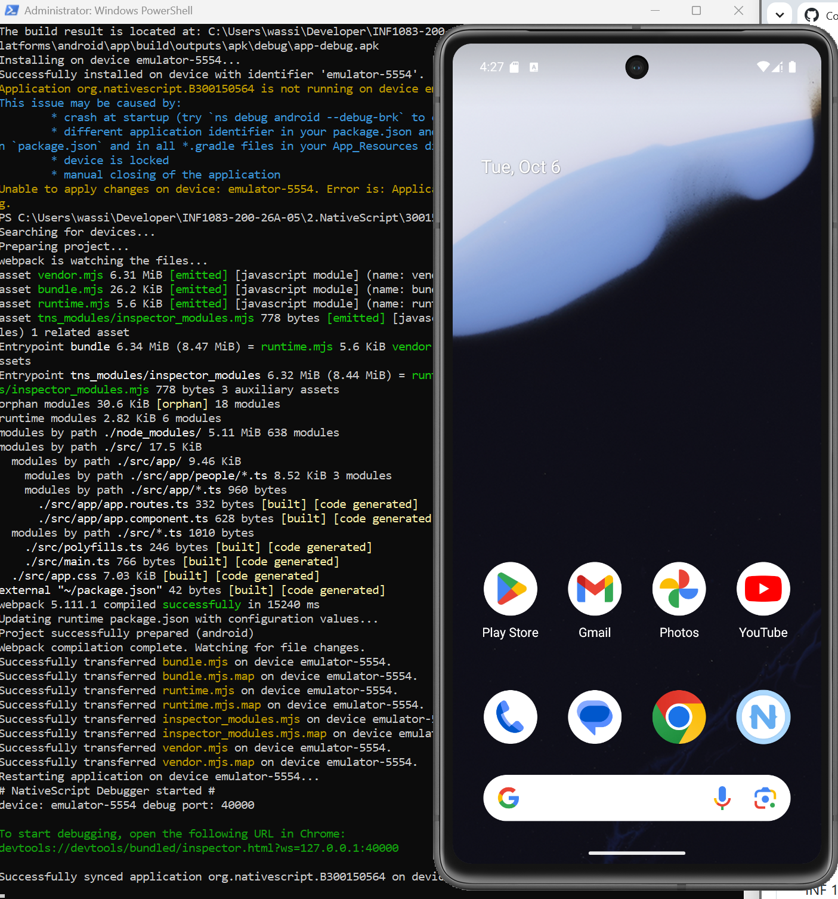

3 # 300151609

Leçon C — NativeScript
Description
NativeScript est un framework qui permet de créer des applications mobiles natives pour Android et iOS avec JavaScript ou TypeScript. Cette documentation présente la leçon C et la capture envoyée de l’émulateur Android pendant le travail.

