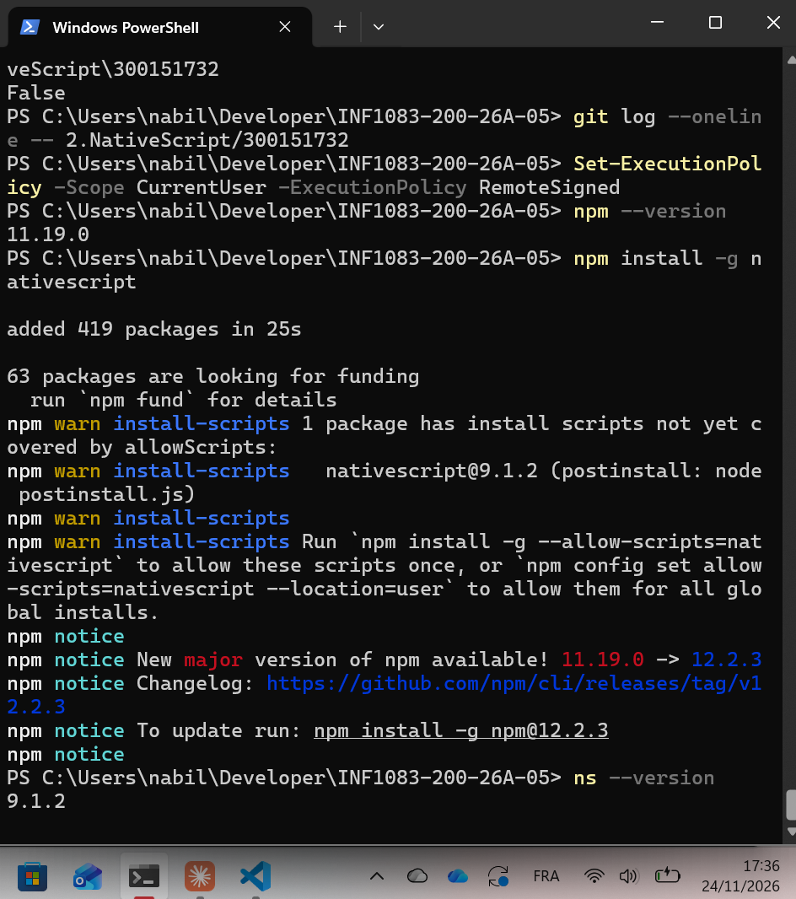
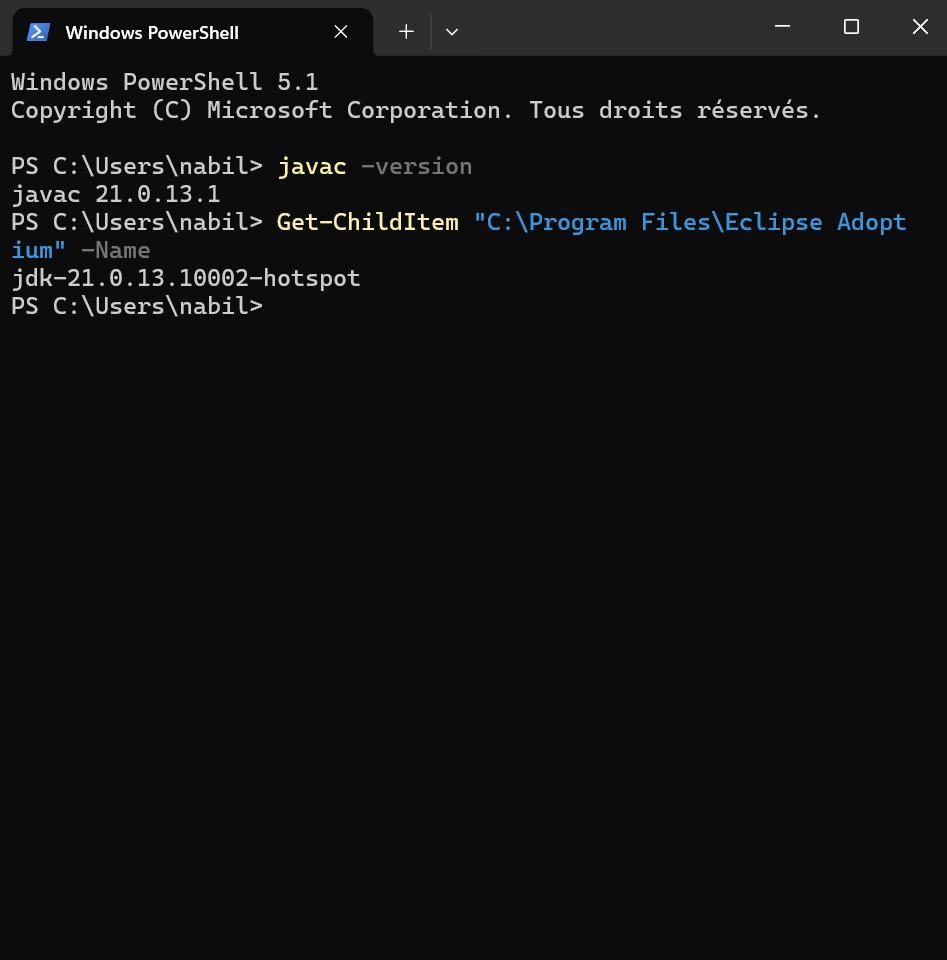
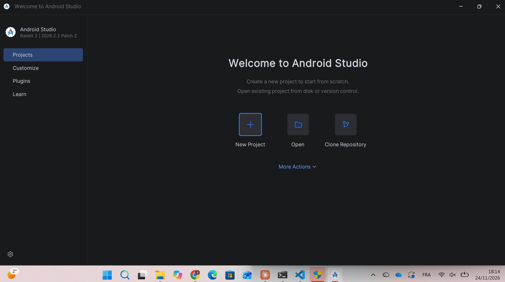
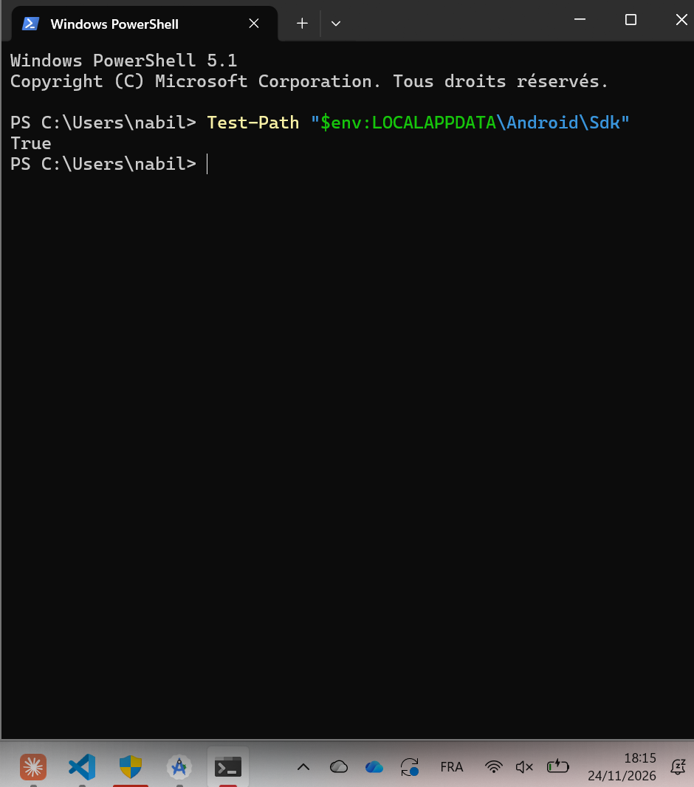
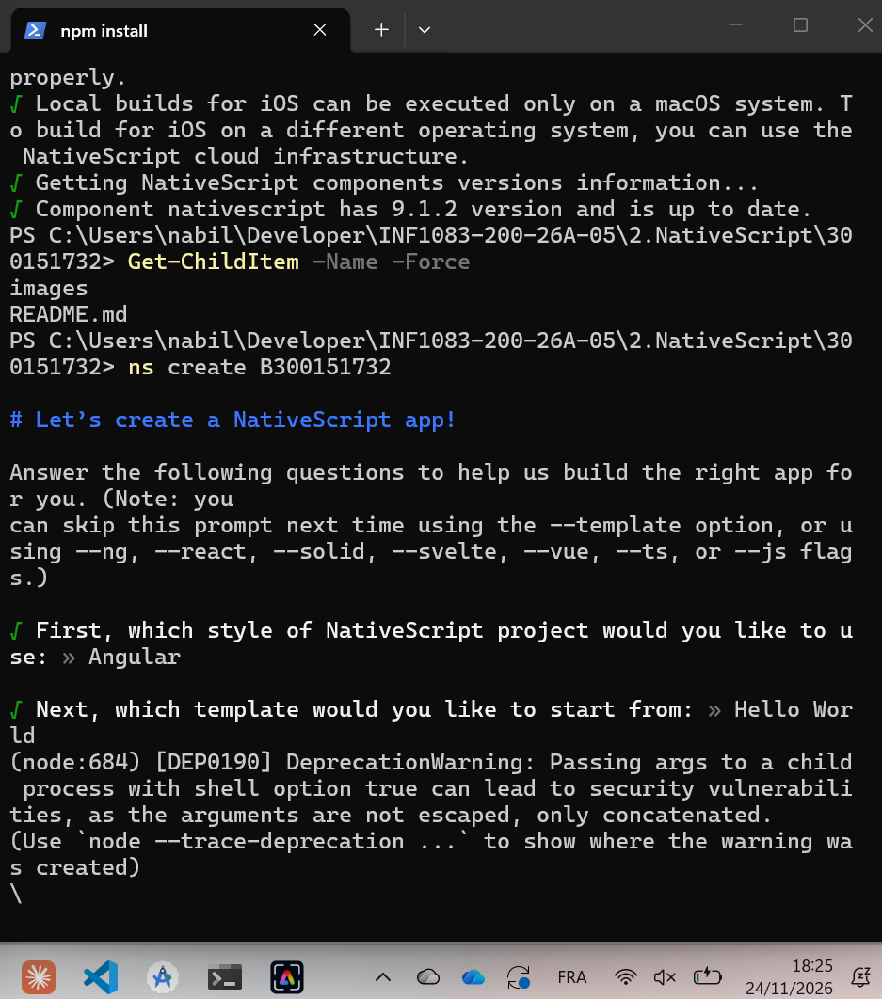
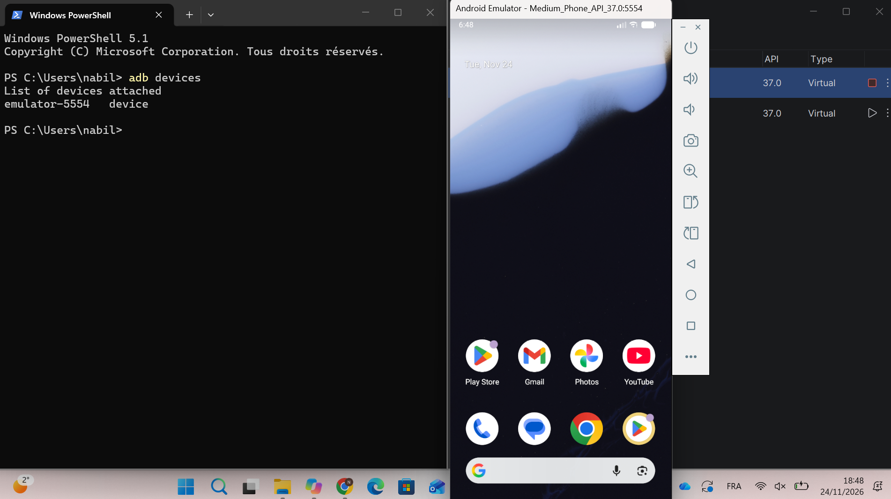
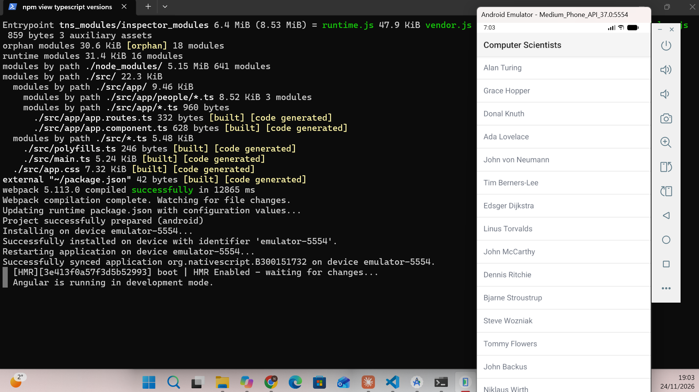

# 📱 Installation et déploiement d'une application NativeScript sous Android

**Étudiant :** Nabil  
**Numéro étudiant :** 300151732  
**Cours :** INF1083-200-26A-05  
**Date :** 24 novembre 2026

---

# Introduction

Dans le cadre de cette activité, un environnement complet de développement mobile a été mis en place à l'aide du framework NativeScript. L'objectif était d'installer les outils nécessaires au développement Android, de configurer l'environnement de travail et de créer une première application Angular. Une fois la configuration terminée, l'application a été déployée et exécutée avec succès dans un émulateur Android.

---

# Objectifs

- Installer NativeScript;
- Installer le Java Development Kit (JDK);
- Installer Android Studio;
- Configurer les variables d'environnement JAVA_HOME et ANDROID_HOME;
- Vérifier la configuration avec l'outil `ns doctor`;
- Créer une application Angular Hello World;
- Déployer l'application sur un émulateur Android.

---

# Table des matières

1. Installation de NativeScript
2. Installation du JDK
3. Configuration de JAVA_HOME
4. Installation d'Android Studio
5. Vérification du SDK Android
6. Configuration de ANDROID_HOME
7. Vérification de l'environnement
8. Création du projet NativeScript
9. Génération du projet
10. Création de l'émulateur Android
11. Vérification de la connexion ADB
12. Déploiement de l'application
13. Conclusion

---

## 1. Installation de NativeScript

La première étape consistait à vérifier l'installation de la CLI NativeScript, qui permet de créer, exécuter et gérer des applications mobiles multiplateformes.

Commande utilisée :

```powershell
ns --version
```

### Figure 1 – Vérification de l'installation de NativeScript

<p align="center">
  <a href="images/01-ns-version.png">
    
  </a>
</p>

*La commande `ns --version` confirme que NativeScript version 9.1.2 est correctement installé.*

---

## 2. Installation du JDK

Le Java Development Kit est requis pour la compilation des applications Android. Le JDK Eclipse Adoptium version 21 a été installé puis validé.

Commande utilisée :

```powershell
javac --version
```

### Figure 2 – Validation de l'installation du JDK

<p align="center">
  <a href="images/02-jdk.png">
    
  </a>
</p>

*Le compilateur Java version 21.0.13.1 est correctement détecté par le système.*

---

## 3. Configuration de JAVA_HOME

Après l'installation du JDK, la variable d'environnement JAVA_HOME a été configurée afin de permettre aux outils Android de localiser l'environnement Java.

### Figure 3 – Validation de JAVA_HOME

<p align="center">
  <a href="images/03-java-home.png">
    
  </a>
</p>

*JAVA_HOME pointe correctement vers le répertoire du JDK installé.*

---

## 4. Installation d'Android Studio

Android Studio a été installé afin d'obtenir le SDK Android, les outils de développement ainsi que le gestionnaire d'émulateurs.

### Figure 4 – Installation d'Android Studio

<p align="center">
  <a href="images/04-android-studio.png">
    
  </a>
</p>

*L'écran d'accueil confirme que l'installation d'Android Studio Rabbit 2 a été réalisée avec succès.*

---

## 5. Vérification du SDK Android

Une validation du SDK Android a été effectuée afin de s'assurer que tous les composants requis étaient présents.

### Figure 5 – Validation du SDK Android

<p align="center">
  <a href="images/05-SDK.png">
    
  </a>
</p>

*La présence du SDK Android est confirmée par le système.*

---

## 6. Configuration de ANDROID_HOME

La variable d'environnement ANDROID_HOME a été configurée afin que NativeScript puisse accéder automatiquement aux outils Android.

### Figure 6 – Validation de ANDROID_HOME

<p align="center">
  <a href="images/06-android-home.png">
    
  </a>
</p>

*La capture confirme que le SDK Android et l'outil ADB sont correctement configurés.*

---

## 7. Vérification de l'environnement NativeScript

Afin de s'assurer que l'ensemble de l'environnement était prêt au développement mobile, l'outil de diagnostic intégré à NativeScript a été exécuté.

Commande utilisée :

```powershell
ns doctor
```

### Figure 7 – Diagnostic complet de l'environnement

<p align="center">
  <a href="images/07-ns-doctor.png">
    
  </a>
</p>

*Aucune anomalie n'a été détectée lors de la vérification de l'environnement.*

---

## 8. Création du projet NativeScript

Le projet a été créé à l'aide de la commande suivante :

```powershell
ns create B300151732
```

Lors de l'assistant de création, les options Angular et Hello World ont été sélectionnées.

### Figure 8 – Sélection du type de projet

<p align="center">
  <a href="images/08-ns-create-choix.png">
    
  </a>
</p>

*Le modèle Angular et le gabarit Hello World ont été choisis.*

---

## 9. Génération du projet

Après la sélection des options, NativeScript a généré automatiquement la structure du projet.

### Figure 9 – Création réussie du projet

<p align="center">
  <a href="images/09-ns-create-succes.png">
    
  </a>
</p>

*Le projet B300151732 a été créé avec succès.*

---

## 10. Création de l'émulateur Android

Un appareil virtuel Android a été créé afin de reproduire un environnement mobile réel sans utiliser un téléphone physique.

### Figure 10 – Émulateur Android opérationnel

<p align="center">
  <a href="images/10-emulateur.png">
    
  </a>
</p>

*L'émulateur Android est prêt à recevoir l'application NativeScript.*

---

## 11. Vérification de la connexion ADB

Avant le déploiement, une validation de la connexion entre l'ordinateur et l'émulateur a été réalisée.

Commande utilisée :

```powershell
adb devices
```

### Figure 11 – Détection de l'émulateur par ADB

<p align="center">
  <a href="images/11-adb-devices.png">
    
  </a>
</p>

*L'émulateur apparaît correctement dans la liste des périphériques détectés.*

---

## 12. Déploiement de l'application

La dernière étape consistait à compiler et exécuter l'application Angular dans l'émulateur Android.

Commande utilisée :

```powershell
ns run android
```

### Figure 12 – Application NativeScript en exécution

<p align="center">
  <a href="images/12-premier-lancement.png">
    
  </a>
</p>

*L'application Angular a été compilée, installée et exécutée avec succès sur l'émulateur Android.*

---

# Conclusion

Cette activité a permis d'installer et de configurer avec succès l'ensemble des outils nécessaires au développement mobile avec NativeScript. Après l'installation de NativeScript, du JDK, d'Android Studio et du SDK Android, l'environnement a été validé grâce à l'outil `ns doctor`. Finalement, une application Angular a été créée, déployée et exécutée avec succès dans un émulateur Android. Les résultats obtenus démontrent que l'environnement est entièrement fonctionnel et prêt pour le développement d'applications mobiles plus avancées.

---

# Références

- NativeScript : https://nativescript.org/
- OpenJS Foundation : https://openjsf.org/blog/nativescript-9-1
- Frontend Developer Roadmap : https://roadmap.sh/frontend