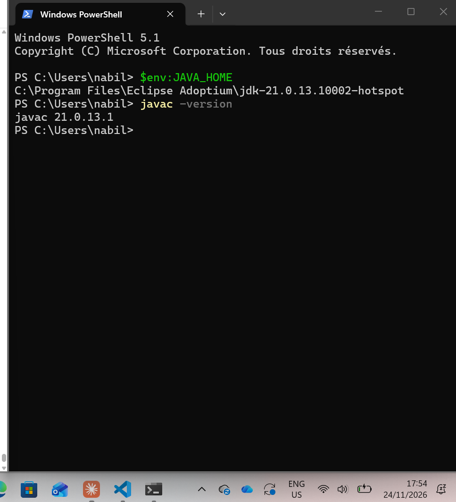
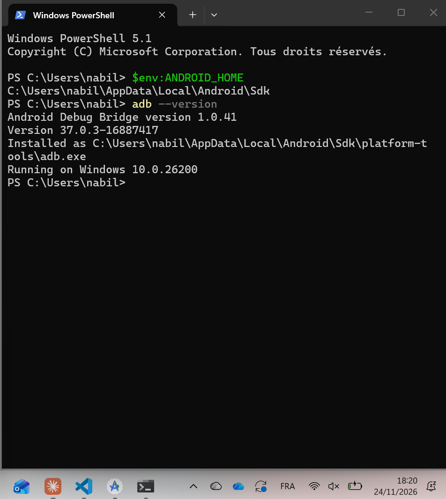
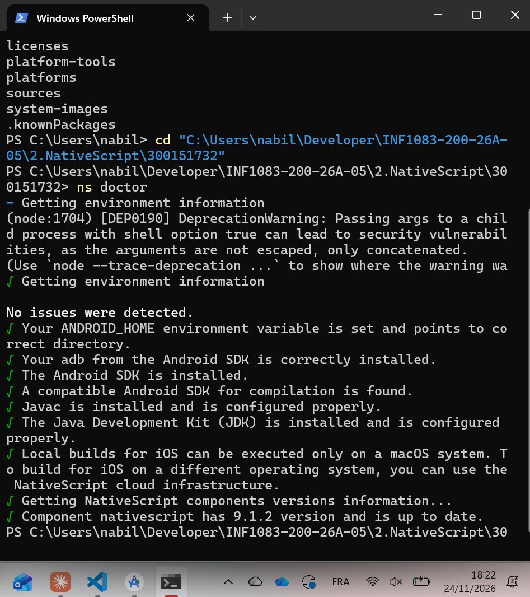
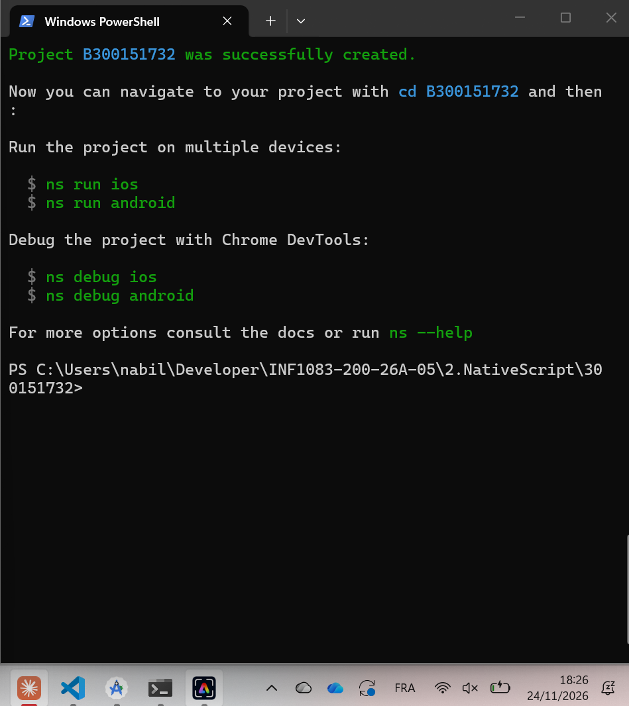
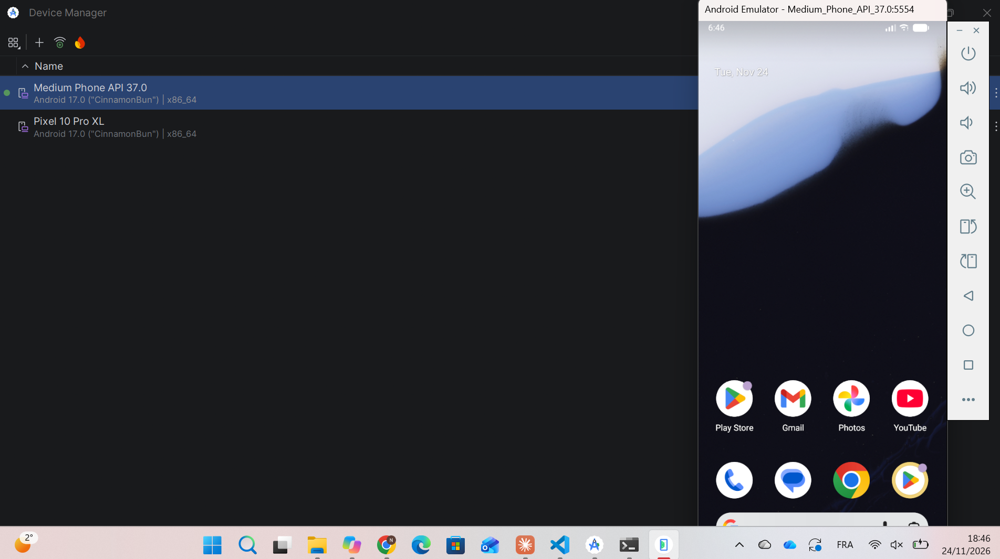

# 📱 Installation et déploiement d'une application NativeScript sous Android

**Étudiant :** Nabil  
**Numéro étudiant :** 300151732  
**Cours :** INF1083-200-26A-05  
**Date :** 24 novembre 2026

---

# Introduction

Ce laboratoire a pour objectif de mettre en place un environnement complet de développement mobile avec NativeScript. Les différentes étapes incluent l'installation des outils requis, la configuration de l'environnement Android, la création d'un projet Angular et le déploiement de l'application dans un émulateur Android.

---

# Objectifs

- Installer NativeScript;
- Installer et configurer le JDK;
- Installer Android Studio;
- Configurer l'environnement Android;
- Créer une application Angular Hello World;
- Déployer l'application dans un émulateur Android.

---

# 1. Installation de NativeScript

La première étape consistait à vérifier l'installation de NativeScript à l'aide de la commande suivante :

```powershell
ns --version
```

### Figure 1 - Vérification de l'installation de NativeScript


La capture montre que NativeScript version 9.1.2 est correctement installé et prêt à être utilisé.

---

# 2. Installation du JDK

Le Java Development Kit (JDK) est requis pour le développement Android. Son installation a été validée grâce à la commande suivante :

```powershell
javac --version
```

### Figure 2 - Validation du JDK


La version 21 du compilateur Java est correctement détectée.

---

# 3. Configuration de JAVA_HOME

La variable d'environnement JAVA_HOME a été configurée afin de permettre aux outils Android de localiser le JDK.

### Figure 3 - Vérification de JAVA_HOME



La capture confirme que JAVA_HOME pointe vers le répertoire du JDK installé.

---

# 4. Installation d'Android Studio

Android Studio a été installé afin d'obtenir le SDK Android, l'émulateur et les outils de développement nécessaires.

### Figure 4 - Android Studio installé


L'écran d'accueil confirme que l'installation d'Android Studio s'est déroulée avec succès.

---

# 5. Vérification du SDK Android

Une vérification a été effectuée afin de confirmer la présence du SDK Android.

### Figure 5 - Validation du SDK Android


La valeur retournée confirme que le SDK Android est bien installé sur le poste de travail.

---

# 6. Configuration de ANDROID_HOME

La variable d'environnement ANDROID_HOME a été configurée afin que NativeScript puisse localiser le SDK Android.

### Figure 6 - Validation de ANDROID_HOME



La capture montre également que l'outil ADB est correctement installé.

---

# 7. Vérification de l'environnement NativeScript

L'outil de diagnostic intégré à NativeScript a été utilisé afin de valider l'ensemble de la configuration.

```powershell
ns doctor
```

### Figure 7 - Diagnostic de l'environnement



Aucune erreur n'a été détectée et toutes les composantes requises sont fonctionnelles.

---

# 8. Création du projet NativeScript

Le projet a été créé avec la commande suivante :

```powershell
ns create B300151732
```

Les options Angular et Hello World ont été sélectionnées.

### Figure 8 - Sélection du modèle du projet


---

# 9. Création réussie du projet

NativeScript a généré automatiquement la structure complète du projet.

### Figure 9 - Projet créé avec succès



Le message de confirmation indique que le projet a été créé correctement.

---

# 10. Création de l'émulateur Android

Un appareil virtuel Android a été créé afin de tester l'application sans utiliser un appareil physique.

### Figure 10 - Émulateur Android



L'émulateur constitue l'environnement de test utilisé pour le déploiement de l'application.

---

# 11. Vérification de la connexion ADB

Une vérification de la communication entre l'émulateur et l'ordinateur a été réalisée.

```powershell
adb devices
```

### Figure 11 - Détection de l'émulateur


Le périphérique virtuel est correctement détecté par Android Debug Bridge.

---

# 12. Déploiement de l'application

L'application a été exécutée avec la commande suivante :

```powershell
ns run android
```

### Figure 12 - Application NativeScript en exécution


L'application Angular a été compilée, installée et exécutée avec succès dans l'émulateur Android.

---

# Conclusion

Cette activité a permis d'installer et de configurer avec succès l'ensemble des outils nécessaires au développement mobile avec NativeScript. Le projet Angular a été créé, compilé et exécuté dans un émulateur Android, démontrant le bon fonctionnement de l'environnement de développement.

---

# Références

- https://nativescript.org/
- https://openjsf.org/blog/nativescript-9-1
- https://roadmap.sh/frontend