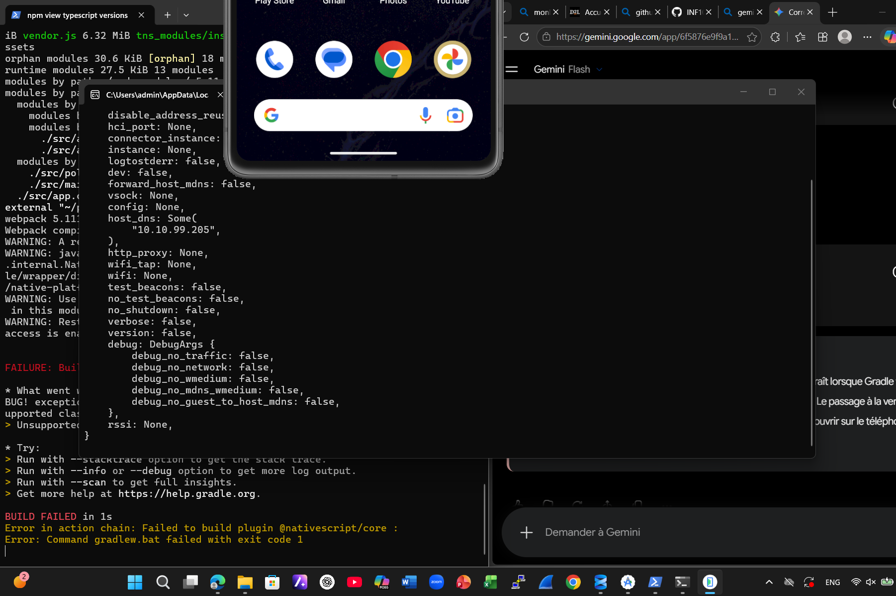
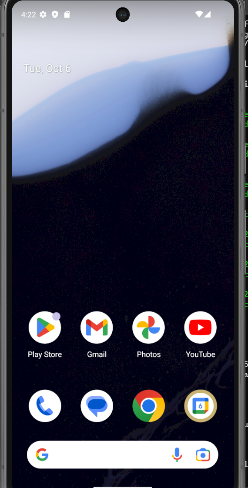
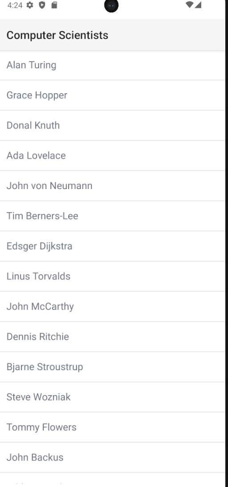
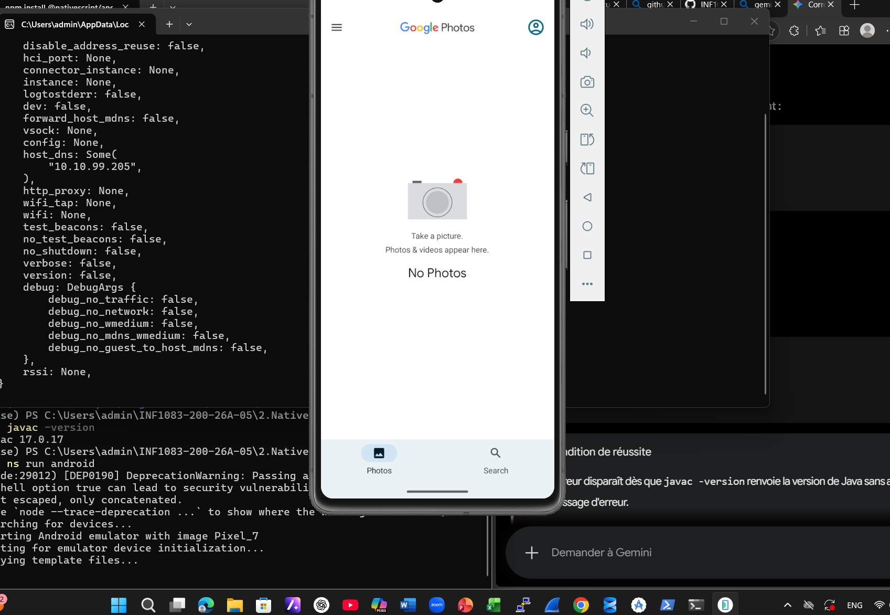

# 📱 NativeScript – BID300151781

## Création du projet

```bash
ns create BID300151781
```

Options choisies : Plain TypeScript, template Hello World.

## Vérification de Java et lancement



## Erreur rencontrée



L'erreur `Unsupported class file major version` venait d'une
incompatibilité entre la version de Java et celle de Gradle.
Solution : <décris ici ce que tu as fait>.

## Émulateur Android



## Application en marche



## Exécution

```bash
cd BID300151781
ns run android
```
