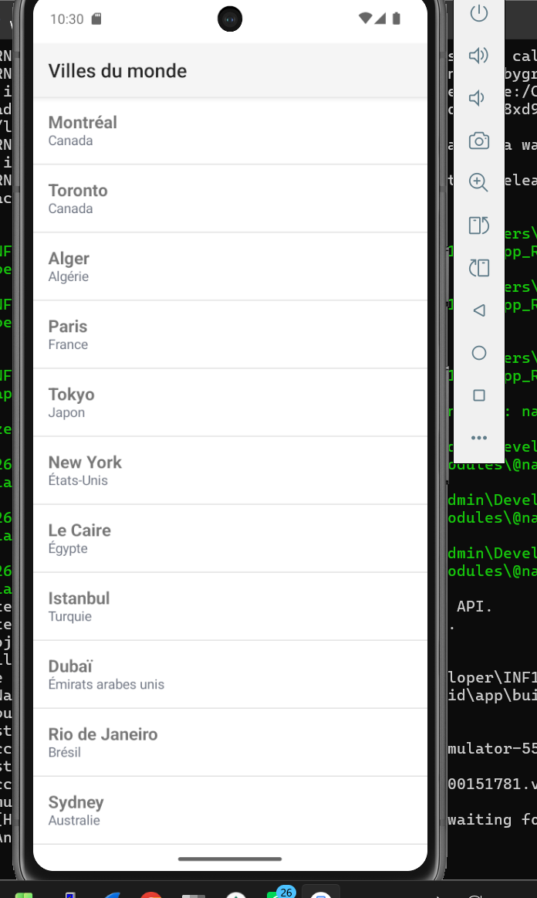
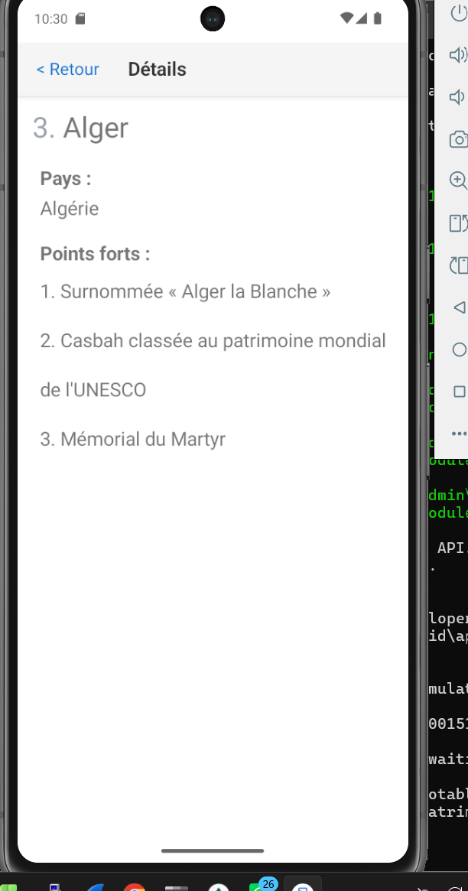
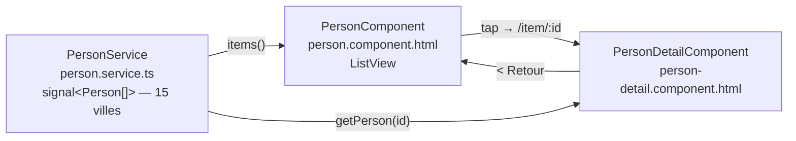
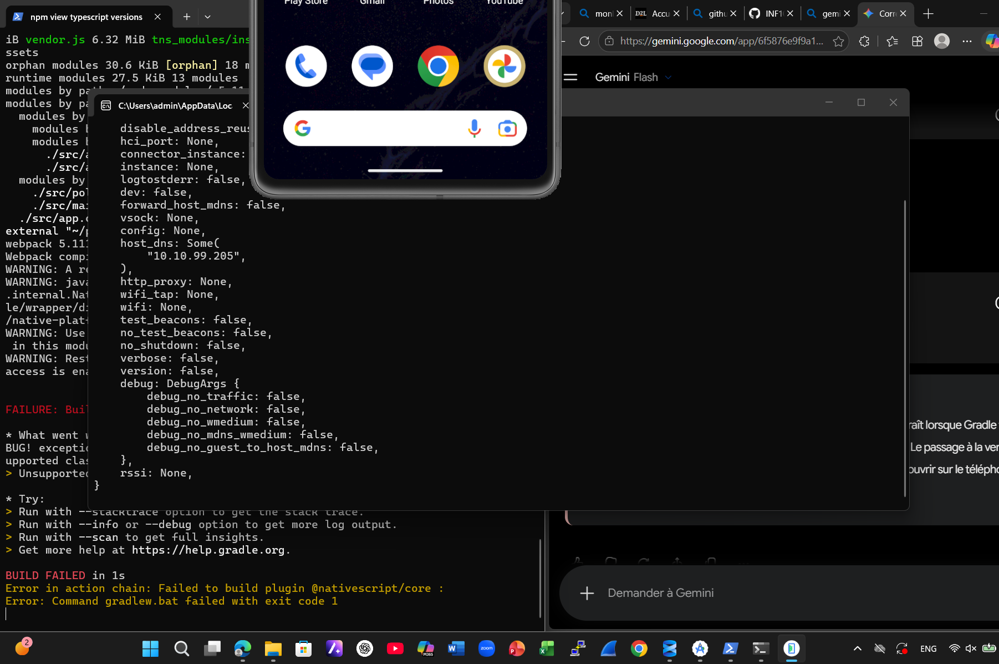
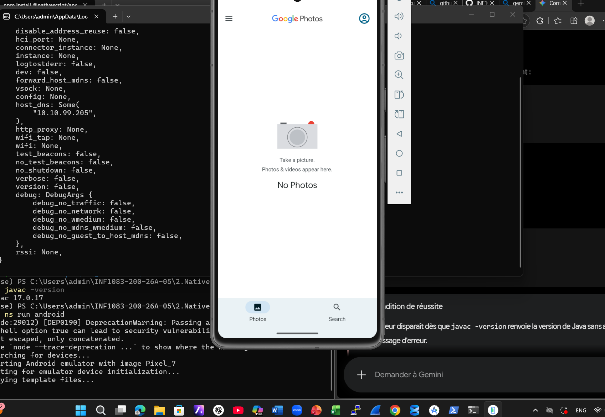
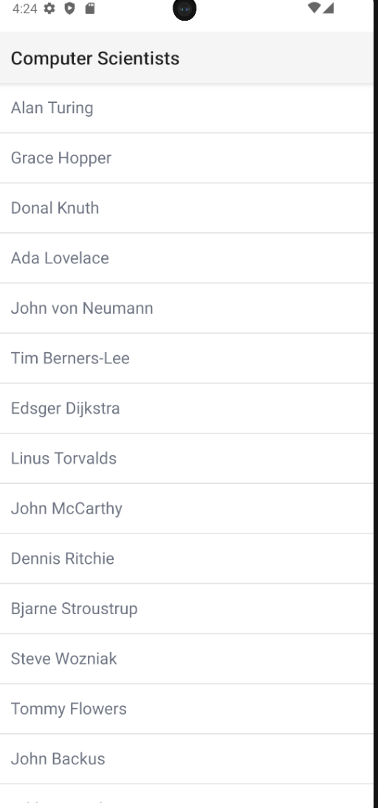

<div align="center">


# :iphone: NativeScript — B300151781

### Ma première application mobile : une **liste personnalisée** de 15 villes du monde


**Lounes Allouti** · :id: 300151781 · :octocat: [@lounesallouti](https://github.com/lounesallouti)
<br>
INF1083 — Labo 2 : NativeScript · Collège Boréal

[Résultat](#white_check_mark-résultat) ·
[Avant / après](#arrows_counterclockwise-avant--après) ·
[Étapes](#hammer_and_wrench-réalisation-pas-à-pas) ·
[Problème Java](#wrench-problème-rencontré--java-et-gradle) ·
[Lancer](#rocket-lancer-le-projet)

</div>

---

## :zap: En bref

<table>
  <tr>
    <td align="center" width="25%"><h3>15</h3>villes<br><sub>dans la nouvelle liste</sub></td>
    <td align="center" width="25%"><h3>2</h3>écrans<br><sub>liste + détail</sub></td>
    <td align="center" width="25%"><h3>4</h3>fichiers modifiés<br><sub>service, 2 vues, config</sub></td>
    <td align="center" width="25%"><h3>100 %</h3>en français<br><sub>titres et libellés</sub></td>
  </tr>
</table>

> [!NOTE]
> Le projet est dans le dossier [`B300151781`](B300151781), créé avec le modèle **Angular · Hello World**.
> La liste d'origine (« Computer Scientists ») a été **remplacée** par une liste de **villes du monde**.

---

## :white_check_mark: Résultat

<table>
  <tr>
    <th width="50%">Écran 1 — la liste</th>
    <th width="50%">Écran 2 — le détail</th>
  </tr>
  <tr>
    <td align="center"></td>
    <td align="center"></td>
  </tr>
  <tr>
    <td>Le titre <b>Villes du monde</b>, puis chaque ville en gras avec son <b>pays</b> en dessous.</td>
    <td>En touchant <b>Alger</b> : son numéro, son <b>pays</b> et ses <b>points forts</b> numérotés, avec un bouton <b>&lt; Retour</b>.</td>
  </tr>
</table>

---

## :arrows_counterclockwise: Avant / après

| | Avant (modèle d'origine) | Après (ma version) |
|---|---|---|
| **Titre** | Computer Scientists | **Villes du monde** |
| **Éléments** | Alan Turing, Grace Hopper, Ada Lovelace… | **Montréal, Toronto, Alger, Paris, Tokyo…** |
| **Ligne de la liste** | Nom seulement | **Nom en gras + pays** |
| **Détail** | *Nationality*, *Notable Achievements* | **Pays**, **Points forts** |
| **Navigation** | *< Back*, *Details* | **< Retour**, **Détails** |
| **Identifiant Android** | `org.nativescript.B300151781` | `org.nativescript.b300151781.villes` |

### Les 15 villes

| # | Ville | Pays | # | Ville | Pays |
|:-:|---|---|:-:|---|---|
| 1 | Montréal | Canada | 9 | Dubaï | Émirats arabes unis |
| 2 | Toronto | Canada | 10 | Rio de Janeiro | Brésil |
| 3 | Alger | Algérie | 11 | Sydney | Australie |
| 4 | Paris | France | 12 | Marrakech | Maroc |
| 5 | Tokyo | Japon | 13 | Londres | Royaume-Uni |
| 6 | New York | États-Unis | 14 | Séoul | Corée du Sud |
| 7 | Le Caire | Égypte | 15 | Barcelone | Espagne |
| 8 | Istanbul | Turquie | | | |

---

## :building_construction: Architecture



| Fichier | Rôle | Modification |
|---|---|---|
| [`person.service.ts`](B300151781/src/app/people/person.service.ts) | Fournit les données | **Nouvelle liste** de 15 villes |
| [`person.component.html`](B300151781/src/app/people/person.component.html) | Écran de la liste | Titre **Villes du monde**, nom + pays |
| [`person-detail.component.html`](B300151781/src/app/people/person-detail.component.html) | Écran de détail | Libellés **Pays**, **Points forts**, **Retour** |
| [`nativescript.config.ts`](B300151781/nativescript.config.ts) | Configuration | Identifiant Android unique |

> [!TIP]
> Le modèle `Person` (`id`, `name`, `nationality`, `notableAchievements`) est **réutilisé tel quel** :
> `name` contient la ville, `nationality` le pays et `notableAchievements` les points forts.
> Seuls les **données** et les **libellés** changent, sans toucher à la logique des composants.

---

## :hammer_and_wrench: Réalisation pas à pas

### 1. Créer le projet

```bash
ns create B300151781 --ng
cd B300151781
```

> [!IMPORTANT]
> Dans l'énoncé, `B🆔` signifie **`B` suivi de mon numéro étudiant** : le projet s'appelle donc
> **`B300151781`** (et non `BID300151781`).

### 2. Remplacer la liste — [`person.service.ts`](B300151781/src/app/people/person.service.ts)

```typescript
@Injectable({providedIn: 'root'})
export class PersonService {
  items = signal<Person[]>([
    { id: 1, name: 'Montréal', nationality: 'Canada', notableAchievements: ['Deuxième plus grande ville francophone du monde', 'Festival international de jazz', 'Ville de l\'intelligence artificielle (Mila)'] },
    { id: 2, name: 'Toronto', nationality: 'Canada', notableAchievements: ['Plus grande ville du Canada', 'Tour CN (553 m)', 'Centre financier du pays'] },
    { id: 3, name: 'Alger', nationality: 'Algérie', notableAchievements: ['Surnommée « Alger la Blanche »', 'Casbah classée au patrimoine mondial de l\'UNESCO', 'Mémorial du Martyr'] },
    // … 12 autres villes
  ]);

  getPerson(id: number): Person {
    return this.items().find((person) => person.id === id);
  }
}
```

`signal()` est une fonctionnalité d'Angular : la liste est **réactive**, et `items()` en lit la valeur.

### 3. Modifier l'écran de la liste — [`person.component.html`](B300151781/src/app/people/person.component.html)

```html
<ActionBar title="Villes du monde" iosLargeTitle="true"> </ActionBar>

<GridLayout>
  <ListView [items]="personService.items()">
    <ng-template let-item="item">
      <StackLayout [nsRouterLink]="['/item', item.id]" class="p-4">
        <Label [text]="item.name" class="text-lg font-bold"></Label>
        <Label [text]="item.nationality" class="text-sm text-gray-500"></Label>
      </StackLayout>
    </ng-template>
  </ListView>
</GridLayout>
```

| Élément | Rôle |
|---|---|
| `ListView [items]` | Affiche une ligne par ville |
| `ng-template let-item` | Modèle d'une ligne (`item` = la ville) |
| `[nsRouterLink]` | Ouvre l'écran de détail de la ville touchée |
| `class="font-bold"`, `text-gray-500` | Classes **Tailwind** pour la mise en forme |

### 4. Traduire l'écran de détail — [`person-detail.component.html`](B300151781/src/app/people/person-detail.component.html)

```html
<Label class="mb-2" fontWeight="700" text="Pays :"></Label>
<Label textWrap="true" [text]="person()?.nationality"></Label>

<Label class="m-2 ml-4" fontWeight="700" text="Points forts :"></Label>
<Label [text]="formatAchievements(person()?.notableAchievements)" textWrap="true"></Label>
```

### 5. Identifiant Android unique — [`nativescript.config.ts`](B300151781/nativescript.config.ts)

```typescript
id: 'org.nativescript.b300151781.villes',
```

Mes autres labos (RxJS, Animations) utilisent aussi un projet `b300151781` : un identifiant distinct évite
qu'une application **remplace** l'autre sur l'émulateur.

---

## :wrench: Problème rencontré : Java et Gradle

<table>
  <tr>
    <th width="50%">:x: Erreur à la compilation</th>
    <th width="50%">:white_check_mark: Après correction</th>
  </tr>
  <tr>
    <td align="center"></td>
    <td align="center"></td>
  </tr>
  <tr>
    <td><code>BUILD FAILED</code> — <code>Unsupported class file major version</code> : <code>gradlew.bat failed with exit code 1</code></td>
    <td><code>javac -version</code> affiche <b>17.0.17</b>, puis <code>ns run android</code> démarre l'émulateur Pixel 7</td>
  </tr>
</table>

| | |
|---|---|
| **Cause** | La version de Java installée était trop récente pour la version de **Gradle** utilisée par NativeScript. |
| **Solution** | Utiliser le **JDK 17**, puis vérifier avec `javac -version` avant de relancer `ns run android`. |

> [!WARNING]
> `Unsupported class file major version` signifie presque toujours **« mauvaise version de Java »**.
> Le réflexe : `javac -version`, puis installer ou sélectionner le JDK compatible.

<details>
<summary><b>Voir l'émulateur Android démarré</b></summary>

<br>

<p align="center"></p>

</details>

---

## :rocket: Lancer le projet

```bash
cd B300151781
npm install
ns run android
```

| Prérequis | Version utilisée |
|---|---|
| NativeScript CLI | 9.1.2 |
| Java (JDK) | 17.0.17 |
| Angular | 22 |
| Émulateur | Android Pixel 7 |

> [!NOTE]
> Le dossier `node_modules` n'est pas versionné : `npm install` le recrée.

---

## :bulb: Ce que j'ai appris

- [x] Créer un projet NativeScript Angular avec `ns create`
- [x] Comprendre le rôle d'un **service** qui fournit les données à plusieurs écrans
- [x] Afficher une collection avec `ListView` et naviguer vers un détail avec `nsRouterLink`
- [x] Personnaliser une application en changeant **les données** et **les libellés**
- [x] Diagnostiquer une erreur **Gradle / Java** et choisir le bon JDK
- [x] Donner un **identifiant unique** à chaque application Android

---

## :books: Références

- [NativeScript](https://nativescript.org)
- [NativeScript 9.1 — OpenJS Foundation](https://openjsf.org/blog/nativescript-9-1)
- [Angular — Signals](https://angular.dev/guide/signals)
- [Roadmap : Front-End Developer](https://roadmap.sh/frontend)

<div align="center">

<sub>Réalisé par <b>Lounes Allouti</b> · INF1083 · Collège Boréal · 2026</sub>


</div>
