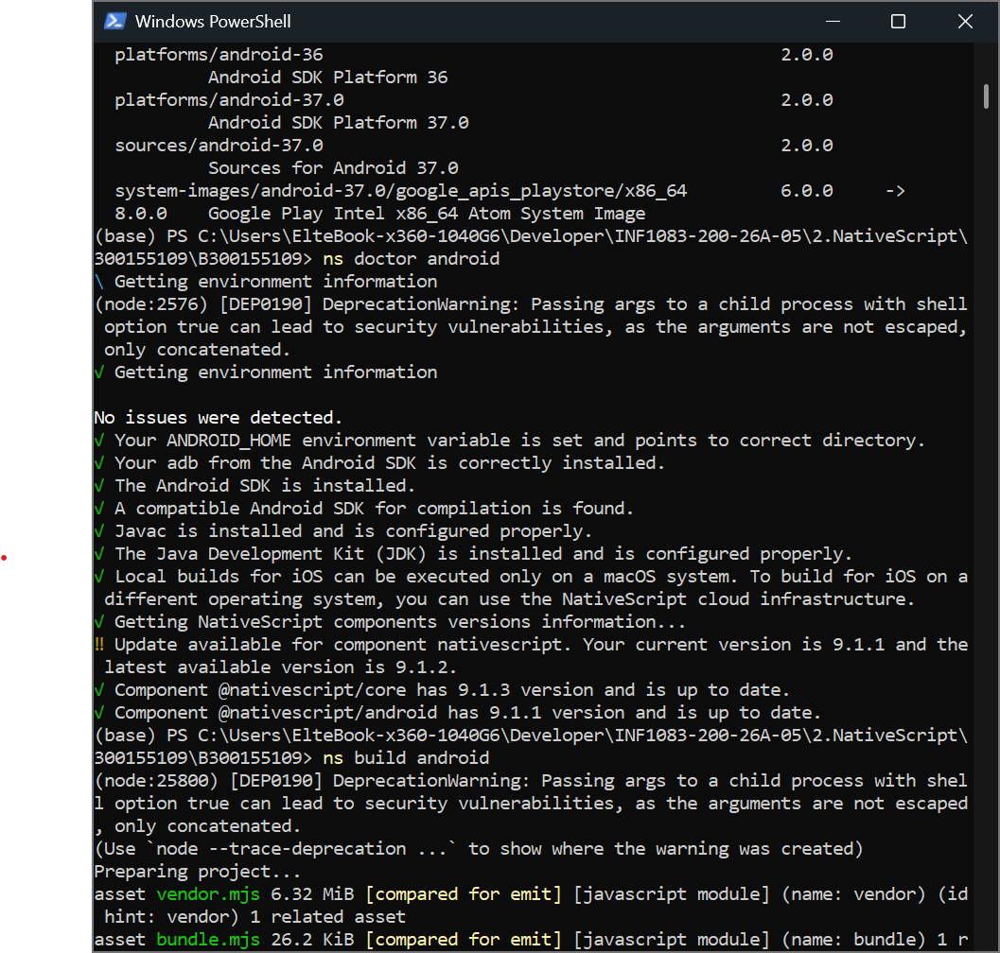
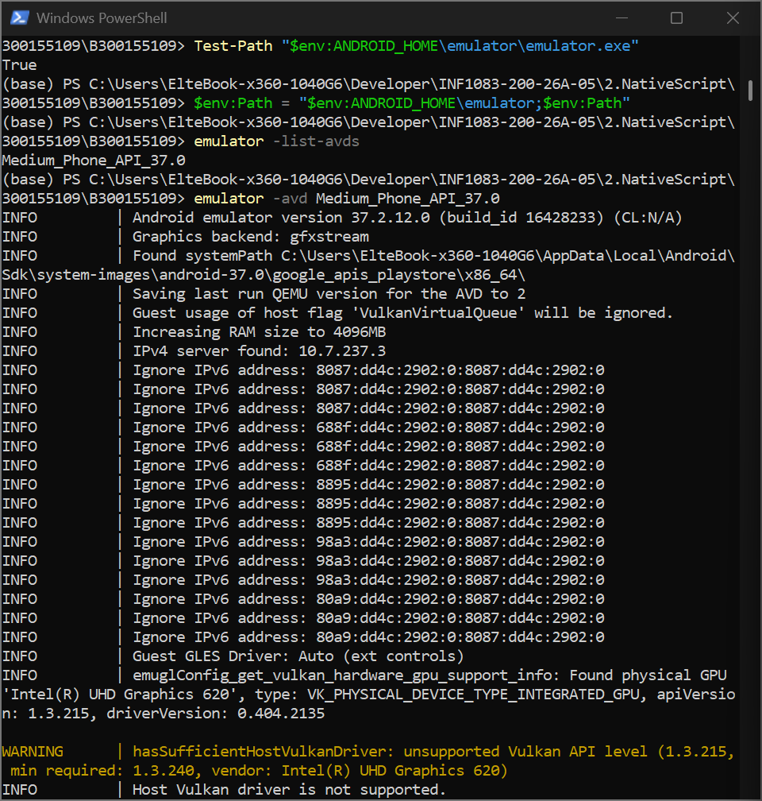
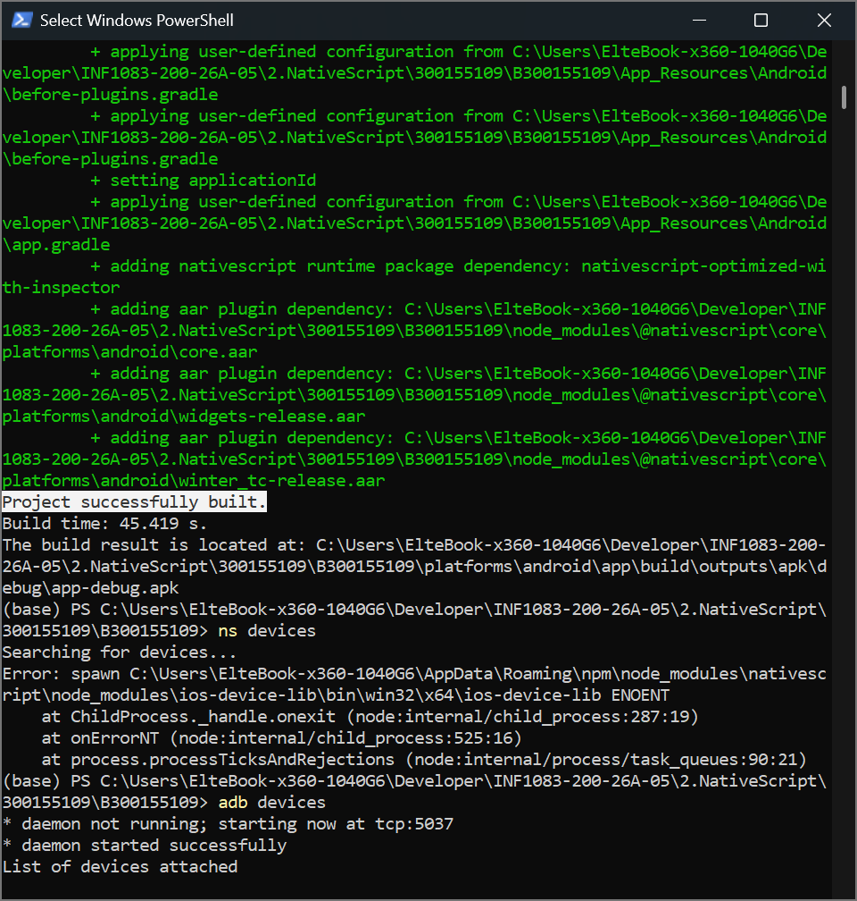
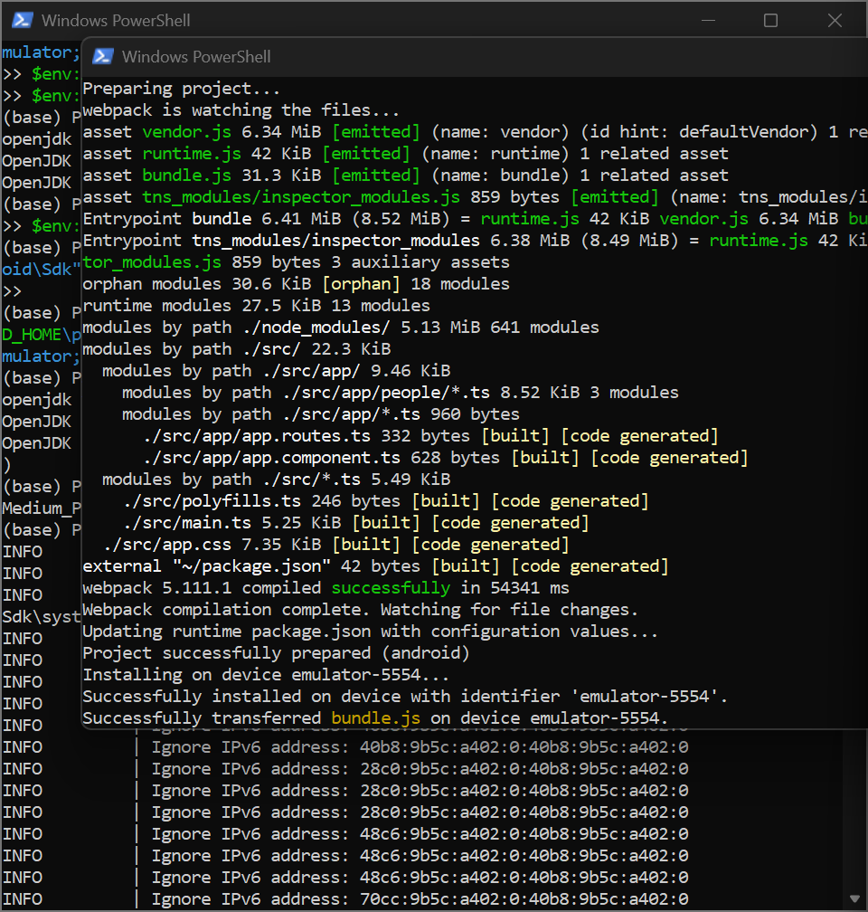
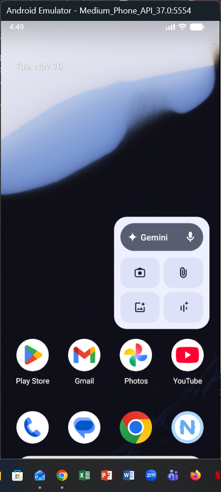

# 300155109
# 📱 NativeScript — INF1083

**Étudiante :** Alexia Kabore  
**Matricule :** 300155109  
**Programme :** Technique de systèmes informatiques  
**Cours :** INF1083 — Développement d'applications

---

## 🎯 Objectif

L'objectif de ce laboratoire est de créer un projet d'application mobile avec **NativeScript et Angular**, de configurer l'environnement de développement Android, puis de compiler et exécuter l'application sur un émulateur Android.

Le projet créé est :

```text
B300155109
```

---

## 🛠️ Environnement de développement

Les outils utilisés pour réaliser ce laboratoire sont :

- Node.js et npm
- NativeScript CLI 9.1.1
- Angular 22
- TypeScript
- Java JDK 17 (Eclipse Temurin)
- Android Studio
- Android SDK
- Android SDK Platform-Tools
- Android SDK Build-Tools
- Gradle
- Émulateur Android

---

## 📁 Création du projet

Un dossier personnel portant mon numéro d'étudiante a été créé dans le dépôt du cours.

Le projet NativeScript a ensuite été créé avec Angular et le modèle Hello World.

Nom du projet :

```text
B300155109
```

Le projet contient notamment les dossiers `src` et `App_Resources`, ainsi que le fichier `package.json`.

---

## ☕ Configuration de Java

Lors de la première tentative de compilation, une incompatibilité a été rencontrée avec Java 25.

Pour résoudre ce problème, j'ai installé **Eclipse Temurin JDK 17** et configuré les variables d'environnement :

```powershell
$env:JAVA_HOME = "C:\Program Files\Eclipse Adoptium\jdk-17.0.20.101-hotspot"
$env:Path = "$env:JAVA_HOME\bin;$env:Path"
```

La version Java 17 a ensuite été vérifiée avec :

```powershell
java -version
```

---

## 🤖 Configuration du SDK Android

Le SDK Android a été configuré dans le répertoire :

```text
C:\Users\ElteBook-x360-1040G6\AppData\Local\Android\Sdk
```

La variable d'environnement `ANDROID_HOME` a été définie :

```powershell
$env:ANDROID_HOME = "$env:LOCALAPPDATA\Android\Sdk"
```

Les outils suivants ont été installés :

- Android SDK Command-line Tools
- Android SDK Platform-Tools
- Android SDK Build-Tools
- Android SDK Platforms 35, 36 et 37

La commande suivante a permis de vérifier les composants installés :

```powershell
sdkmanager --list_installed
```

---

## 🔗 Vérification de l'environnement NativeScript

La configuration Android a été vérifiée avec :

```powershell
ns doctor android
```

Résultat :

```text
No issues were detected.
Your ANDROID_HOME environment variable is set and points to correct directory.
Your adb from the Android SDK is correctly installed.
A compatible Android SDK for compilation is found.
Javac is installed and is configured properly.
The Java Development Kit (JDK) is installed and is configured properly.
```



---

## 📱 Configuration de l'émulateur Android

Un appareil virtuel a été configuré dans Android Studio.

Nom de l'émulateur :

```text
Medium_Phone_API_37.0
```

La présence de l'émulateur a été vérifiée avec :

```powershell
emulator -list-avds
```



---

## 🚀 Compilation du projet Android

La compilation du projet a été effectuée avec :

```powershell
ns build android
```

La compilation Webpack s'est terminée correctement, puis Gradle a construit le projet Android.

Résultat :

```text
Webpack compilation complete.
Project successfully prepared (android)
Project successfully built.
Build time: 45.419 s.
```

Le fichier APK généré est :

```text
platforms/android/app/build/outputs/apk/debug/app-debug.apk
```



---

## 📲 Exécution de l'application

La commande pour lancer l'application est :

```powershell
ns run android
```



### Résultat final



---

## 📝 Conclusion

Ce laboratoire m'a permis de découvrir le développement d'applications mobiles avec NativeScript et Angular. J'ai également appris à configurer Java, Android SDK, ADB et Gradle, ainsi qu'à compiler un projet Android.

La compilation du projet a été réalisée avec succès. La prochaine étape consiste à exécuter et tester l'application sur l'émulateur Android.

---

**📱 INF1083 — NativeScript | 300155109**
