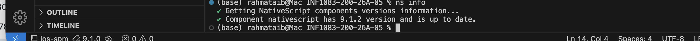
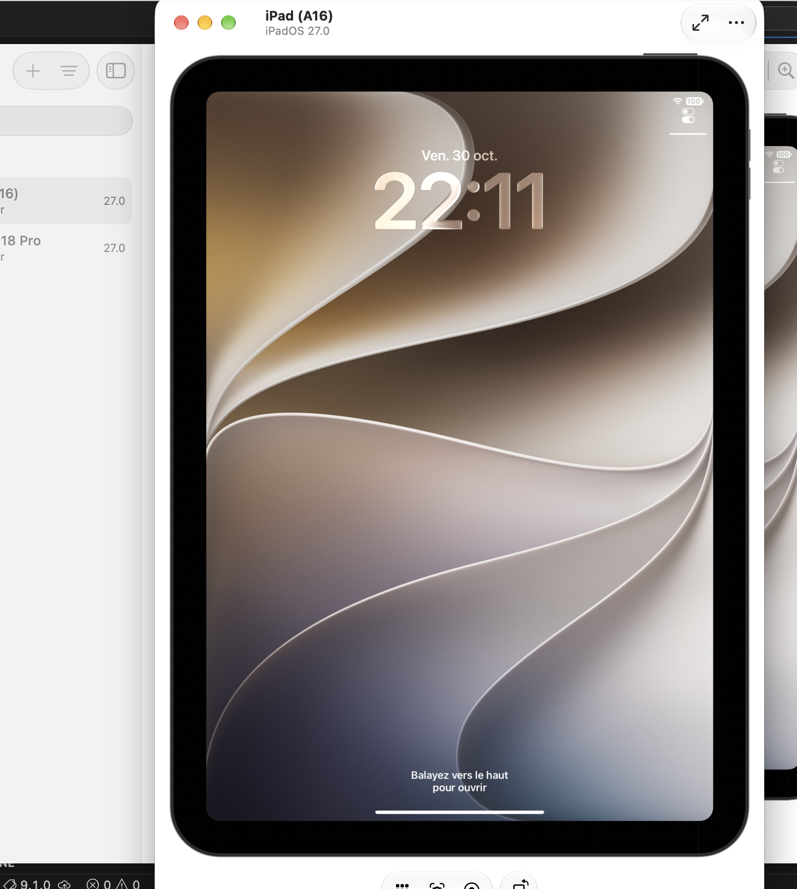
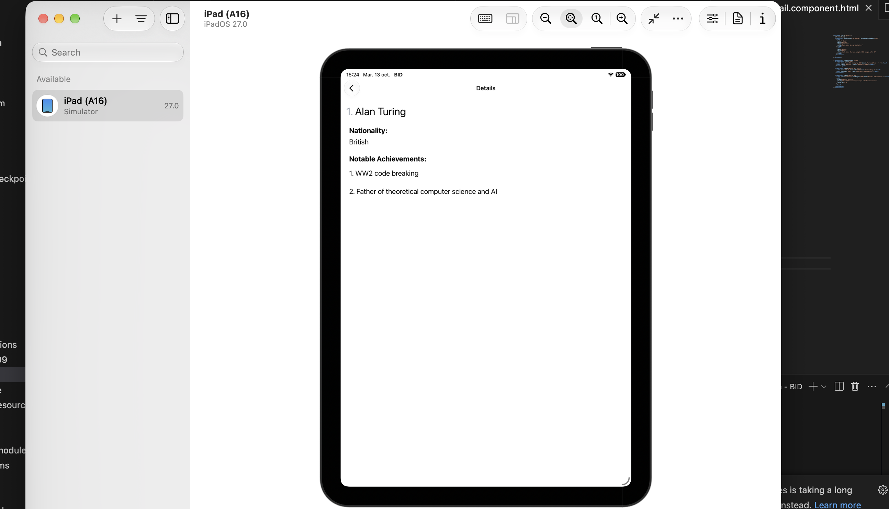

# Projet NativeScript – 300155909

## 1. Introduction

Dans le cadre du cours INF1083, j’ai réalisé mon premier projet avec **NativeScript**. L’objectif était de découvrir le développement d’applications mobiles et de créer une application avec Angular.

## 2. Préparation de l’environnement

J’ai commencé par ouvrir Visual Studio Code et son terminal intégré.

J’ai vérifié l’installation de NativeScript avec la commande suivante :

```bash
ns info
```

Le terminal a confirmé que NativeScript était installé. La version affichée était **9.1.2**.



## 3. Création du projet

J’ai utilisé la commande suivante pour créer mon projet :

```bash
ns create BID
```

Pendant la création du projet, j’ai sélectionné les options suivantes :

- Framework : Angular
- Template : Hello World

Cette étape a permis de générer la structure initiale de l’application.

## 4. Structure du projet

Le projet contient plusieurs fichiers et dossiers importants :

- `src/` : contient le code source de l’application.
- `src/app/` : contient les composants et les fichiers Angular.
- `App_Resources/` : contient les ressources de l’application mobile.
- `package.json` : contient les informations et les dépendances du projet.
- `tsconfig.json` : contient la configuration TypeScript.

## 5. Exécution de l’application

Après la création du projet, j’ai accédé au dossier du projet :

```bash
cd BID
```

Ensuite, j’ai utilisé la commande suivante pour lancer l’application dans le simulateur iOS :

```bash
ns run ios
```

Cette commande permet de compiler et d’exécuter l’application dans le simulateur iOS.



## 6. Application finale

Voici une capture d’écran de mon application finale :



## 7. Conclusion

Ce travail m’a permis de découvrir NativeScript, de créer un projet avec Angular, de comprendre la structure d’une application mobile et d’apprendre les étapes nécessaires pour exécuter une application dans un simulateur iOS.
