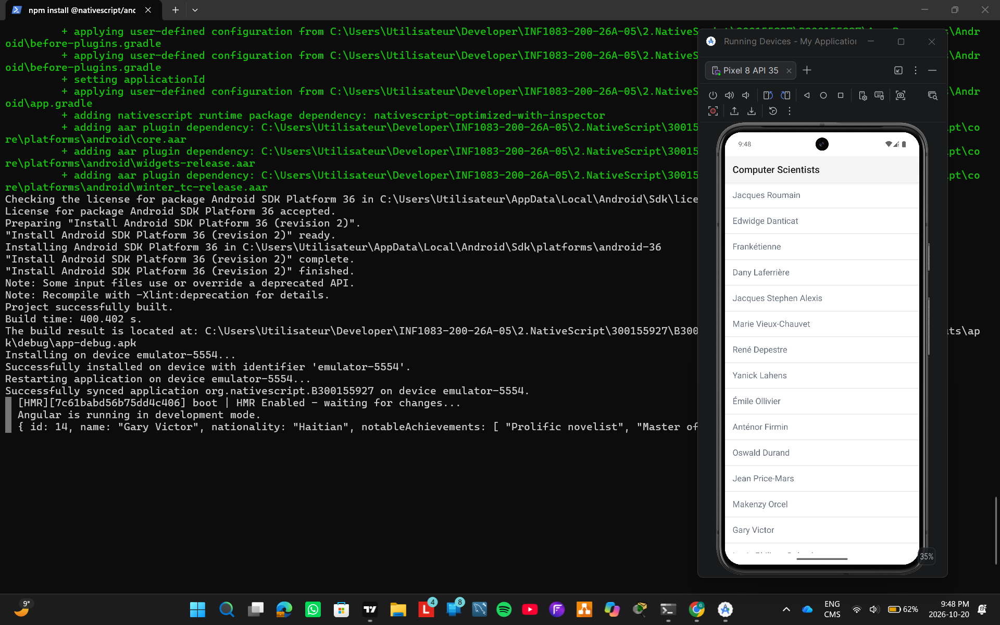

# 300155927
## ------------------------------------------------------------------------------------------------------------------------------------------------------

## Description

Cette application mobile développée avec NativeScript permet d'afficher une liste d'auteurs et des informations les concernant.

## Technologies utilisées

- NativeScript
- Angular
- TypeScript
- Android Emulator (Pixel 8 API 35)

## Fonctionnalités

- Affichage d'une liste d'auteurs.
- Présentation des noms des auteurs dans une interface mobile.
- Consultation de la liste sur un émulateur Android.

## Capture d'écran



## Installation

Installer les dépendances du projet :

```bash
npm install
```

## Exécution

Lancer l'application sur Android :

```bash
ns run android
```
