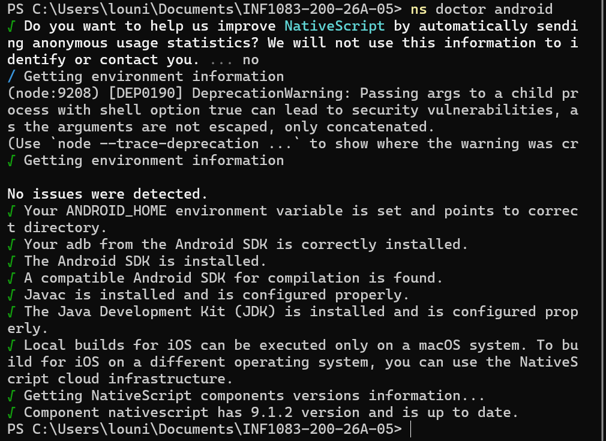
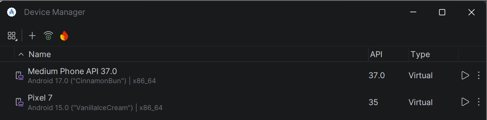
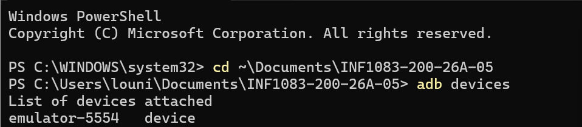
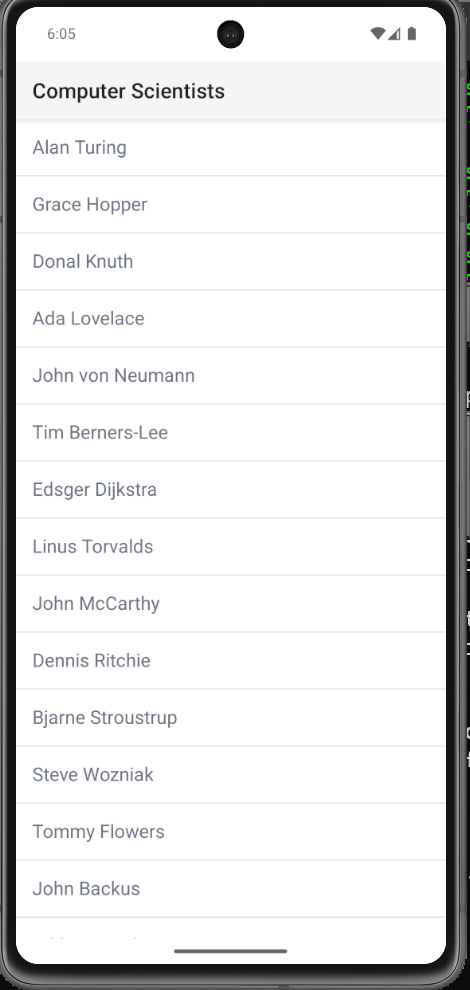
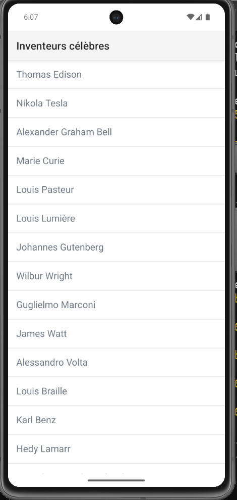
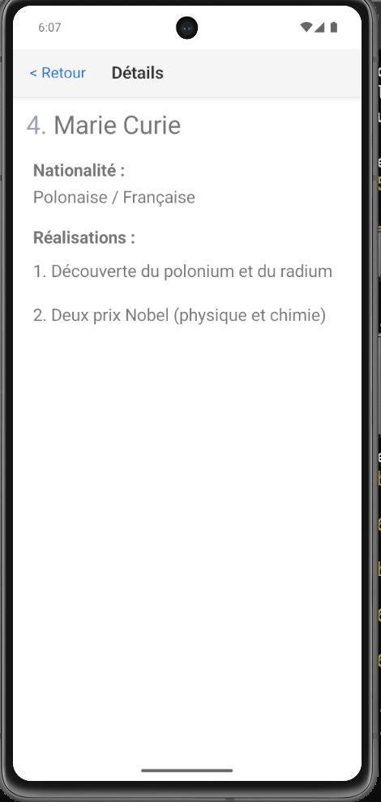

# 📱 NativeScript — INF1083

**Étudiant :** Rayan Lounis  
**Matricule :** 300157117  
**GitHub :** [lounisrayan](https://github.com/lounisrayan)  
**Cours :** INF1083 — Développement d'applications  
**Session :** Automne 2026  

---

## 🎯 Objectif

Créer une application mobile **NativeScript avec Angular**, l'exécuter sur un émulateur Android, puis **modifier la liste** affichée par l'application.

Projet réalisé : **`B300157117`**

```text
2.NativeScript/300157117/
├── README.md
├── images/
└── B300157117/          ← projet NativeScript (Angular, Hello World)
    └── src/app/people/
        ├── person.service.ts              ← liste modifiée
        ├── person.component.html          ← titre modifié
        └── person-detail.component.html   ← page de détails en français
```

---

## 🛠️ 1. Installation de l'environnement (Windows)

| Outil | Commande d'installation | Version |
|---|---|---|
| 🟢 Node.js | (déjà installé) | v24.21.0 |
| 🚀 NativeScript CLI | `npm install -g nativescript` | 9.1.2 |
| ☕ Java JDK 17 | `winget install --id Microsoft.OpenJDK.17 -e` | 17.0.21 |
| 🤖 Android Studio + SDK | `winget install --id Google.AndroidStudio -e` | 2026.2.2 |

Pour autoriser la commande `ns` dans PowerShell :

```powershell
Set-ExecutionPolicy -Scope CurrentUser RemoteSigned -Force
```

### ⚙️ Variables d'environnement

NativeScript doit savoir où se trouvent Java 17 et le SDK Android :

```powershell
$jdk = (Get-ChildItem "C:\Program Files\Microsoft" -Directory -Filter "jdk-17*" | Select-Object -First 1).FullName
$sdk = "$env:LOCALAPPDATA\Android\Sdk"
[Environment]::SetEnvironmentVariable("JAVA_HOME", $jdk, "User")
[Environment]::SetEnvironmentVariable("ANDROID_HOME", $sdk, "User")
[Environment]::SetEnvironmentVariable("Path", "$jdk\bin;$sdk\platform-tools;$sdk\emulator;" + [Environment]::GetEnvironmentVariable("Path","User"), "User")
```

### 🩺 Vérification avec `ns doctor android`

Résultat : **`No issues were detected.`** ✅



---

## 📲 2. Émulateur Android

Dans Android Studio → **Virtual Device Manager**, j'ai créé un **Pixel 7** avec **Android 15 (API 35)**, image *Google Play Intel x86_64*.



Vérification de la connexion avec ADB :

```powershell
adb devices
```

```text
emulator-5554   device
```



---

## 🏗️ 3. Création et exécution du projet

```powershell
cd 2.NativeScript\300157117
ns create B300157117 --ng
cd B300157117
ns run android
```

- `--ng` : style **Angular**, modèle **Hello World**.
- `ns run android` compile le projet, l'installe sur `emulator-5554` et reste actif : chaque modification du code recharge l'application automatiquement (*hot reload*).

Application d'origine (liste **Computer Scientists**) :



---

## ✏️ 4. Modification de la liste

J'ai remplacé la liste des **Computer Scientists** par une liste de **15 inventeurs célèbres**.

**`src/app/people/person.service.ts`** (extrait) :

```ts
// Liste modifiée par Rayan Lounis (300157117) : Inventeurs célèbres
items = signal<Person[]>([
  { id: 1, name: 'Thomas Edison', nationality: 'Américaine', notableAchievements: ['Ampoule électrique à incandescence durable', 'Phonographe'] },
  { id: 2, name: 'Nikola Tesla', nationality: 'Serbo-américaine', notableAchievements: ['Moteur à courant alternatif', 'Bobine Tesla'] },
  { id: 4, name: 'Marie Curie', nationality: 'Polonaise / Française', notableAchievements: ['Découverte du polonium et du radium', 'Deux prix Nobel (physique et chimie)'] },
  // ...
  { id: 15, name: 'Joseph-Armand Bombardier', nationality: 'Canadienne (Québec)', notableAchievements: ['Motoneige', 'Fondateur de Bombardier'] },
]);
```

### 📋 La liste complète

| # | Inventeur | Nationalité | Réalisations |
|---|---|---|---|
| 1 | Thomas Edison | Américaine | Ampoule électrique durable, phonographe |
| 2 | Nikola Tesla | Serbo-américaine | Moteur à courant alternatif, bobine Tesla |
| 3 | Alexander Graham Bell | Écossaise / Canadienne / Américaine | Brevet du téléphone (1876) |
| 4 | Marie Curie | Polonaise / Française | Polonium et radium, deux prix Nobel |
| 5 | Louis Pasteur | Française | Vaccin contre la rage, pasteurisation |
| 6 | Louis Lumière | Française | Cinématographe (1895) |
| 7 | Johannes Gutenberg | Allemande | Imprimerie à caractères mobiles |
| 8 | Wilbur Wright | Américaine | Premier vol motorisé contrôlé (1903) |
| 9 | Guglielmo Marconi | Italienne | Télégraphie sans fil, prix Nobel 1909 |
| 10 | James Watt | Écossaise | Amélioration de la machine à vapeur |
| 11 | Alessandro Volta | Italienne | Pile électrique (1800) |
| 12 | Louis Braille | Française | Écriture en relief pour les personnes aveugles |
| 13 | Karl Benz | Allemande | Première automobile à essence (1886) |
| 14 | Hedy Lamarr | Austro-américaine | Saut de fréquence (base du Wi-Fi et du Bluetooth) |
| 15 | Joseph-Armand Bombardier | Canadienne (Québec) | Motoneige |

### 🏷️ Titre et page de détails

- `person.component.html` : titre `Computer Scientists` → **`Inventeurs célèbres`**
- `person-detail.component.html` : traduction en français → **`Détails`**, **`< Retour`**, **`Nationalité :`**, **`Réalisations :`**

---

## ✅ 5. Résultat final

| Liste modifiée | Page de détails |
|---|---|
|  |  |

L'application affiche la nouvelle liste **Inventeurs célèbres**. Un clic sur un nom ouvre la page de détails en français.

---

## ⚠️ Problèmes rencontrés et solutions

| Problème | Solution |
|---|---|
| `ns`, `adb` introuvables | Installation de NativeScript (`npm`) et d'Android Studio (`winget`) |
| Java 8 (Corretto) trop ancien pour Gradle | Installation de **JDK 17** et variable `JAVA_HOME` |
| Variables non prises en compte | Fermer puis rouvrir PowerShell |

## 📝 Conclusion

J'ai installé et configuré un environnement complet de développement mobile sous Windows (Node.js, NativeScript, JDK 17, Android SDK, émulateur Pixel 7), créé une application NativeScript Angular, puis personnalisé ses données et son interface. Le *hot reload* de `ns run android` m'a permis de voir les changements immédiatement sur l'émulateur.

---

<p align="center"><b>📱 INF1083 — NativeScript | 300157117</b></p>
