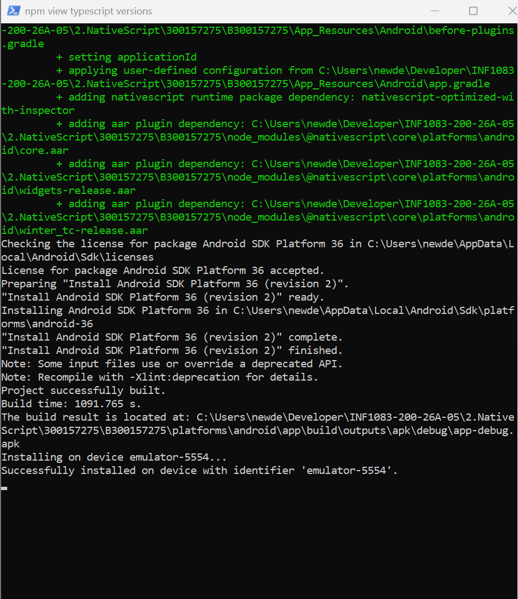
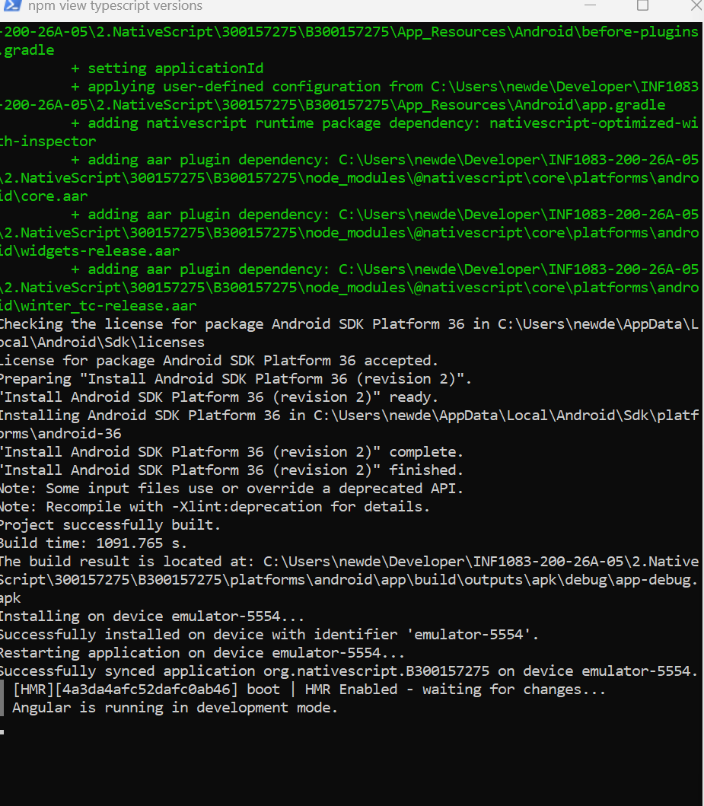
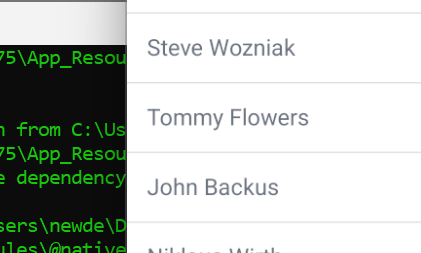
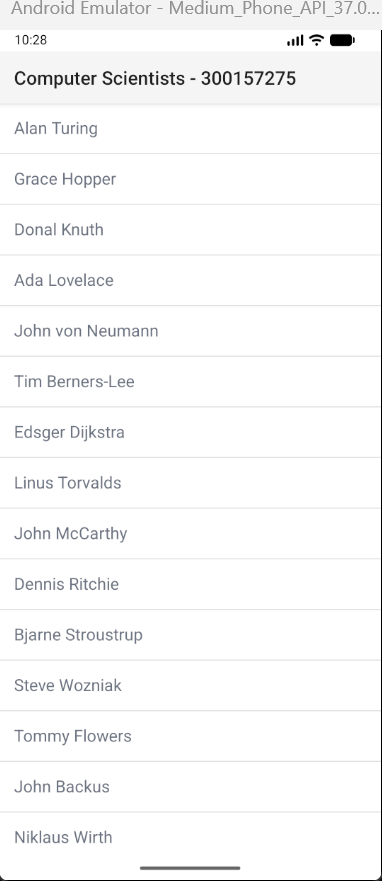

# TP 2 — NativeScript / Angular

**Étudiant :** Yahia Benkara  
**Numéro étudiant :** 300157275  
**Cours :** INF1083 — Développement d'applications  
**Projet :** `B300157275`

## Objectif

Créer et exécuter une application mobile NativeScript avec Angular sur un émulateur Android, puis vérifier la navigation entre une liste de personnalités de l'informatique et leurs fiches détaillées.

## Environnement

- Windows et PowerShell
- Node.js, npm et NativeScript CLI 9.1.2
- Angular et `@nativescript/core` 9.1.4
- Java JDK 17 (Eclipse Temurin)
- Android Studio et Android SDK
- Émulateur `Medium_Phone_API_37.0` (`emulator-5554`)
- Plateforme Android NativeScript 9.1.1

## Préparation et exécution

Le projet `B300157275` a été créé avec le modèle Angular de NativeScript. La plateforme Android a ensuite été ajoutée et l'application exécutée sur l'émulateur.

```powershell
ns doctor android
ns platform add android
adb devices
ns run android
```

### Compilation et installation



### Synchronisation de l'application



## Fonctionnalités

L'application présente une liste de **15 personnalités de l'informatique** définies dans `B300157275/src/app/people/person.service.ts`. Chaque entrée permet d'ouvrir une fiche présentant la nationalité et les réalisations de la personne choisie.

Le titre de la liste a été personnalisé dans `B300157275/src/app/people/person.component.html` : **Computer Scientists - 300157275**.

### Première exécution sur l'émulateur



### Liste des informaticiens



### Détails d'Alan Turing

La fiche d'Alan Turing indique sa nationalité britannique et ses contributions au déchiffrement pendant la Seconde Guerre mondiale et aux fondements de l'informatique théorique et de l'intelligence artificielle.


## Résultats

- Vérification de l'environnement avec `ns doctor android`.
- Compilation et installation réussies sur l'émulateur Android.
- Affichage de la liste des 15 personnalités.
- Navigation vers une fiche détaillée vérifiée.
- Personnalisation du titre avec le numéro étudiant.

## Fichiers importants

- `B300157275/src/app/people/person.service.ts` : données des personnalités.
- `B300157275/src/app/people/person.component.html` : affichage de la liste.
- `B300157275/src/app/people/person-detail.component.html` : affichage des détails.
- `B300157275/package.json` : dépendances du projet.

Les dossiers `node_modules` et `platforms`, générés localement, sont exclus du dépôt Git par le fichier `.gitignore`.
