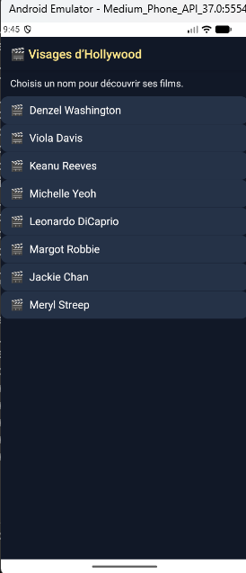
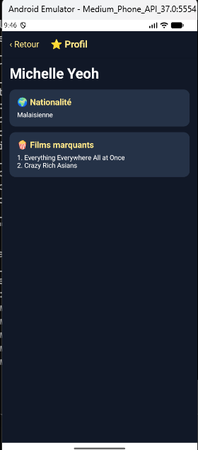

# 🎬 Visages d’Hollywood

**Cours** · INF1083 — Développement d’applications  
**Numéro étudiant** · 300157330  
**Projet** · `B300157330`

## Présentation

Visages d’Hollywood est une application Android créée avec NativeScript et Angular. Elle présente une liste de huit acteurs et actrices. En touchant un nom, on ouvre une fiche qui affiche la nationalité de la personne et deux de ses films marquants.

J’ai personnalisé l’interface avec une palette bleu nuit et or, des emojis sur le thème du cinéma et une transition de 350 ms qui fait glisser la fiche à l’écran.

## Lancer l’application sur Android

Depuis le dossier `B300157330`, avec un émulateur Android déjà démarré, exécuter dans PowerShell :

```powershell
npm.cmd ci
ns.cmd run android
```

## Captures d’écran

### 🎬 Accueil



### ⭐ Fiche de Michelle Yeoh

