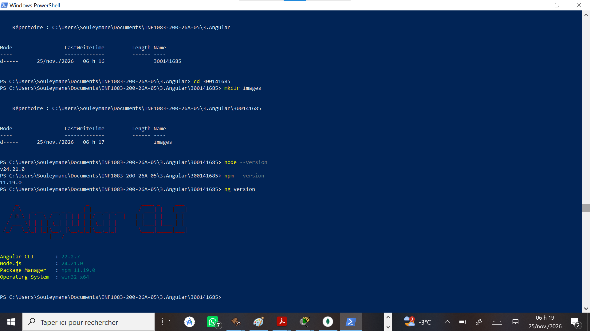
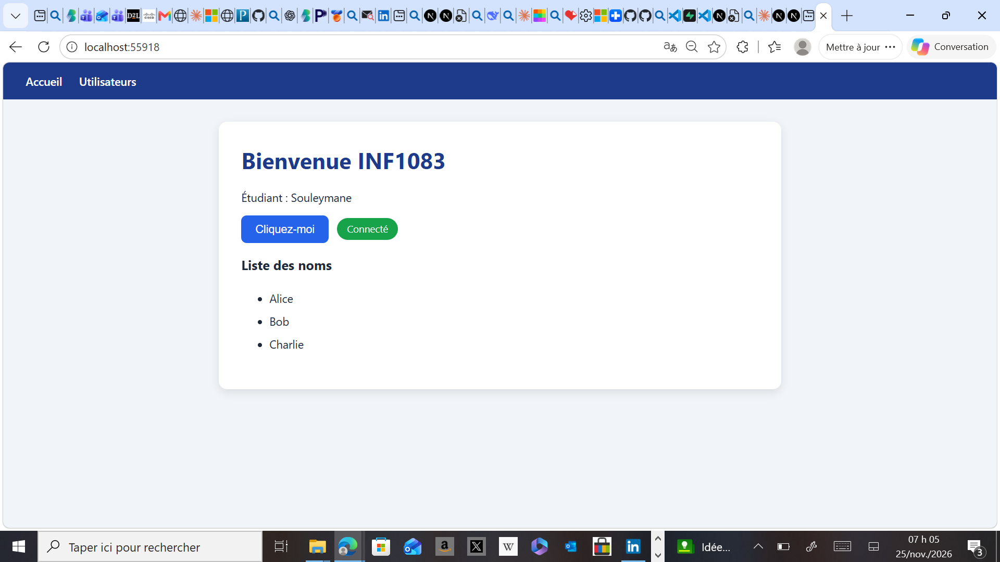
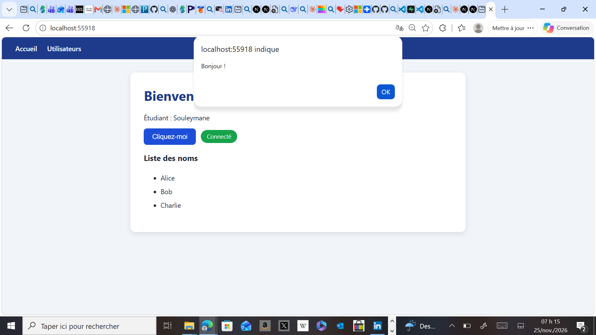
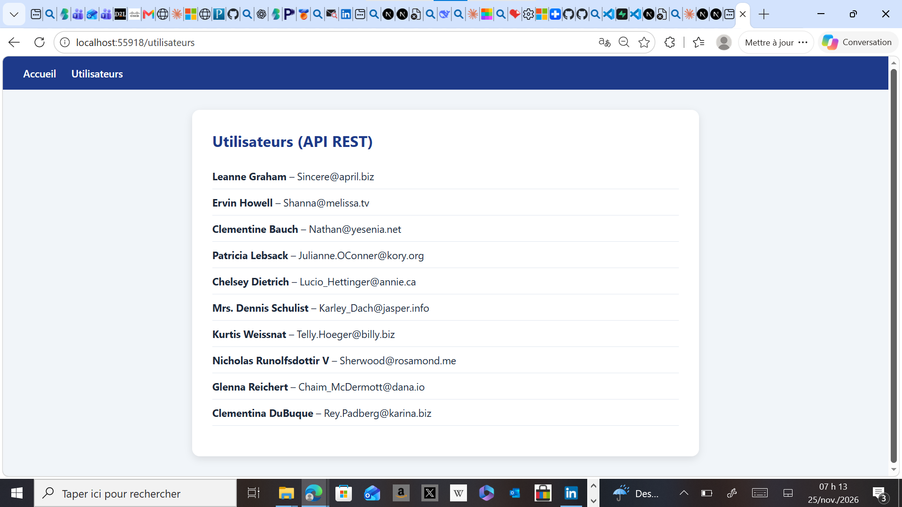

# 🚀 Laboratoire Angular – 300141685

**Nom :** Souleymane Barry
**Numéro étudiant :** 300141685
**Cours :** INF1083 – Collège Boréal
**Projet :** B300141685

## 🎯 Objectif

Créer une application Angular qui utilise des composants, le data binding, les évènements, les directives, le routage et une API REST.

## 📦 Installation

```bash
node --version
npm --version
npm install -g @angular/cli
ng version
ng new B300141685
cd B300141685
ng generate component accueil
ng generate component utilisateurs
ng serve
```



## 🧩 Composants créés

| Composant | Rôle |
|---|---|
| `accueil` | Titre, data binding, bouton (évènement), `@if`, `@for` |
| `utilisateurs` | Consomme l'API REST JSONPlaceholder avec `HttpClient` |

## 🏠 Page d'accueil

Affichage du titre et du nom avec le data binding `{{ }}`, d'un badge « Connecté » avec `@if` et d'une liste avec `@for`.



## 🖱️ Évènement

Le bouton « Cliquez-moi » utilise `(click)="saluer()"` et affiche une alerte.



## 🌐 API REST

La liste des utilisateurs vient de `https://jsonplaceholder.typicode.com/users`.



## 🛣️ Routage

| Route | Composant |
|---|---|
| `/` | Accueil |
| `/utilisateurs` | Utilisateurs |

## 🎨 Style CSS

Menu de navigation bleu, cartes blanches avec ombre, bouton et badge stylisés pour une interface moderne.

## ✅ Ce que j'ai appris

- Le rôle d'Angular et la structure d'un projet
- Installer Angular CLI et créer une application
- Créer des composants avec `ng generate component`
- Utiliser le data binding et les évènements
- Utiliser les directives `@if` et `@for`
- Configurer le routage
- Consommer une API REST avec `HttpClient`