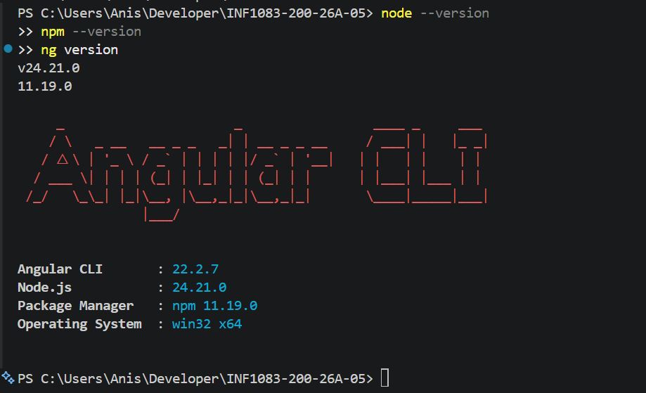
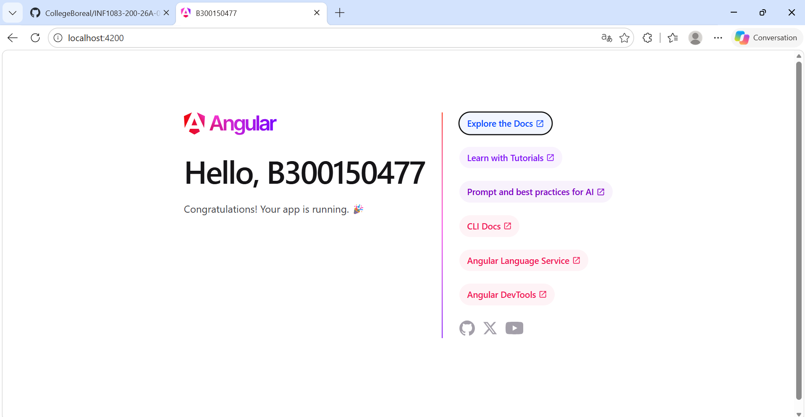
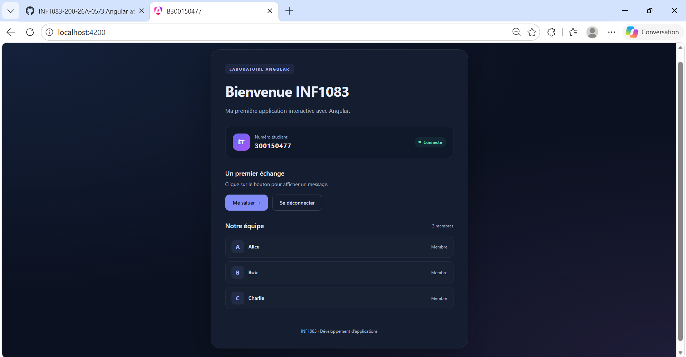
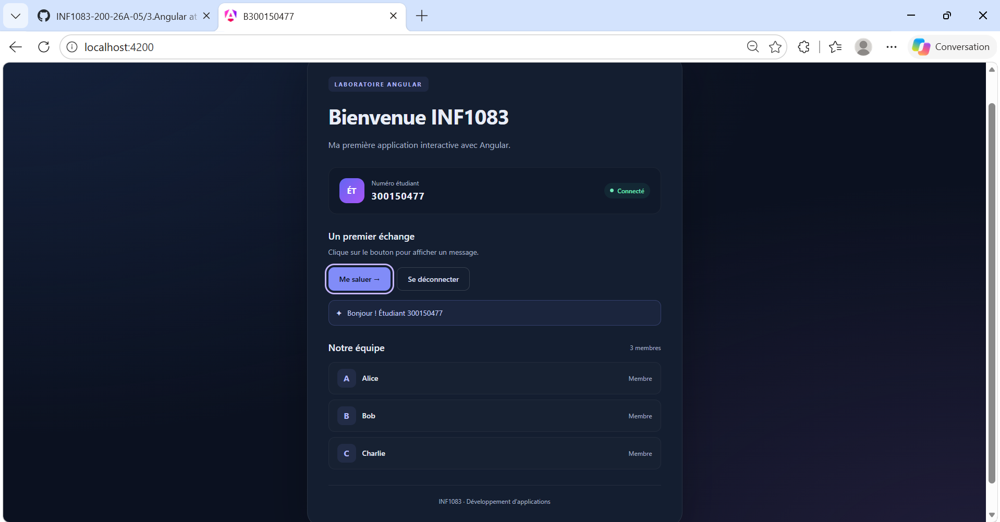
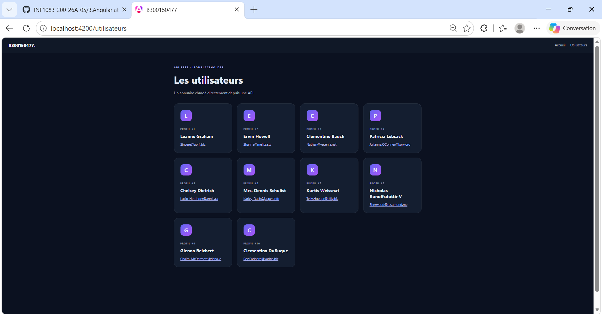
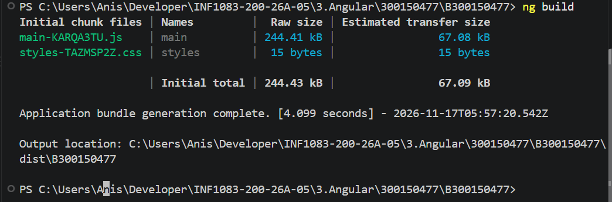

# Laboratoire Angular — 300150477

**Cours :** INF1083-200 — Développement d’applications  
**Numéro étudiant :** 300150477  
**Projet :** B300150477

## Objectif

Créer une application Angular utilisant les composants, le data binding,
les événements, les conditions, les listes, le routage et une API REST.

## Outils utilisés

- Node.js : 24.21.0
- npm : 11.19.0
- Angular CLI : 22.2.7
- Visual Studio Code
- Git et GitHub

## Organisation

```text
300150477/
├── README.md
├── images/
└── B300150477/
    ├── angular.json
    ├── package.json
    ├── package-lock.json
    └── src/
        └── app/
            ├── accueil/
            ├── utilisateurs/
            ├── app.ts
            ├── app.html
            ├── app.css
            ├── app.config.ts
            └── app.routes.ts
```

## Démarrer l’application

Depuis la racine du dépôt du cours :

```bash
cd 3.Angular/300150477/B300150477
npm ci
npx ng serve
```

Ouvrir http://localhost:4200 dans un navigateur.

Pour compiler :

```bash
npx ng build
```

## Composant Accueil

Le composant Accueil affiche le titre et mon numéro étudiant
avec l’interpolation `{{ ... }}`.

Il contient :

- Un bouton qui affiche une salutation grâce à l’événement `(click)`.
- Un bouton qui change l’état de connexion.
- Un affichage conditionnel avec `@if`.
- Une liste de membres affichée avec `@for`.
- Des signals pour mettre à jour l’interface.
- Une présentation adaptée aux petits écrans avec CSS.

## Composant supplémentaire : Utilisateurs

Le composant Utilisateurs récupère des données avec `HttpClient`
depuis l’API :

https://jsonplaceholder.typicode.com/users

Chaque profil affiche le nom et le courriel d’un utilisateur.
Un message apparaît pendant le chargement ou en cas d’erreur.

Cette fonctionnalité nécessite une connexion Internet.

## Routage

| Route | Composant |
|---|---|
| `/` | Accueil |
| `/utilisateurs` | Utilisateurs |

Le menu utilise `RouterLink` pour naviguer.
`RouterOutlet` affiche le composant correspondant à la route.

## Captures d’écran

### 1. Versions des outils



### 2. Application Angular initiale



### 3. Accueil personnalisé



### 4. Gestion d’un événement

Après un clic sur « Me saluer », un message apparaît.



### 5. Affichage conditionnel

Le bouton de connexion permet d’alterner entre les deux états.


### 6. API REST et composant supplémentaire



### 7. Compilation



## Vérifications

Cocher uniquement après vérification :

- [ ] L’accueil affiche mon numéro étudiant.
- [ ] Le bouton de salutation fonctionne.
- [ ] Le changement de connexion fonctionne.
- [ ] La liste des membres apparaît.
- [ ] La navigation entre les deux pages fonctionne.
- [ ] Les utilisateurs de l’API apparaissent.
- [ ] La compilation réussit avec `ng build`.
- [ ] Toutes les captures s’affichent dans le README.

## Difficulté rencontrée

La page est restée blanche pendant la configuration de l’accueil.
Les fichiers du composant et du routage ont été vérifiés.
L’accueil s’est ensuite affiché correctement.

## Références

- [Consignes du laboratoire](https://github.com/CollegeBoreal/INF1083-200-26A-05/blob/main/3.Angular/README.md)
- [Documentation Angular](https://angular.dev/)
- [API JSONPlaceholder](https://jsonplaceholder.typicode.com/)