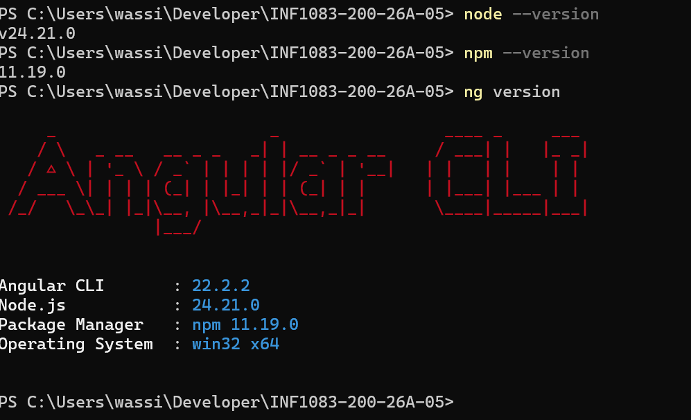
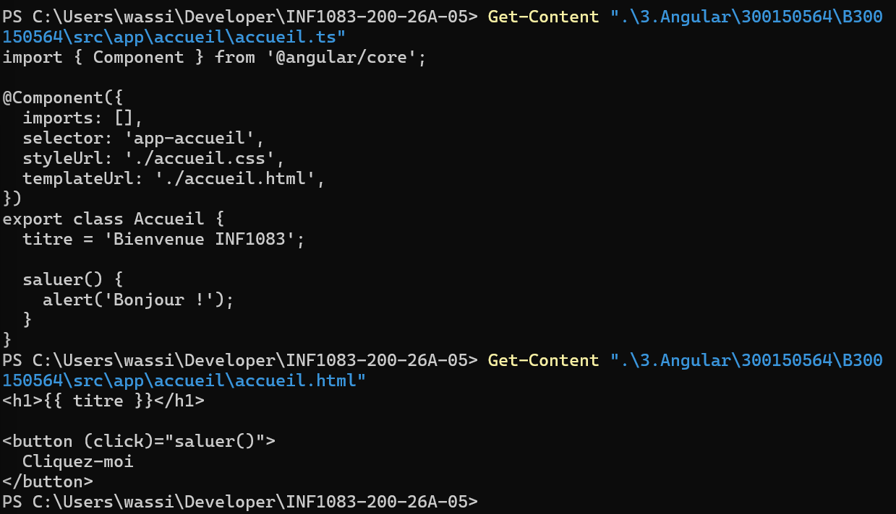
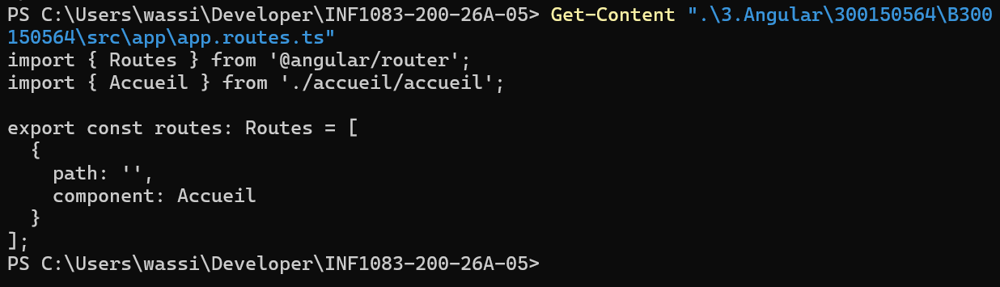
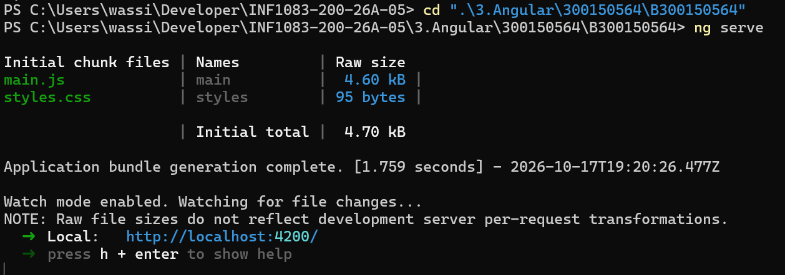
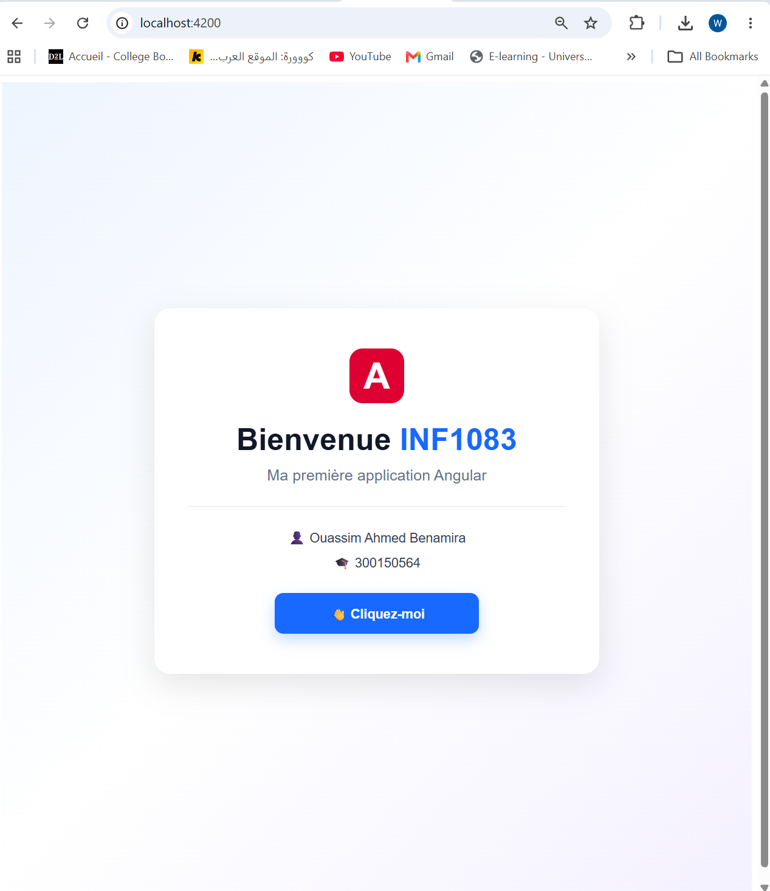
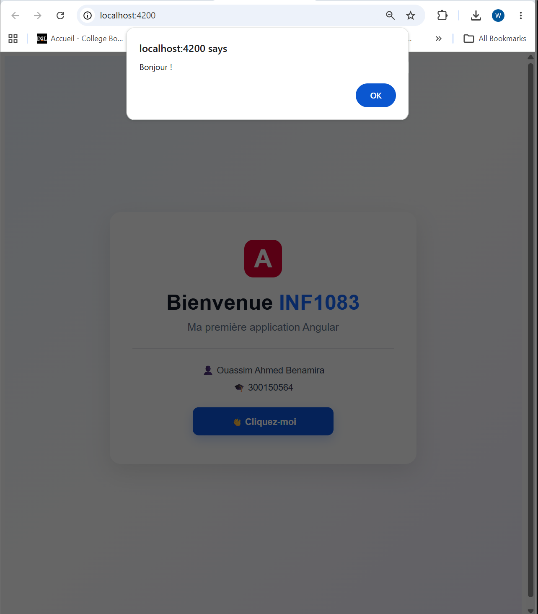

# 🚀 Introduction à Angular — INF1083

**Étudiant :** Ouassim Ahmed Benamira  
**Matricule :** 300150564  
**Programme :** Techniques des systèmes informatiques  
**Cours :** INF1083 — Développement d'applications

---

## 🎯 Objectif

L'objectif de ce laboratoire est de découvrir les bases d'**Angular** et de créer une première application Web.

Dans ce laboratoire, j'ai réalisé :

- la vérification de Node.js, npm et Angular CLI
- la création d'une application Angular
- la création d'un composant `Accueil`
- l'utilisation du Data Binding
- la gestion d'un événement avec un bouton
- la configuration du routage Angular
- la personnalisation de l'interface avec CSS
- l'exécution et le test de l'application avec `ng serve`

Le projet réalisé est :

```text
B300150564
```

---

## 🛠️ 1. Environnement Angular

J'ai vérifié mon environnement de développement avec :

```powershell
node --version
npm --version
ng version
```

Versions utilisées :

- **Node.js :** v24.21.0
- **npm :** 11.19.0
- **Angular CLI :** 22.2.2
- **Système :** Windows 64 bits

<p align="center">
  
</p>

<p align="center">
  <em>Figure 1 — Vérification de l'environnement Angular.</em>
</p>

---

## 🏗️ 2. Création du projet

Dans mon répertoire étudiant `300150564`, j'ai créé l'application avec :

```powershell
ng new B300150564
```

Lors de la création du projet, j'ai utilisé :

- **Routing :** Yes
- **Stylesheet :** CSS

Le projet a été créé dans :

```text
3.Angular/300150564/B300150564
```

Pour entrer dans le projet :

```powershell
cd B300150564
```

---

## 📁 3. Structure du projet

Le projet Angular contient notamment les fichiers principaux suivants :

```text
src/
└── app/
    ├── app.config.ts
    ├── app.css
    ├── app.html
    ├── app.routes.ts
    ├── app.spec.ts
    ├── app.ts
    └── accueil/
        ├── accueil.css
        ├── accueil.html
        ├── accueil.spec.ts
        └── accueil.ts
```

Cette organisation permet de séparer la logique TypeScript, l'interface HTML, le style CSS et la configuration du routage.

---

## 🧩 4. Composant Accueil

Angular utilise des **composants** pour organiser les différentes parties de l'interface.

Dans mon projet, j'ai créé un composant nommé `Accueil`.

Dans `accueil.ts`, le composant est défini avec `@Component` :

```typescript
import { Component } from '@angular/core';

@Component({
  imports: [],
  selector: 'app-accueil',
  styleUrl: './accueil.css',
  templateUrl: './accueil.html',
})
export class Accueil {
  titre = 'Bienvenue INF1083';

  saluer() {
    alert('Bonjour !');
  }
}
```

La variable `titre` contient une donnée utilisée par l'interface et la fonction `saluer()` est exécutée lorsque l'utilisateur clique sur le bouton.

<p align="center">
  
</p>

<p align="center">
  <em>Figure 2 — Création et configuration du composant Accueil.</em>
</p>

---

## 🔄 5. Data Binding

Le **Data Binding** permet de connecter les données TypeScript à l'interface HTML.

Dans le composant, j'ai défini :

```typescript
titre = 'Bienvenue INF1083';
```

Cette valeur peut être affichée dans le HTML grâce à l'interpolation Angular :

```html
{{ titre }}
```

Cela permet à l'interface d'utiliser directement une valeur provenant du code TypeScript.

---

## 🖱️ 6. Gestion d'un événement

J'ai également utilisé un événement Angular avec un bouton.

Dans le HTML :

```html
<button (click)="saluer()">
  👋 Cliquez-moi
</button>
```

L'événement `(click)` appelle la fonction suivante dans le composant :

```typescript
saluer() {
  alert('Bonjour !');
}
```

Lorsque l'utilisateur clique sur le bouton, une boîte de dialogue contenant **Bonjour !** apparaît.

---

## 🛣️ 7. Routage Angular

Le routage permet de déterminer quel composant doit être affiché selon l'adresse utilisée.

Dans `app.routes.ts`, j'ai configuré la route principale :

```typescript
import { Routes } from '@angular/router';
import { Accueil } from './accueil/accueil';

export const routes: Routes = [
  {
    path: '',
    component: Accueil
  }
];
```

La route vide `''` correspond à la page principale de l'application et affiche le composant `Accueil`.

Dans `app.html`, j'utilise :

```html
<router-outlet></router-outlet>
```

`router-outlet` représente l'endroit où Angular affiche le composant correspondant à la route active.

<p align="center">
  
</p>

<p align="center">
  <em>Figure 3 — Configuration du routage Angular.</em>
</p>

---

## 🎨 8. Personnalisation avec CSS

J'ai personnalisé l'interface dans :

```text
src/app/accueil/accueil.css
```

Le CSS permet notamment de définir :

- la disposition de la page avec Flexbox
- un arrière-plan en dégradé
- une carte centrale
- les couleurs et tailles des titres
- un logo Angular personnalisé
- le style du bouton
- une ombre autour de la carte
- un effet au passage de la souris

Par exemple, la carte principale utilise :

```css
.card {
  width: 520px;
  max-width: 85%;
  padding: 55px 45px;
  background: white;
  border-radius: 22px;
  text-align: center;
  box-shadow: 0 15px 45px rgba(0, 0, 0, 0.10);
}
```

Le bouton possède également un effet au passage de la souris :

```css
button:hover {
  background: #0d55db;
  transform: translateY(-2px);
}
```

Cette personnalisation permet d'obtenir une interface plus claire et moderne.

---

## ▶️ 9. Exécution de l'application

Pour démarrer le serveur Angular, j'ai utilisé :

```powershell
ng serve
```

L'application est ensuite accessible à l'adresse :

```text
http://localhost:4200/
```

Angular compile le projet et lance un serveur local permettant de tester l'application dans le navigateur.

<p align="center">
  
</p>

<p align="center">
  <em>Figure 4 — Serveur Angular démarré avec ng serve.</em>
</p>

---

## ✅ 10. Résultat final

L'application affiche une interface personnalisée contenant notamment :

- le titre **Bienvenue INF1083**
- mon nom
- mon matricule
- le bouton **Cliquez-moi**

<p align="center">
  
</p>

<p align="center">
  <em>Figure 5 — Résultat final de l'application Angular.</em>
</p>

### 🖱️ Test du bouton

Lorsque je clique sur **Cliquez-moi**, l'événement `(click)` appelle la fonction `saluer()`.

Le message suivant apparaît :

```text
Bonjour !
```

<p align="center">
  
</p>

<p align="center">
  <em>Figure 6 — Test du bouton et affichage du message Bonjour !</em>
</p>

---

## 📋 Résumé des étapes réalisées

Le projet **B300150564** a été :

- ✅ créé avec `ng new B300150564`
- ✅ configuré avec le routage Angular
- ✅ configuré avec CSS
- ✅ organisé avec un composant `Accueil`
- ✅ configuré avec du Data Binding
- ✅ configuré avec un événement `(click)`
- ✅ configuré avec une route principale
- ✅ personnalisé avec CSS
- ✅ exécuté avec `ng serve`
- ✅ testé dans le navigateur
- ✅ testé avec le bouton **Cliquez-moi**

---

## 📝 Conclusion

Ce laboratoire m'a permis de comprendre les bases d'Angular et le fonctionnement d'une application organisée avec des composants.

J'ai appris à créer un projet Angular, à utiliser un composant, à connecter TypeScript et HTML avec le Data Binding, à gérer un événement, à configurer le routage et à personnaliser l'interface avec CSS.

J'ai également exécuté et testé l'application avec `ng serve` afin de vérifier son fonctionnement dans le navigateur.

---

<p align="center">
  <b>🚀 INF1083 — Angular | 300150564</b>
</p>