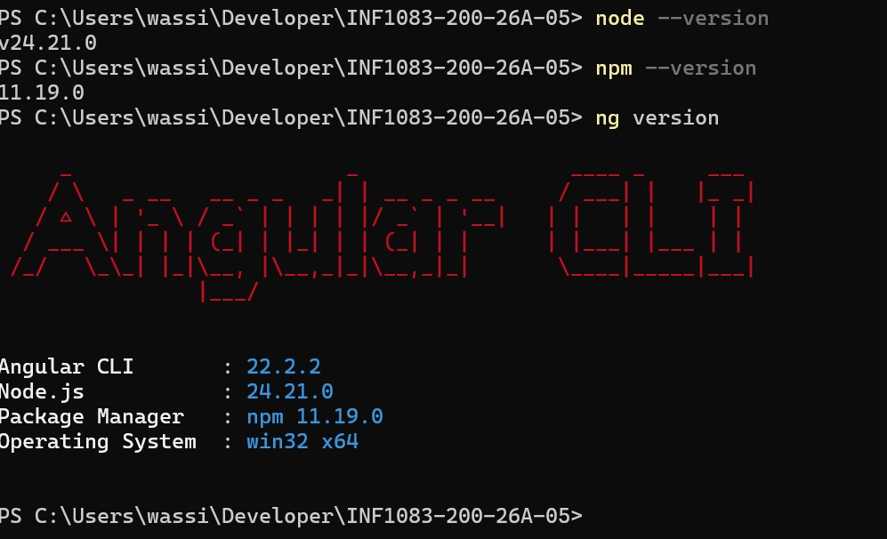
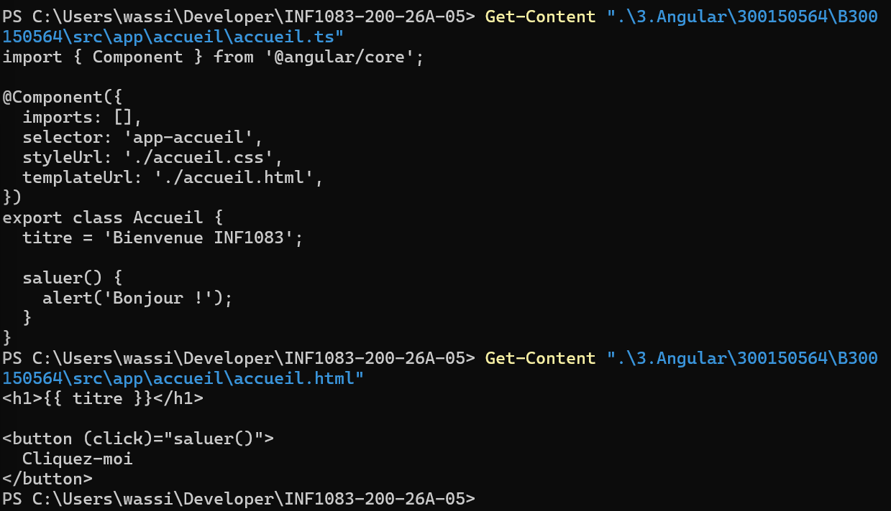
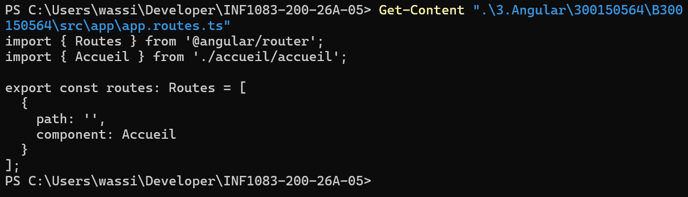
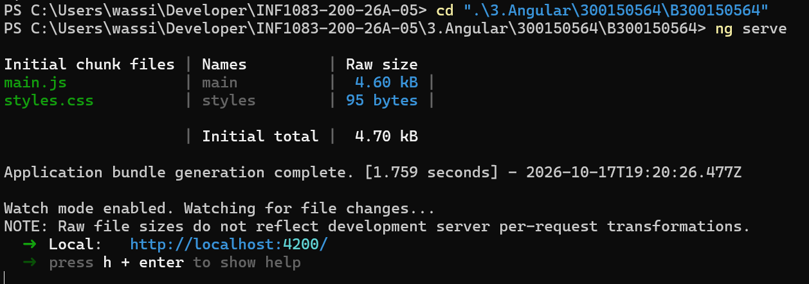
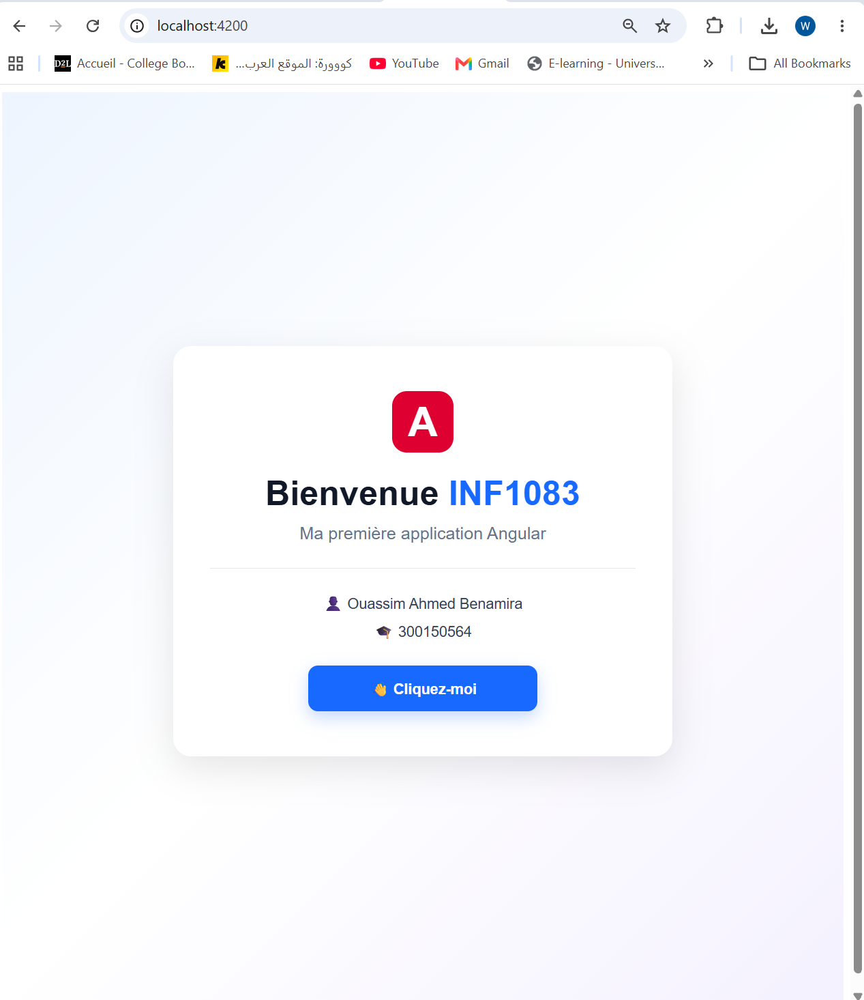
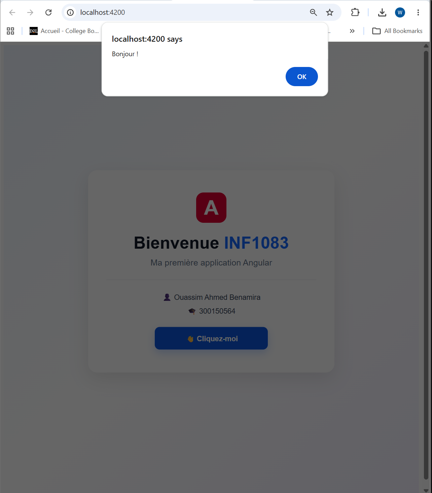

# Introduction à Angular - INF1083

**Étudiant :** Ouassim Ahmed Benamira  
**Matricule :** 300150564  
**Programme :** Techniques des systèmes informatiques

---

## Objectif

L'objectif de ce TP est de découvrir Angular et de créer une première application Web.

Dans ce TP, j'ai réalisé :

- La vérification de Node.js, npm et Angular CLI
- La création d'une application Angular
- La création du composant Accueil
- Le Data Binding
- Un événement avec un bouton
- Le routage Angular
- L'exécution de l'application avec `ng serve`

---

## 1. Environnement Angular

J'ai vérifié les versions avec :

```powershell
node --version
npm --version
ng version
```

Versions utilisées :

- Node.js : v24.21.0
- npm : 11.19.0
- Angular CLI : 22.2.2
- Windows 64 bits



---

## 2. Création du projet

J'ai créé mon application Angular avec :

```powershell
ng new B300150564
```

Le projet utilise le routage Angular et CSS.

---

## 3. Composant Accueil

J'ai créé un composant nommé `accueil`.

Le composant contient :

```typescript
titre = 'Bienvenue INF1083';

saluer() {
  alert('Bonjour !');
}
```

Dans le fichier HTML :

```html
<h1>{{ titre }}</h1>

<button (click)="saluer()">
  Cliquez-moi
</button>
```

Cela permet d'utiliser le Data Binding et un événement `click`.



---

## 4. Routage Angular

J'ai configuré la route principale pour afficher le composant Accueil.

```typescript
export const routes: Routes = [
  {
    path: '',
    component: Accueil
  }
];
```



---

## 5. Exécution de l'application

Pour lancer l'application :

```powershell
ng serve
```

L'application est disponible sur :

```text
http://localhost:4200/
```



---

## 6. Résultat final

L'application affiche le titre **Bienvenue INF1083** et le bouton **Cliquez-moi**.

Quand je clique sur le bouton, la fonction `saluer()` affiche le message `Bonjour !`.



### Test du bouton

Après avoir cliqué sur le bouton **Cliquez-moi**, le message **Bonjour !** s'affiche.



---

## Conclusion

Ce TP m'a permis d'apprendre les bases d'Angular, de créer un composant, d'utiliser le Data Binding, de gérer un événement, de configurer le routage et d'exécuter une application Angular.