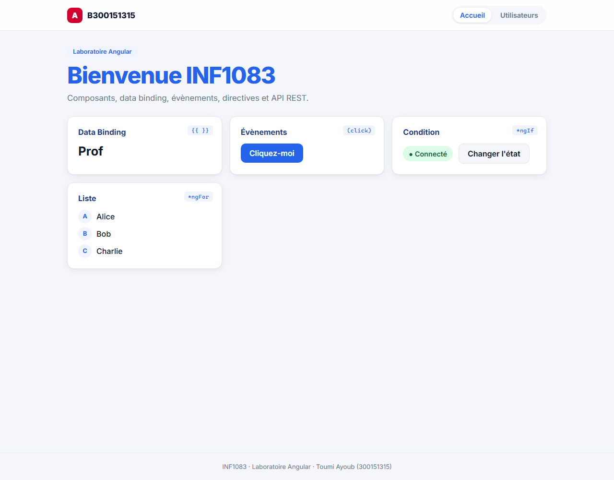
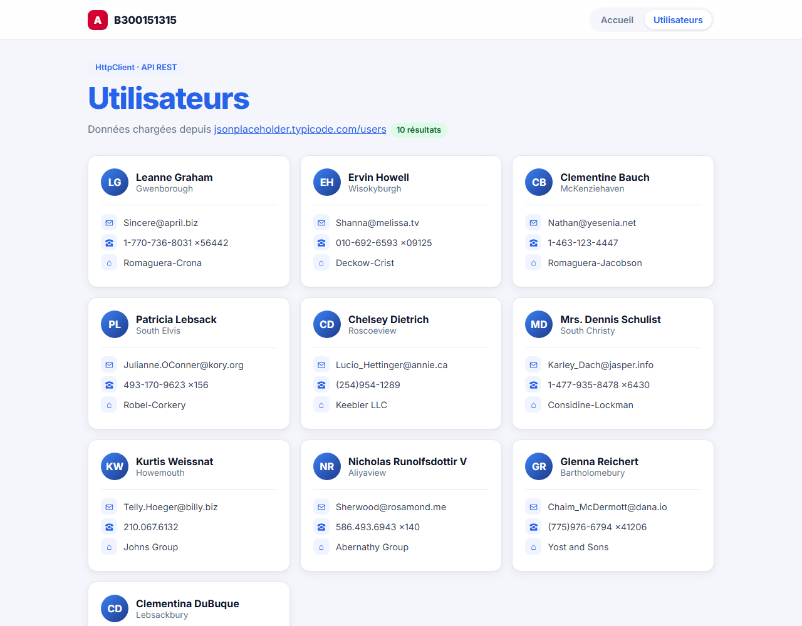

# 300151315 - Angular

Application créée par **Toumi Ayoub**.

## Description
Application Angular `B300151315` avec deux pages :

- **Accueil** : titre, data binding, évènement `(click)`, directives `*ngIf` et `*ngFor`.
- **Utilisateurs** : liste d'utilisateurs chargée depuis l'API REST `https://jsonplaceholder.typicode.com/users` avec `HttpClient`.

Une barre de navigation permet de passer d'une page à l'autre (routage).

## Installation
Node.js et Angular CLI étaient déjà installés sur mon PC, car je les avais utilisés avant ce laboratoire. Je n'ai donc pas eu à refaire l'installation, seulement à vérifier les versions :

```
node --version    # v24.13.0
npm --version
ng version        # Angular CLI 21
```

Pour une première installation, il faudrait faire `choco install nodejs-lts -y` puis `npm install -g @angular/cli`.

## Création du projet
```
ng new B300151315 --routing --style=css
cd B300151315
ng serve
```
Ouvrir : http://localhost:4200

## Composants
```
ng g c accueil
ng g c utilisateurs
```

Depuis Angular 17+, les fichiers générés s'appellent `accueil.ts`, `accueil.html`, `accueil.css` (au lieu de `accueil.component.ts`) et les composants sont *standalone* (pas de `app.module.ts`).

## Fichiers modifiés

| Fichier | Rôle |
|---------|------|
| `src/app/app.routes.ts` | Routes `''` → `Accueil` et `'utilisateurs'` → `Utilisateurs` |
| `src/app/app.config.ts` | Ajout de `provideHttpClient()` pour consommer l'API REST |
| `src/app/app.html` / `app.css` | Barre de navigation (`routerLink`), `<router-outlet>` et pied de page |
| `src/app/accueil/*` | Data binding, évènement, `*ngIf`, `*ngFor`, `h1 { color: blue; }` |
| `src/app/utilisateurs/*` | Appel `this.http.get(...)` et affichage des utilisateurs en cartes |

### Accueil (extrait)
```html
<h1>{{ titre }}</h1>
<p>{{ nom }}</p>
<button (click)="saluer()">Cliquez-moi</button>
<div *ngIf="connecte">Connecté</div>
<ul>
  <li *ngFor="let nom of noms">{{ nom }}</li>
</ul>
```

### Utilisateurs (extrait)
```ts
this.http
  .get<Utilisateur[]>('https://jsonplaceholder.typicode.com/users')
  .subscribe(data => {
    console.log(data);
    this.utilisateurs.set(data);
  });
```

## Captures d'écran

### Page d'accueil


### Page Utilisateurs (API REST)


L'interface est responsive : sur un téléphone, les cartes s'affichent sur une seule colonne.

## Problèmes rencontrés et solutions

| Problème | Solution |
|----------|----------|
| Angular CLI 13 installé globalement ne supporte pas Node 24 | Utilisation de `npx @angular/cli@21 new B300151315` |
| Angular CLI 22 demande Node 24.15+ (installé : 24.13) | Angular 21, compatible avec Node 24.13 |
| Dans l'énoncé, `ngIf` et `ngFor` sans `*` et sans `=` | Syntaxe correcte : `*ngIf="connecte"` et `*ngFor="let nom of noms"` (importer `NgIf`, `NgFor`) |
| La page Utilisateurs restait sur « Chargement… » | Angular 21 fonctionne sans zone.js : utilisation de `signal()` pour mettre à jour l'affichage après l'appel HTTP |
