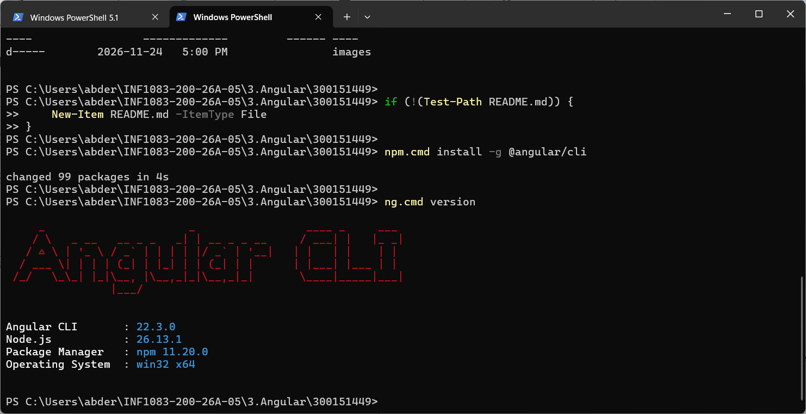
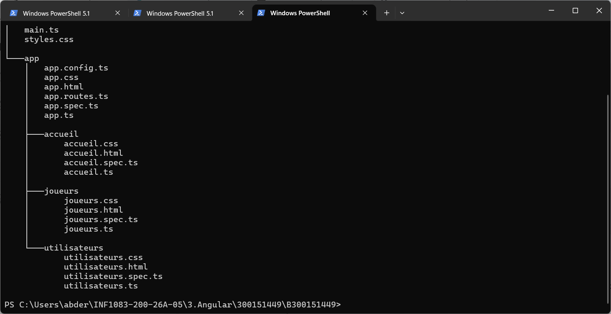
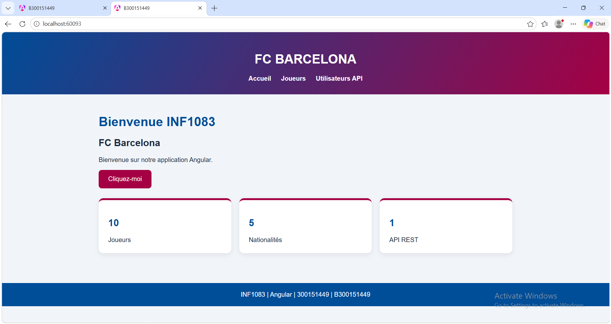
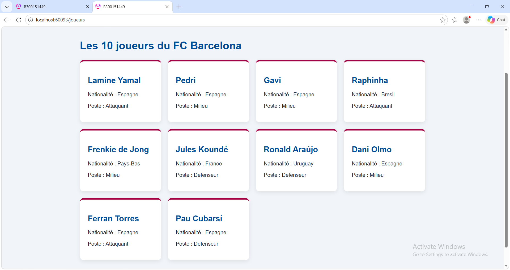
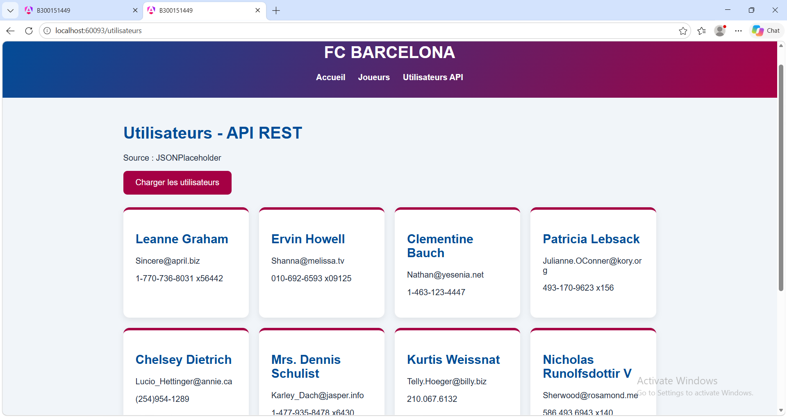

# 3.Angular — FC Barcelona

**Cours :** INF1083-200-26A-05  
**Identifiant :** 300151449  
**Projet :** B300151449

## Objectif

Créer une application web Angular présentant dix joueurs du FC Barcelona, avec navigation, composants réutilisables, data binding, événements, affichage conditionnel et consommation d’une API REST.

## Environnement

Windows x64, Node.js 26.13.1, npm 11.20.0 et Angular CLI 22.3.0.

```powershell
npm.cmd install -g @angular/cli
ng.cmd version
```



## Création et exécution

Depuis le répertoire étudiant `3.Angular/300151449` :

```powershell
ng.cmd new B300151449 --routing --style=css --skip-git --ssr=false --defaults
cd B300151449
ng.cmd generate component accueil
ng.cmd generate component joueurs
ng.cmd generate component utilisateurs
ng.cmd serve --open
```

Le routage est activé et le format CSS est utilisé. Le serveur utilise normalement le port 4200 ; lors de la démonstration, le port 60093 était utilisé.

## Architecture

- [Accueil](B300151449/src/app/accueil/accueil.ts) : titre dynamique et bouton de bienvenue.
- [Joueurs](B300151449/src/app/joueurs/joueurs.ts) : tableau de dix joueurs et affichage avec `@for`.
- [Utilisateurs](B300151449/src/app/utilisateurs/utilisateurs.ts) : récupération des utilisateurs via HttpClient.
- [Routes](B300151449/src/app/app.routes.ts) : navigation entre les trois pages.
- [Configuration](B300151449/src/app/app.config.ts) : fournisseurs du routeur et du client HTTP.
- [Styles](B300151449/src/styles.css) : grille responsive et couleurs du FC Barcelona.



## Data binding et événements

L’interpolation `{{ titre }}` relie les données TypeScript au HTML. Le bouton utilise `(click)="saluer()"` et un signal pour afficher conditionnellement un message avec `@if`. La liste des joueurs utilise `@for` avec une clé de suivi.

## API REST

Le composant Utilisateurs utilise `HttpClient` et la méthode GET sur `https://jsonplaceholder.typicode.com/users`. Le code prévoit l’affichage des noms, courriels et téléphones, ainsi que des états de chargement et d’erreur. La capture ci-dessous confirme le chargement et l’affichage des utilisateurs. Le bouton de bienvenue reste à vérifier séparément.

## Résultats

### Accueil



### Joueurs



Les captures confirment l’affichage de l’accueil et des dix joueurs, ainsi que la navigation vers la route `/joueurs`. La sélection des joueurs est utilisée comme jeu de données pédagogique.

### Utilisateurs — API REST



## Conclusion

Ce laboratoire met en pratique la création de composants Angular, le routage, le data binding, les événements, le contrôle de flux moderne et la conception d’une interface CSS. Il introduit également la consommation d’une API REST.

## Références

- [Angular](https://angular.dev/)
- [JSONPlaceholder](https://jsonplaceholder.typicode.com/)
