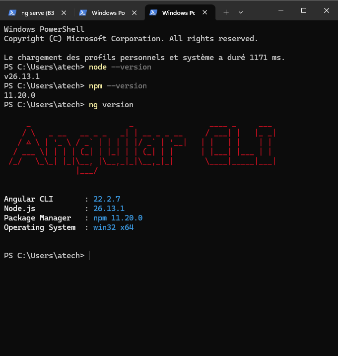
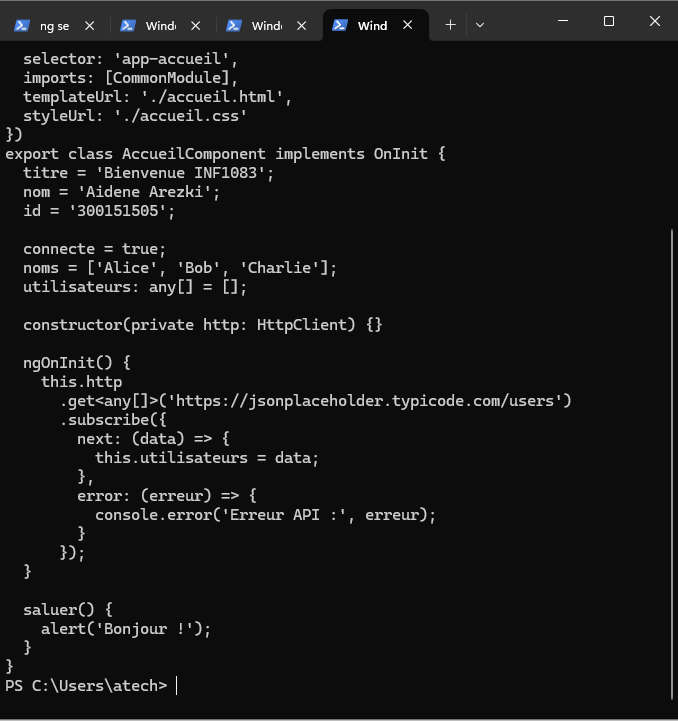
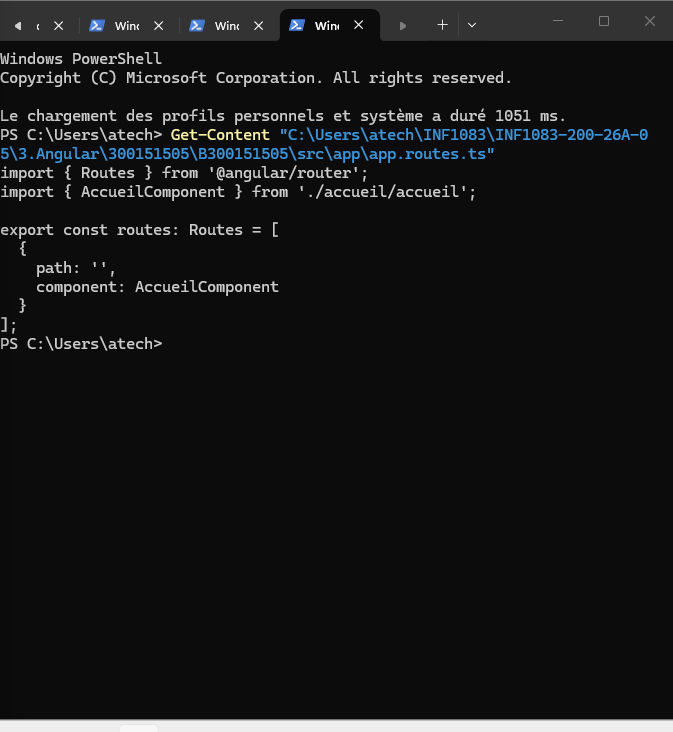
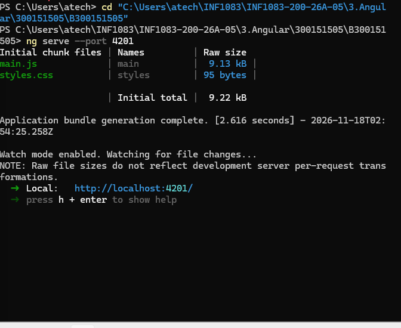
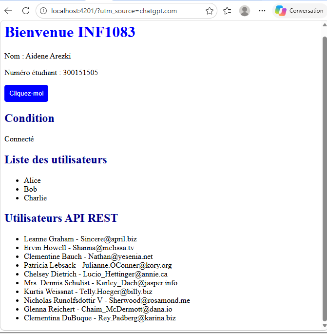
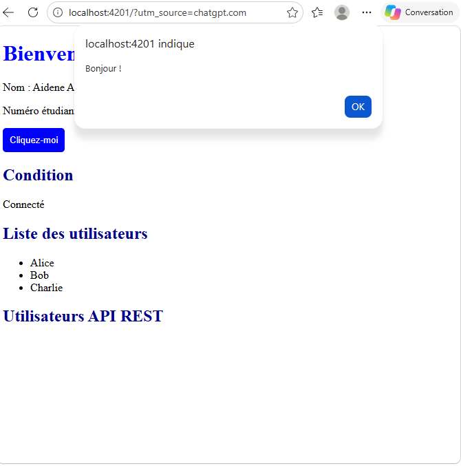

\# 🚀 Laboratoire 3 — Introduction à Angular


\*\*Étudiant :\*\* Aidene Arezki  

\*\*Numéro étudiant :\*\* 300151505  

\*\*Programme :\*\* Techniques des systèmes informatiques  

\*\*Cours :\*\* INF1083 — Développement d'applications


\---


\## 1. Objectif


L'objectif de ce laboratoire est de découvrir Angular et de créer une application Web en utilisant les composants, le Data Binding, les événements, les directives et le routage.


\## 2. Environnement Angular


J'ai utilisé Node.js, npm, Angular CLI et Visual Studio Code pour développer mon application.


Commandes de vérification :


```powershell

node --version

npm --version

ng version

```


\## 3. Création du projet


Mon projet Angular s'appelle `B300151505`.


Pour accéder au projet :


```powershell

cd B300151505

```


\## 4. Composant Accueil


J'ai créé un composant `AccueilComponent` qui contient les informations principales de mon application.


Ce composant affiche mon nom, mon numéro étudiant et un message de bienvenue.


\## 5. Data Binding


J'ai utilisé le Data Binding pour afficher les informations provenant du fichier TypeScript.


```typescript

titre = 'Bienvenue INF1083';

nom = 'Aidene Arezki';

id = '300151505';

```


Dans le HTML :


```html

<h1>{{ titre }}</h1>

<p>Nom : {{ nom }}</p>

<p>Numéro étudiant : {{ id }}</p>

```


\## 6. Gestion des événements


J'ai ajouté un bouton qui exécute une fonction lorsque l'utilisateur clique dessus.


```typescript

saluer() {

&#x20; alert('Bonjour !');

}

```


Dans le HTML :


```html

<button (click)="saluer()">Cliquez-moi</button>

```


\## 7. Directives Angular


J'ai utilisé deux directives Angular :


\- `\*ngIf` pour afficher un message selon une condition.

\- `\*ngFor` pour afficher une liste d'utilisateurs.


La liste contient Alice, Bob et Charlie.


\## 8. Connexion à une API REST


J'ai utilisé `HttpClient` pour récupérer des utilisateurs depuis l'API :


https://jsonplaceholder.typicode.com/users


Les utilisateurs sont affichés avec leur nom et leur adresse courriel.


Le test dans le navigateur a permis de confirmer l'affichage de 10 utilisateurs.


\## 9. Routage Angular


J'ai configuré la route principale dans `app.routes.ts`.


```typescript

import { Routes } from '@angular/router';

import { AccueilComponent } from './accueil/accueil';


export const routes: Routes = \[

&#x20; {

&#x20;   path: '',

&#x20;   component: AccueilComponent

&#x20; }

];

```


Cette configuration permet d'afficher le composant Accueil sur la page principale.


\## 10. Personnalisation CSS


J'ai utilisé le CSS pour modifier l'apparence de mon application, notamment les couleurs des titres et le bouton.


\## 11. Exécution de l'application


Pour lancer mon application :


```powershell

ng serve

```


L'application est accessible à l'adresse :


http://localhost:4200/


J'ai également vérifié la compilation avec :


```powershell

ng build

```


La compilation s'est terminée sans erreur.


\## 12. Résultat final


L'application affiche :


\- Le titre « Bienvenue INF1083 »

\- Mon nom et mon numéro étudiant

\- Un bouton « Cliquez-moi »

\- Le message « Connecté »

\- Une liste de trois utilisateurs

\- Dix utilisateurs provenant de l'API REST


\### Capture de l'application


!\[Application Angular](images/application-angular.png)


\## 13. Conclusion


Ce laboratoire m'a permis de découvrir Angular et de comprendre le fonctionnement des composants, du Data Binding, des directives et du routage.


J'ai également appris à récupérer des données depuis une API REST et à les afficher dans une application Web.


\---


**INF1083 – Laboratoire Angular – Aidene Arezki – 300151505**
## Captures d'écran du laboratoire

### Figure 1 — Environnement Angular


### Figure 2 — Composant Accueil


### Figure 3 — Routage Angular


### Figure 4 — Serveur Angular


### Figure 5 — Application Angular finale


### Figure 6 — Test du bouton Bonjour


