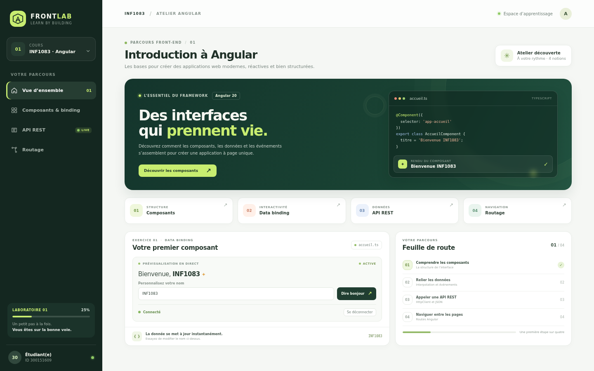

# 300151609

<div align="center">

# 🅰️ Introduction à Angular

**Laboratoire pratique : application monopage (SPA) interactive, responsive et structurée en composants**


</div>

---

| | |
|---|---|
| **Étudiant(e)** | 300151609 |
| **Projet Angular** | `B300151609` |
| **Dossier du dépôt** | `3.Angular/300151609` |

## 📑 Table des matières

1. [Présentation](#-présentation)
2. [Aperçu](#-aperçu)
3. [Objectifs pédagogiques](#-objectifs-pédagogiques)
4. [Fonctionnalités et routes](#-fonctionnalités-et-routes)
5. [Architecture du dépôt](#-architecture-du-dépôt)
6. [Choix d'implémentation](#-choix-dimplémentation)
7. [Technologies](#-technologies)
8. [Installation et exécution](#-installation-et-exécution)
9. [Détails de l'API](#-détails-de-lapi)

---

## 📖 Présentation

Ce projet met en pratique les notions fondamentales d'Angular :

- architecture par **composants** ;
- liaison entre **TypeScript et HTML** (data binding) ;
- gestion des **événements** ;
- **routage** côté client ;
- consommation d'une **API REST**.

L'interface est entièrement **en français** et conçue pour les **écrans de bureau** comme pour les **appareils mobiles**.

## 🖼️ Aperçu

La capture ci-dessous provient de l'application exécutée localement avec Angular CLI.



## 🎯 Objectifs pédagogiques

- [x] Expliquer le rôle d'Angular dans le développement d'applications web monopages (SPA).
- [x] Créer un projet Angular et le lancer avec Angular CLI.
- [x] Organiser une interface en composants autonomes.
- [x] Utiliser l'interpolation, la liaison de formulaire et les événements.
- [x] Afficher des conditions et des listes avec le contrôle de flux Angular.
- [x] Configurer la navigation avec Angular Router.
- [x] Envoyer une requête HTTP et présenter des données JSON provenant d'une API REST.

## 🧭 Fonctionnalités et routes

| Route | Page | Notions démontrées |
|---|---|---|
| `/` | Accueil | Interpolation, `[(ngModel)]`, événement `(click)` et affichage conditionnel `@if` |
| `/composants` | Composants & data binding | Composants, interpolation et affichage de listes avec `@for` |
| `/utilisateurs` | API REST | `HttpClient`, service typé, chargement, gestion des erreurs et nouvelle tentative |
| `/routage` | Routage | Configuration des routes, `routerLink` et `router-outlet` |

> 💡 **La page d'accueil est interactive** : modifiez le nom pour voir la liaison de données en direct, utilisez le bouton de salutation et basculez l'état de connexion.

## 🗂️ Architecture du dépôt

```text
300151609/
├── README.md
├── .gitignore
├── images/
│   └── capture-accueil.png
└── B300151609/
    ├── README.md
    ├── angular.json
    ├── package.json
    └── src/
        ├── app/
        │   ├── app.ts
        │   ├── app.config.ts
        │   ├── app.routes.ts
        │   └── pages/
        │       ├── accueil/
        │       ├── concepts/
        │       ├── utilisateurs/
        │       └── routage/
        ├── index.html
        └── styles.css
```

## 🛠️ Choix d'implémentation

| Domaine | Choix |
|---|---|
| **Composants** | Composants autonomes (*standalone*) : chaque page possède son propre template et ses styles. |
| **Routage** | Angular Router, avec les pages configurées dans `src/app/app.routes.ts`. |
| **HTTP** | `provideHttpClient()` est fourni dans `src/app/app.config.ts` ; `UserService` encapsule l'appel à l'API. |
| **Contrôle de flux** | Syntaxe moderne d'Angular dans les templates : `@if`, `@for` et `@empty`. |
| **Styles** | CSS responsive, sans dépendance à une bibliothèque d'interface externe. |

## 🧰 Technologies

- **Angular 20.3** et **Angular CLI**
- **TypeScript**
- **RxJS**
- **HTML** et **CSS**
- **JSONPlaceholder** (API de démonstration)

## 🚀 Installation et exécution

### Prérequis

- [Node.js](https://nodejs.org/) **20.19+** (ou toute version prise en charge par Angular CLI 20)
- **npm**
- Une **connexion Internet** pour charger les utilisateurs depuis JSONPlaceholder

### Démarrer en développement

Depuis le dossier de ce dépôt :

```bash
cd B300151609
npm ci
npm start
```

Ouvrez ensuite [http://localhost:4200](http://localhost:4200).

### Générer un build de production

```bash
cd B300151609
npm run build
```

Le build est généré dans `B300151609/dist/`.

## 🌐 Détails de l'API

La page **API REST** interroge l'endpoint public suivant :

```http
GET https://jsonplaceholder.typicode.com/users?_limit=6
```

- La réponse est **typée** dans `src/app/pages/utilisateurs/user.service.ts`.
- L'interface gère les **états de chargement et d'erreur**, ainsi qu'une **action pour relancer la requête**.
- ⚠️ Une connexion Internet est nécessaire pour cette page.

---

<div align="center">

Réalisé dans le cadre du laboratoire **Introduction à Angular** · Étudiant(e) 300151609

</div>
