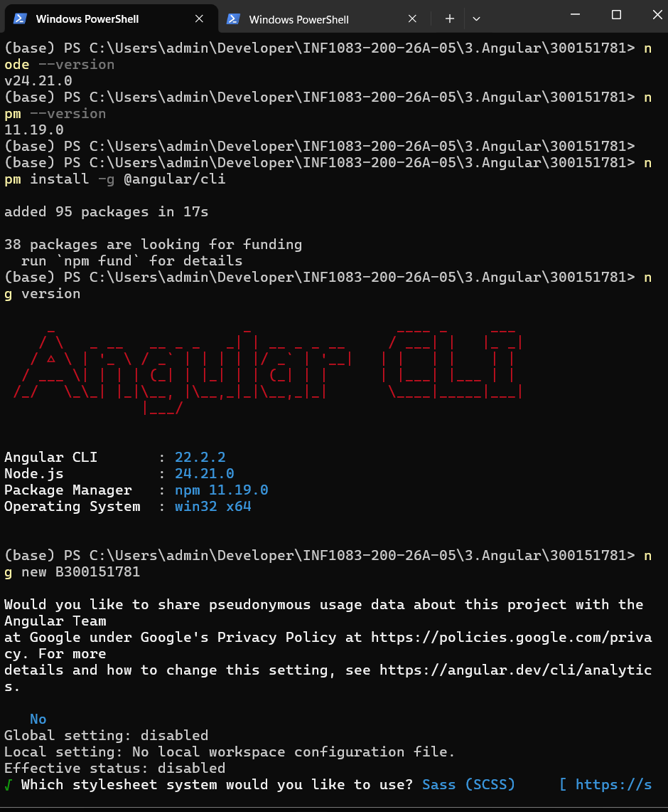
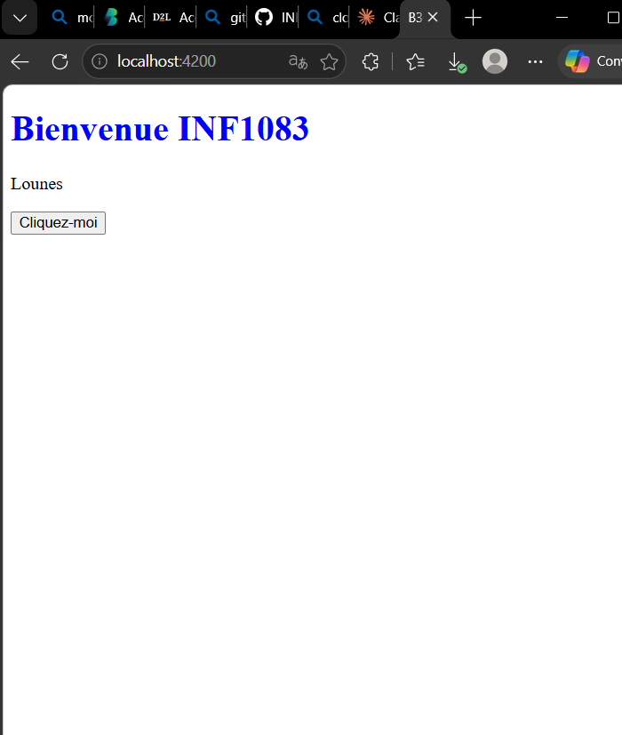
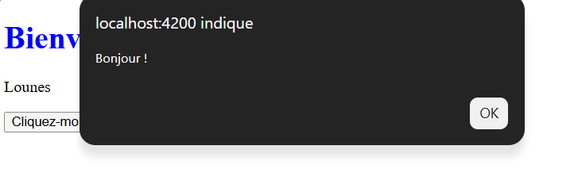
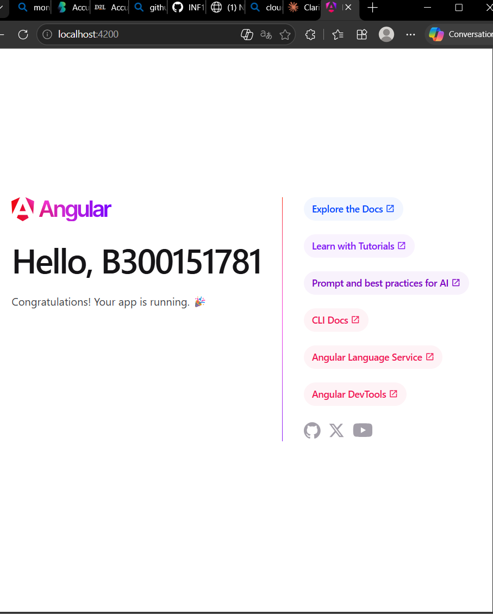
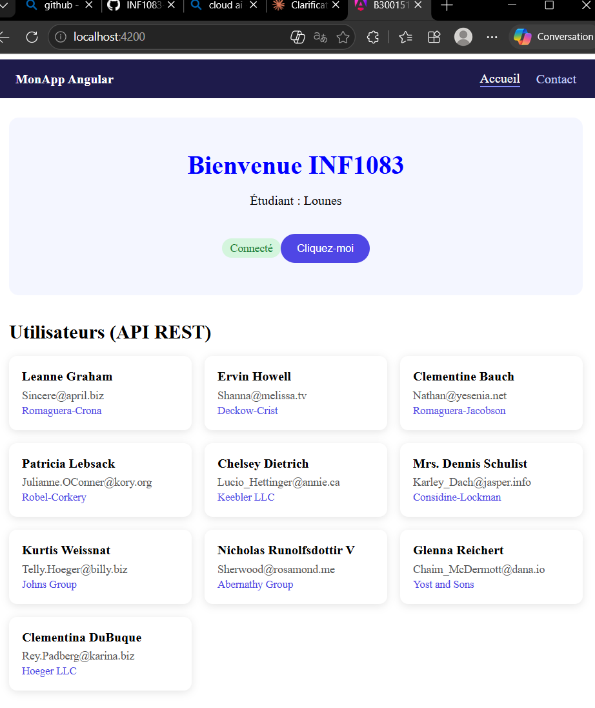

# Introduction à Angular

**Étudiant :** Lounes
**Numéro :** 300151781
**Projet :** B300151781
**Cours :** INF1083

## Objectif

Installer Angular CLI, créer une application, utiliser les composants, le data binding, les directives et consommer une API REST.

## 1. Installation

Vérification de Node.js et npm, puis installation d'Angular CLI :

```powershell
node --version
npm --version
npm install -g @angular/cli
ng version
```

Versions utilisées : Node.js 24.21.0, npm 11.19.0, Angular CLI 22.2.2.

## 2. Création du projet

```powershell
ng new B300151781
cd B300151781
ng serve
```

L'application est disponible sur http://localhost:4200. Le texte affiché vient de la variable `title` du fichier `app.ts`.



## 3. Composant accueil

Création du composant :

```powershell
ng g c accueil
```

`accueil.ts` contient les données et la fonction :

```ts
export class Accueil {
  titre = 'Bienvenue INF1083';
  nom = 'Lounes';

  saluer() {
    alert('Bonjour !');
  }
}
```

`accueil.html` utilise le data binding `{{ }}` et l'événement `(click)` :

```html
<h1>{{ titre }}</h1>
<p>{{ nom }}</p>
<button (click)="saluer()">Cliquez-moi</button>
```

Le composant est importé dans `app.ts` (`imports: [RouterOutlet, Accueil]`) et affiché dans `app.html` avec `<app-accueil />`.



## 4. Directives et style

Condition et liste avec la syntaxe moderne `@if` et `@for` :

```html
@if (connecte) {
  <div>Connecté</div>
}

<ul>
  @for (n of noms; track n) {
    <li>{{ n }}</li>
  }
</ul>
```

Style dans `accueil.scss` :

```scss
h1 {
  color: blue;
}
```



## 5. API REST

Ajout de `provideHttpClient(withFetch())` dans `app.config.ts`, puis appel de l'API avec `HttpClient` dans `accueil.ts` :

```ts
private http = inject(HttpClient);

ngOnInit() {
  this.http
    .get<any[]>('https://jsonplaceholder.typicode.com/users')
    .subscribe((data) => this.users.set(data));
}
```

Affichage dans `accueil.html` :

```html
@for (u of users(); track u.id) {
  <li>{{ u.name }} - {{ u.email }}</li>
}
```



## 6. Routage

Dans `app.routes.ts`, la route vide affiche le composant `Accueil` :

```ts
export const routes: Routes = [
  { path: '', component: Accueil },
];
```

## Difficultés rencontrées

- **`ng` non reconnu** :

## 7. Version améliorée

- Page d'accueil stylée (SCSS) : titre, badge « Connecté » avec `@if`, bouton avec événement `(click)`.
- Liste de 10 utilisateurs récupérés via l'API REST JSONPlaceholder (`HttpClient`, `@for`), affichés en cartes.
- Routage : menu de navigation avec deux pages, Accueil et Contact (`RouterLink`, `RouterOutlet`).


## 7. Version améliorée

- Page d'accueil stylée (SCSS) : titre, badge « Connecté » avec `@if`, bouton avec événement `(click)`.
- Liste de 10 utilisateurs récupérés via l'API REST JSONPlaceholder (`HttpClient`, `@for`), affichés en cartes.
- Routage : menu de navigation avec deux pages, Accueil et Contact (`RouterLink`, `RouterOutlet`).


