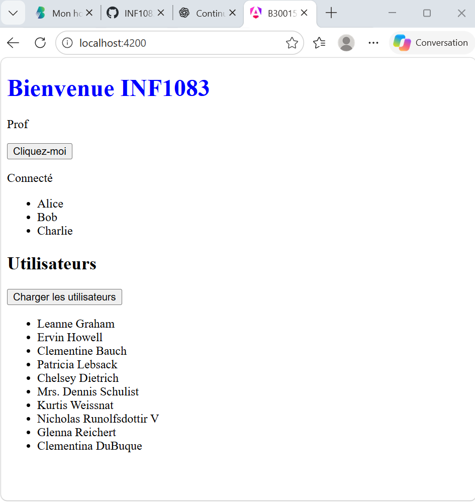

# Introduction à Angular

- Étudiant : Lyes Medjahed
- Numéro étudiant : 300153676
- Cours : INF1083

L’application [B300153676](./B300153676) utilise le routage Angular et des feuilles de style CSS. La page d’accueil affiche un titre avec l’interpolation, un bouton qui déclenche un événement, une condition et une liste. Elle peut aussi charger des utilisateurs à partir de l’API JSONPlaceholder.

## Démarrage

```bash
cd B300153676
npm ci
npm start
```

Ouvrir http://localhost:4200 dans le navigateur.

## Composant Accueil

La route `/` affiche le [composant Accueil](./B300153676/src/app/accueil/accueil.ts). Son [gabarit HTML](./B300153676/src/app/accueil/accueil.html) affiche « Bienvenue INF1083 », puis les noms Alice, Bob et Charlie. Le bouton **Cliquez-moi** ouvre une alerte « Bonjour ! ». Le bouton **Charger les utilisateurs** demande à JSONPlaceholder la liste des utilisateurs et affiche leurs noms.

## Vérification

Depuis le dossier `B300153676`, exécuter ces deux commandes.

```powershell
npm run build
npm test -- --watch=false
```

La compilation a réussi et les deux tests sont passés. Le premier vérifie la création du composant `Accueil`. Le second vérifie que la route `/` affiche « Bienvenue INF1083 ».

## Capture de l’application

Après un clic sur **Charger les utilisateurs**, la page affiche les dix noms reçus de JSONPlaceholder.


