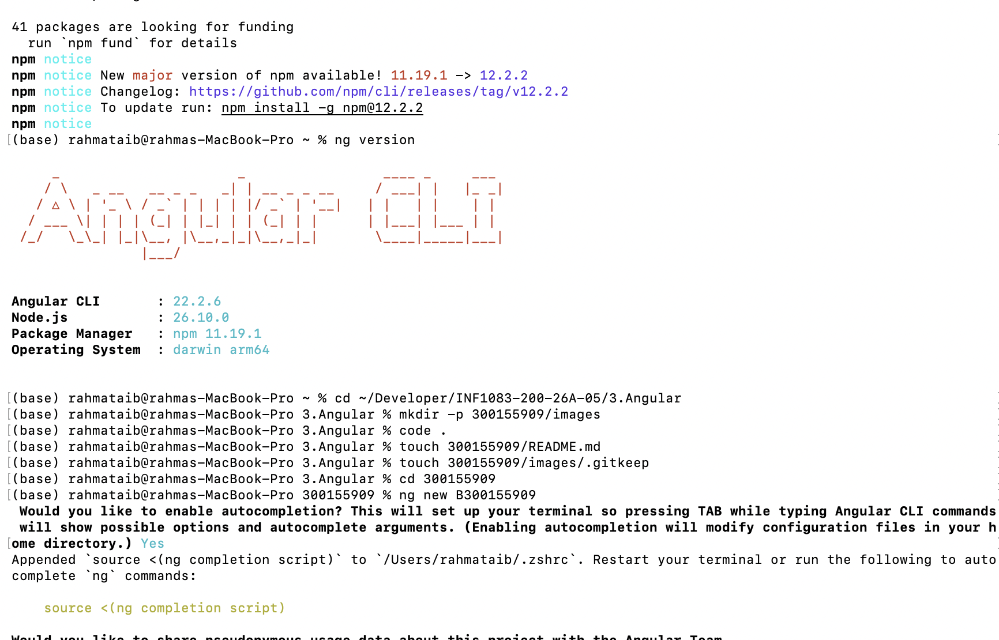
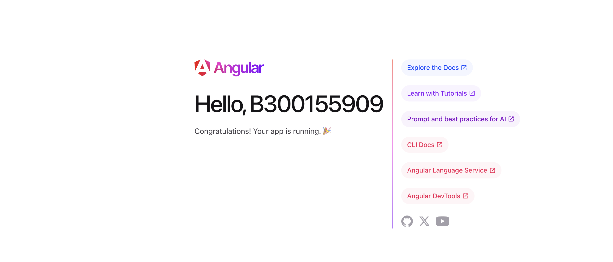
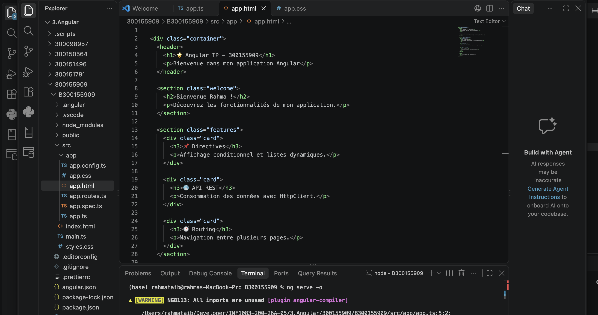
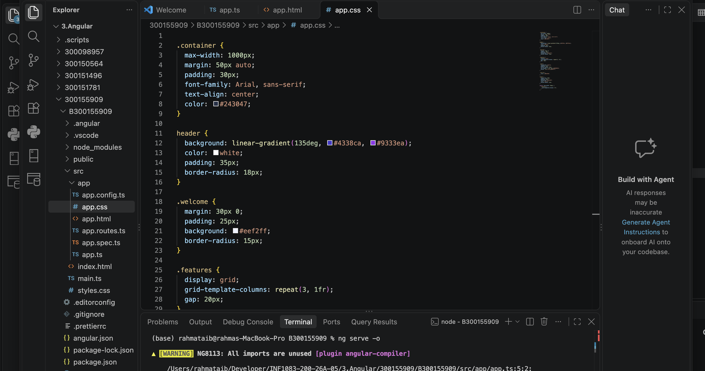
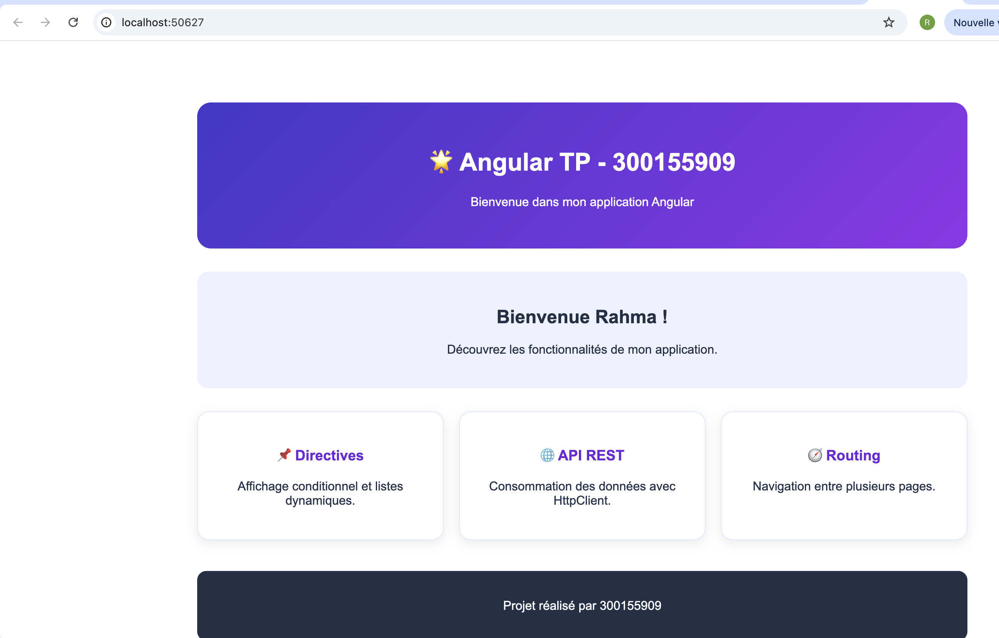

# TP Angular – 300155909

**Étudiante : Rahma**  
**Cours : INF1083**  
**Projet : Introduction à Angular**

## 1. Présentation du projet

Dans ce TP, j'ai réalisé une application web avec Angular. L'objectif est de découvrir les principales fonctionnalités du framework Angular et de créer une interface web simple.

## 2. Installation et configuration

J'ai installé Node.js, npm et Angular CLI. Ensuite, j'ai vérifié les versions et préparé l'environnement de développement.

## 3. Création du projet Angular

J'ai créé un nouveau projet nommé B300155909 et organisé les fichiers du projet.

## 4. Création du composant Accueil

J'ai généré un composant nommé Accueil avec Angular CLI afin de séparer et organiser l'interface de l'application.

## 5. Développement HTML

J'ai utilisé HTML pour créer la structure de la page d'accueil avec un titre, un message de bienvenue et trois sections.

## 6. Mise en forme CSS

J'ai utilisé CSS pour personnaliser l'application avec des couleurs, des cartes, des espacements et une mise en page responsive.

## 7. Résultat final

L'application a été exécutée localement avec la commande `ng serve -o`.

## Conclusion

Ce TP m'a permis de découvrir Angular, de créer un projet, de générer un composant, de travailler avec HTML et CSS et de lancer une application web localement.
