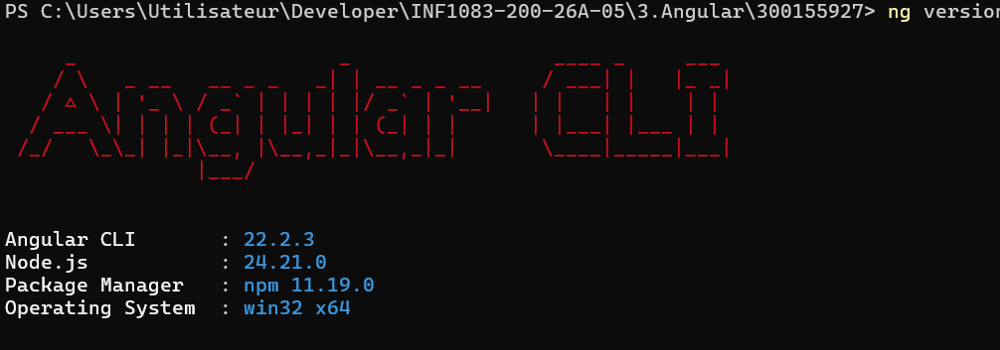
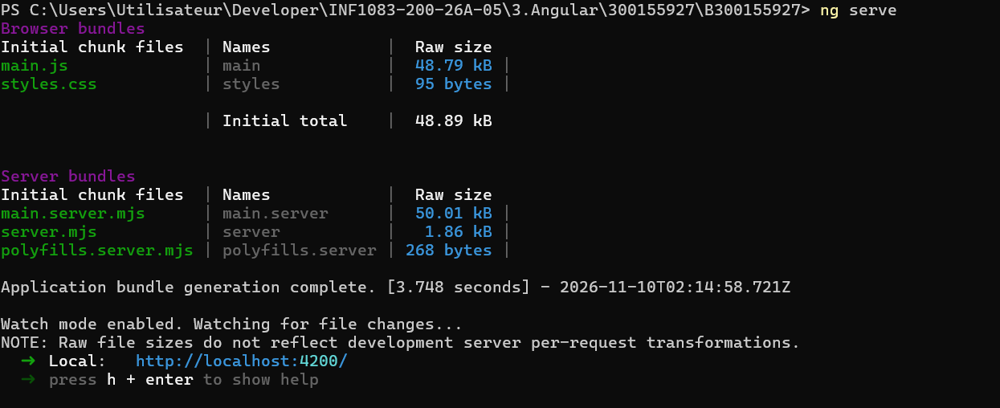
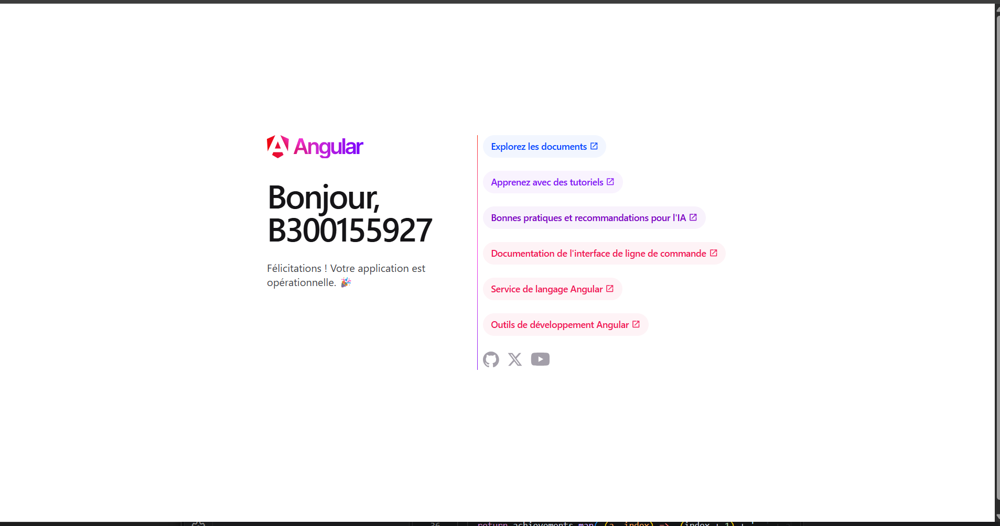
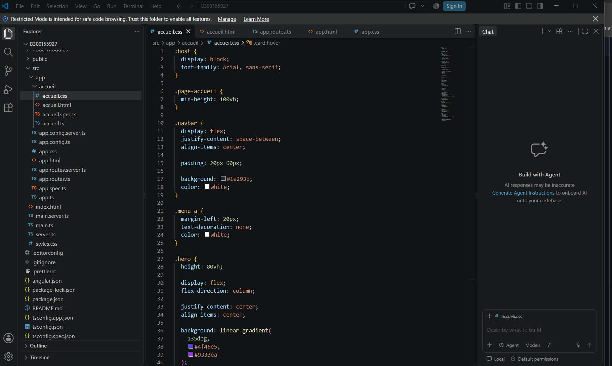
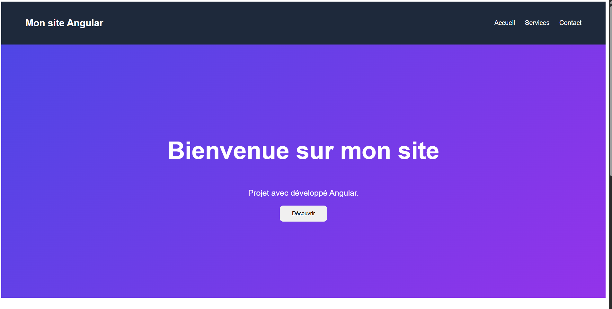
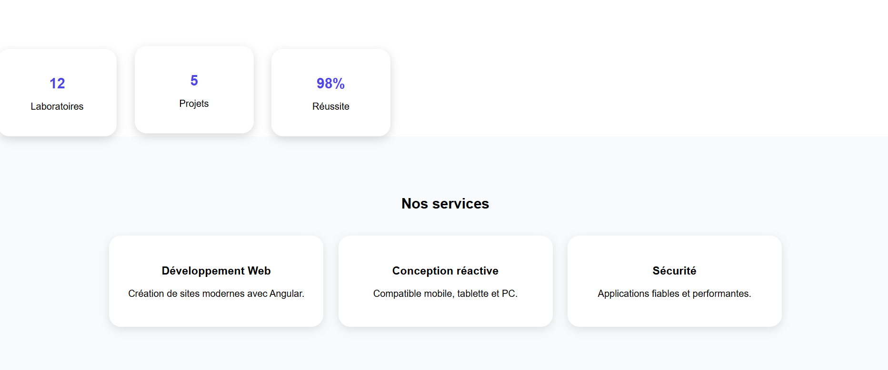

# 300155927

# Projet Angular — B300155927

Documentation des étapes de création et de personnalisation d'une application Angular (cours **INF1083**, dossier `3.Angular`).

## Environnement

| Outil | Version |
|---|---|
| Angular CLI | 22.2.3 |
| Node.js | 24.21.0 |
| npm | 11.19.0 |
| Système | Windows (win32 x64) |
| Nom du projet | `B300155927` |
| Emplacement | `C:\Users\Utilisateur\Developer\INF1083-200-26A-05\3.Angular\300155927\B300155927` |
| Adresse locale | http://localhost:4200/ |

## Étapes

### 1. Vérification des versions

Avant de commencer, on vérifie que Angular CLI et Node.js sont bien installés avec la commande `ng version` dans PowerShell.



Résultat : Angular CLI **22.2.3**, Node.js **24.21.0** et npm **11.19.0**. Tout est prêt.

### 2. Création du projet

Le projet est créé avec Angular CLI :

```powershell
ng new B300155927
```

On entre ensuite dans le dossier du projet :

```powershell
cd B300155927
```

### 3. Lancement du serveur de développement

La commande `ng serve` compile l'application et démarre le serveur local. La compilation réussit et l'application est disponible à l'adresse **http://localhost:4200/**. Le mode *watch* recharge la page automatiquement à chaque modification du code.



### 4. Page par défaut d'Angular

Au premier lancement, Angular affiche sa page de bienvenue : **« Bonjour, B300155927 — Félicitations ! Votre application est opérationnelle. »** Cela confirme que le projet fonctionne avant toute modification.



### 5. Création du composant Accueil

Un composant dédié à la page d'accueil est créé avec Angular CLI :

```powershell
ng generate component accueil
```

Il apparaît dans `src/app/accueil/` avec ses fichiers `accueil.ts`, `accueil.html`, `accueil.css` et `accueil.spec.ts`, et sa route est déclarée dans `app.routes.ts`. Le fichier `accueil.css` contient les styles de la page : barre de navigation sombre (`#1e293b`) en flexbox et section principale (*hero*) avec un dégradé violet (`linear-gradient(135deg, #4f46e5, #9333ea)`).



### 6. Personnalisation de la page d'accueil

La page par défaut est remplacée par une page personnalisée :

- **En-tête** « Mon site Angular » avec un menu de navigation : *Accueil*, *Services*, *Contact*
- **Section principale** sur fond dégradé violet : titre « Bienvenue sur mon site », texte « Projet développé avec Angular » et bouton **Découvrir**



### 7. Statistiques et services

Deux sections sont ajoutées sous la page d'accueil :

- **Statistiques** : 12 Laboratoires, 5 Projets, 98 % Réussite
- **Nos services** :
  - *Développement Web* — Création de sites modernes avec Angular
  - *Conception réactive* — Compatible mobile, tablette et PC
  - *Sécurité* — Applications fiables et performantes



## Commandes utilisées

```powershell
ng version     # vérifier les versions installées
ng new B300155927   # créer le projet
cd B300155927       # entrer dans le dossier
ng serve            # lancer le serveur (http://localhost:4200/)
ng generate component accueil   # créer le composant Accueil
```
