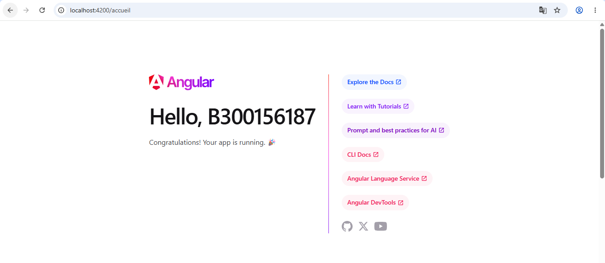
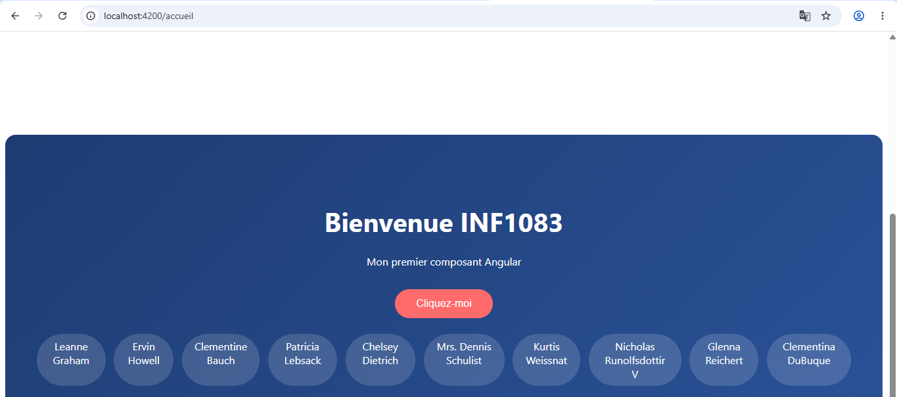

# Labo 3 — Introduction à Angular

**Étudiant :** 300156187
**Cours :** INF1083 — Développement d'application

## Objectif

Découvrir Angular : créer une application, comprendre les composants, le data binding, les événements, les directives, la consommation d'une API REST et le routage.

## Étapes réalisées

1. Installation de Node.js et d'Angular CLI : `npm install -g @angular/cli`
2. Création du projet : `ng new B300156187`
3. Démarrage du serveur : `ng serve` → http://localhost:4200
4. Création du composant accueil : `ng g c accueil`
5. Data binding : affichage de la variable `titre` avec `{{ titre }}`
6. Événement : bouton avec `(click)` qui appelle la méthode `saluer()`
7. Directive : boucle `@for` pour afficher une liste
8. API REST : `HttpClient` pour récupérer les utilisateurs de jsonplaceholder.typicode.com
9. Routage : route `/accueil` avec `<router-outlet>`
10. Style CSS personnalisé

## Résultat

