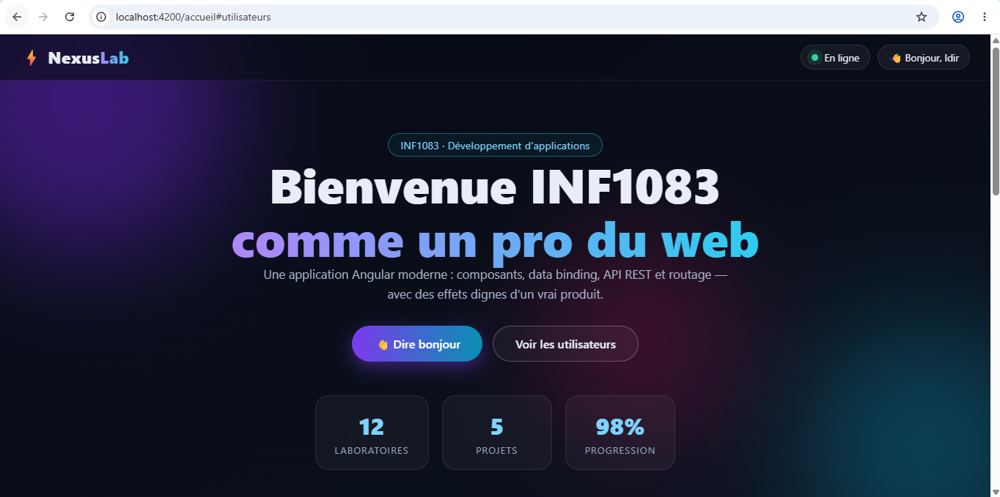
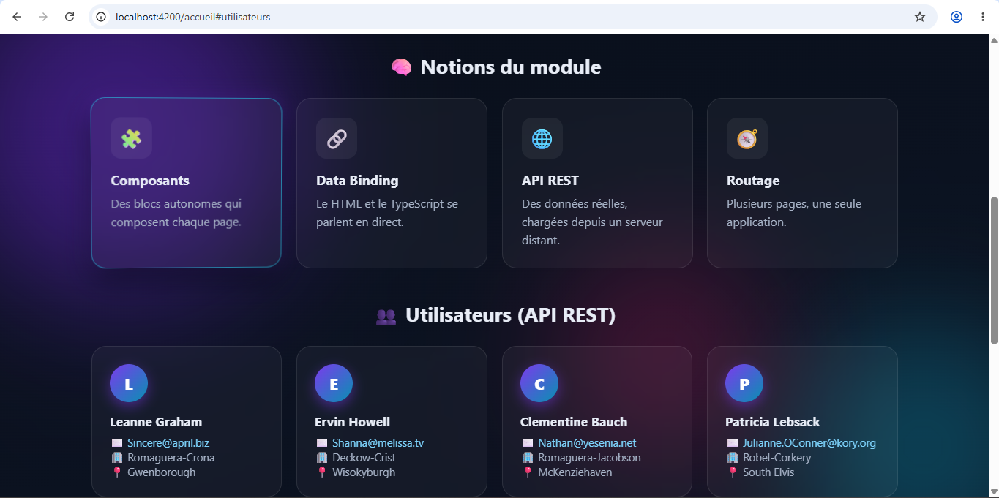
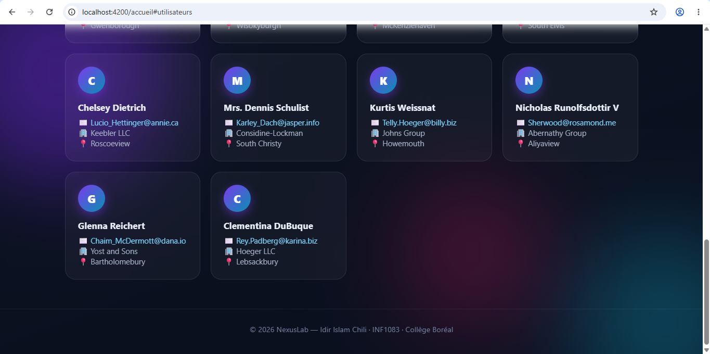

# Labo 3 – Angular (version professionnelle)

## Description
Version améliorée du laboratoire Angular : mêmes fonctionnalités que la
version de base (voir README.md), mais avec une interface entièrement
repensée, sombre et animée, appelée « NexusLab ».

## Changements apportés

### Structure (accueil.html)
- En-tête fixe effet « verre dépoli » (glassmorphism) avec logo, badge « En ligne » animé et salutation
- Section héros : titre affiché par data binding `{{ titre }}`, bouton branché sur l'événement `(click)` vers `saluer()`, statistiques animées
- Section « Notions du module » : cartes générées par un `@for` à partir d'un tableau TypeScript
- Section utilisateurs : cartes complètes (nom, courriel, entreprise, ville) alimentées par l'API jsonplaceholder via HttpClient
- Pied de page
- Nettoyage de `app.html` : suppression du contenu de démonstration d'Angular, il ne reste que le `<router-outlet>`

### Logique (accueil.ts)
- Les utilisateurs sont conservés au complet (avant : seulement les noms)
- Compteurs animés : les statistiques comptent automatiquement de 0 à leur valeur (12 laboratoires, 5 projets, 98 %)
- Méthodes `incliner()` et `redresser()` : calculent l'angle d'inclinaison 3D des cartes selon la position de la souris

### Style et animations (accueil.css)
- Thème sombre avec fond dégradé et halos de couleur animés
- Titre avec dégradé de couleurs animé
- Cartes « notions » avec effet 3D qui suivent la souris (perspective + rotateX/rotateY)
- Cartes utilisateurs qui apparaissent en cascade (délai calculé avec `$index` dans le `@for`)
- Effets de survol : élévation et lueur sur les boutons et les cartes
- Point « En ligne » avec animation de pulsation
- Respect de `prefers-reduced-motion` : les animations se coupent si le système le demande

## Résultat

*Le héros : titre dégradé animé et compteurs automatiques.*

*Les notions du module en cartes 3D et les premiers utilisateurs de l'API.*

*La suite des utilisateurs et le pied de page.*