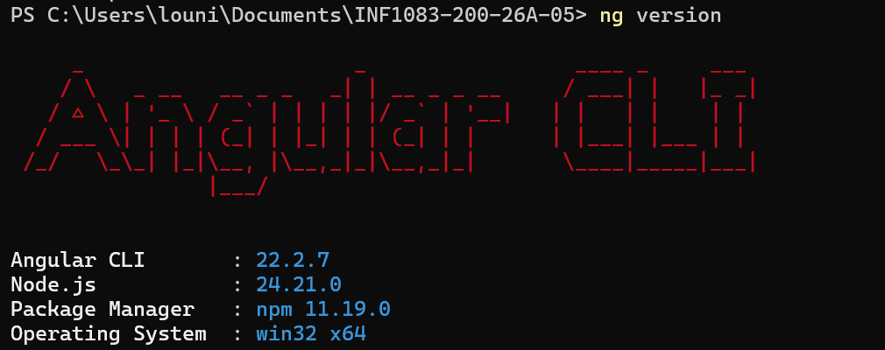
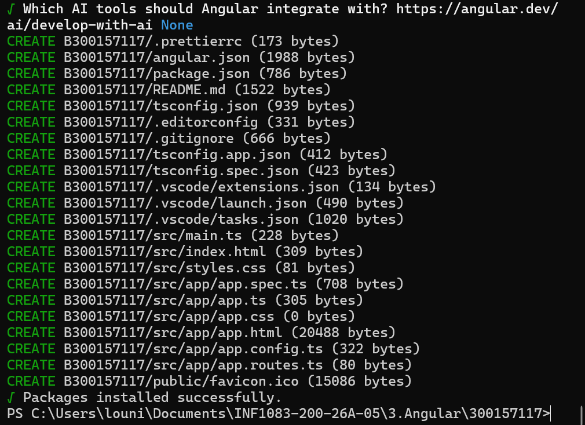
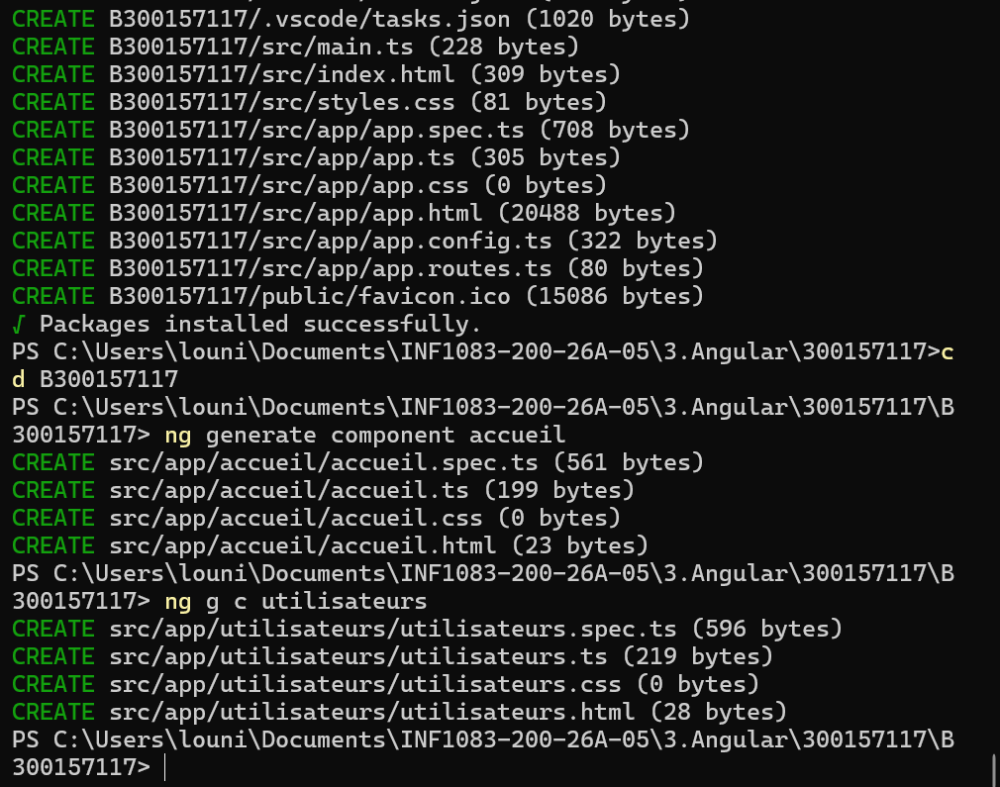
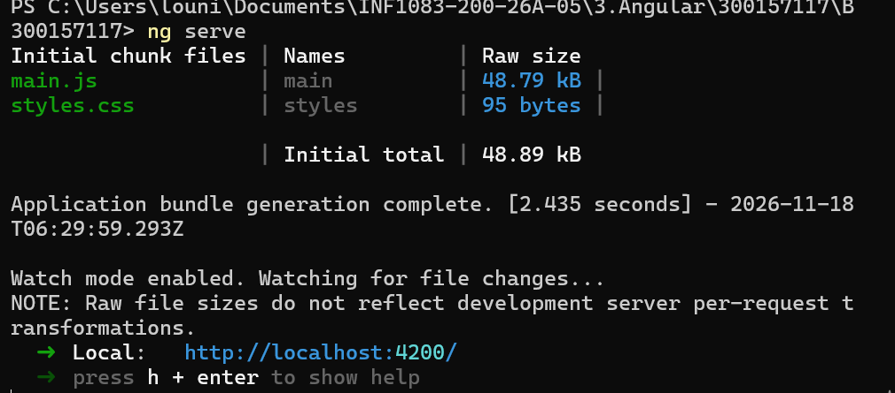
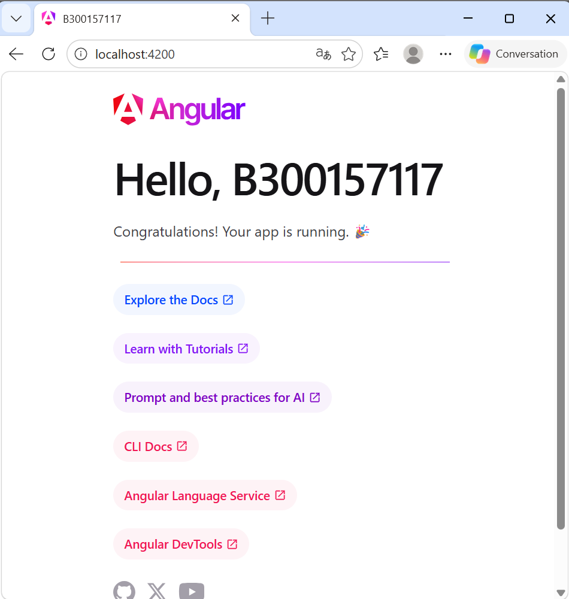
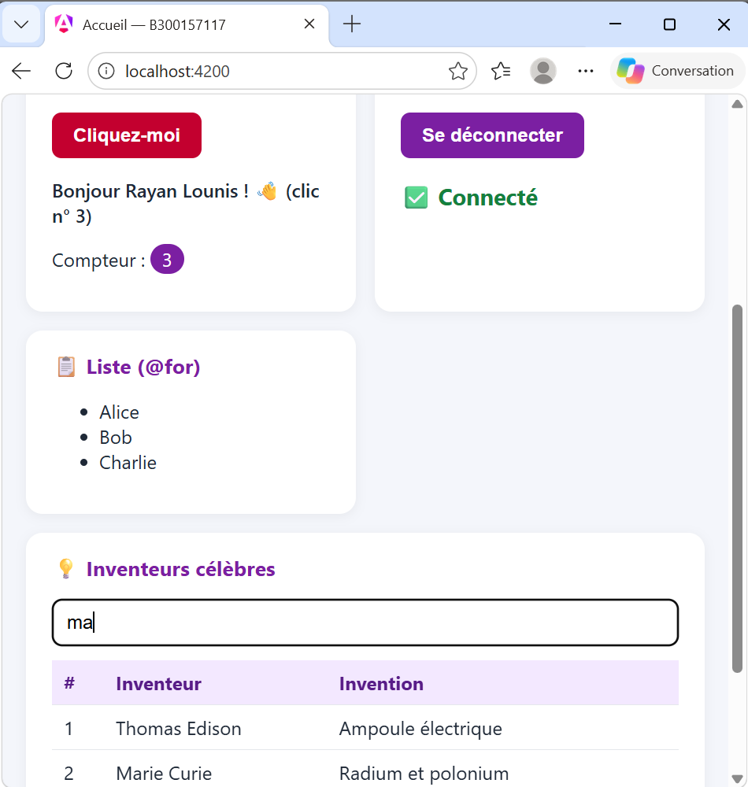
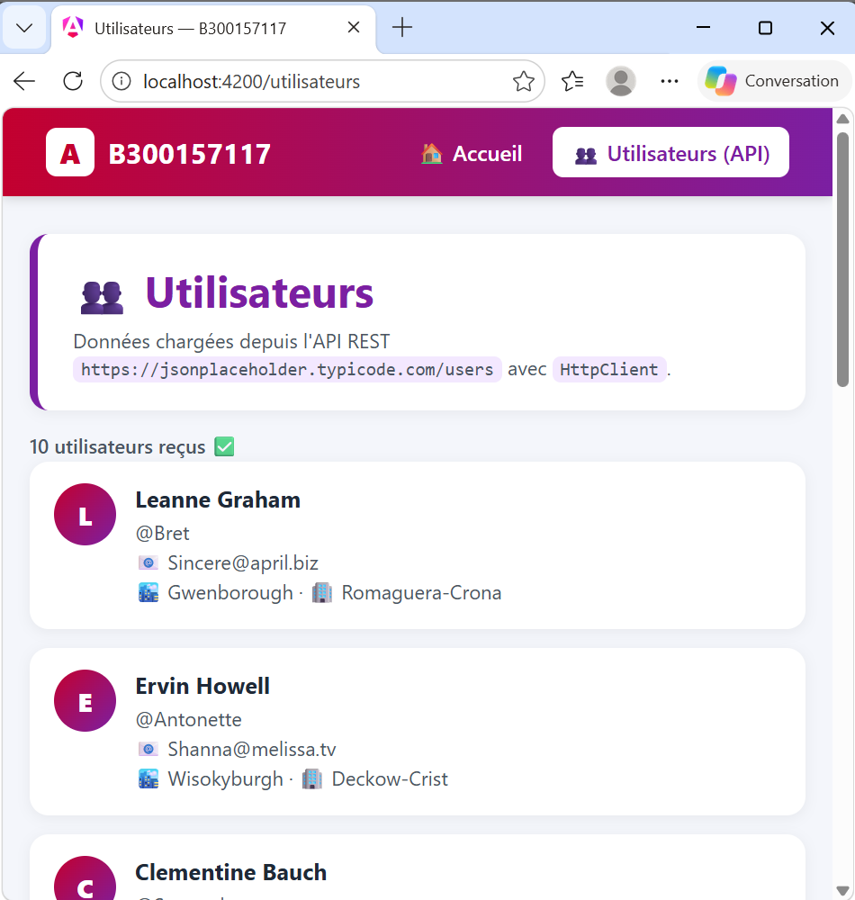

# 🚀 Introduction à Angular — INF1083

**Étudiant :** Rayan Lounis  
**Matricule :** 300157117  
**GitHub :** [lounisrayan](https://github.com/lounisrayan)  
**Cours :** INF1083 — Développement d'applications  
**Session :** Automne 2026  

---

## 🎯 Objectif

Créer une application **Angular** et y mettre en pratique les notions du cours : composants, data binding, évènements, directives (condition et liste), routage, style CSS et consommation d'une **API REST**.

Projet réalisé : **`B300157117`** (Angular 22)

```text
3.Angular/300157117/
├── README.md
├── images/
└── B300157117/
    └── src/
        ├── styles.css                  ← styles globaux
        └── app/
            ├── app.ts / app.html / app.css   ← en-tête + navigation + <router-outlet>
            ├── app.routes.ts                 ← 🛣️ routage
            ├── app.config.ts                 ← provideHttpClient()
            ├── accueil/                      ← 🧩 composant Accueil
            └── utilisateurs/                 ← 🌐 composant Utilisateurs (API REST)
```

---

## ▶️ Exécuter le projet

```powershell
cd 3.Angular\300157117\B300157117
npm install
ng serve
```

Puis ouvrir **http://localhost:4200**.

---

## 📦 1. Installation d'Angular CLI

```powershell
npm install -g @angular/cli
ng version
```



## 🏗️ 2. Création du projet

```powershell
cd 3.Angular\300157117
ng new B300157117 --style=css --ssr=false --skip-git
```

- Feuilles de style : **CSS**
- Partage de statistiques : **No** · Outils IA : **None**



## 🧩 3. Création des composants

```powershell
cd B300157117
ng generate component accueil
ng g c utilisateurs
```



## 🖥️ 4. Démarrage du serveur

```powershell
ng serve
```



Page par défaut générée par Angular :



---

## ✍️ 5. Le code de l'application

### 🛣️ Routage — `app.routes.ts`

```typescript
export const routes: Routes = [
  { path: '', component: Accueil, title: 'Accueil — B300157117' },
  { path: 'utilisateurs', component: Utilisateurs, title: 'Utilisateurs — B300157117' },
  { path: '**', redirectTo: '' }
];
```

La barre de navigation (`app.html`) utilise `routerLink` et `routerLinkActive`, et les pages s'affichent dans `<router-outlet />`.

### 🔄 Data binding — `accueil.ts` / `accueil.html`

```typescript
titre = 'Bienvenue INF1083';
nom = 'Rayan Lounis';
```

```html
<h1>{{ titre }}</h1>
<p>Application Angular de <strong>{{ nom }}</strong></p>
```

### 🖱️ Évènements

```html
<button (click)="saluer()">Cliquez-moi</button>
<p>{{ message() }}</p>
<p>Compteur : {{ compteur() }}</p>
```

```typescript
compteur = signal(0);
message = signal('');

saluer() {
  this.compteur.update((n) => n + 1);
  this.message.set(`Bonjour ${this.nom} ! 👋 (clic n° ${this.compteur()})`);
}
```

> J'ai remplacé `alert()` par un message affiché dans la page : c'est plus agréable et on voit le compteur augmenter.

### 📋 Directive : condition

```html
@if (connecte()) {
  <p>✅ Connecté</p>
} @else {
  <p>⛔ Déconnecté</p>
}
```

> Angular 17+ utilise la nouvelle syntaxe `@if` / `@for` (équivalente à `*ngIf` / `*ngFor`).

### 📋 Directive : liste

```html
<ul>
  @for (nom of noms; track nom) {
    <li>{{ nom }}</li>
  }
</ul>
```

```typescript
noms = ['Alice', 'Bob', 'Charlie'];
```

### 💡 Liste avec recherche (property binding + event binding)

```html
<input [value]="recherche()" (input)="filtrer($event)" placeholder="Rechercher un inventeur…" />

@for (inventeur of inventeursFiltres(); track inventeur.nom; let i = $index) {
  <tr><td>{{ i + 1 }}</td><td>{{ inventeur.nom }}</td><td>{{ inventeur.invention }}</td></tr>
} @empty {
  <tr><td colspan="3">Aucun inventeur trouvé 🔍</td></tr>
}
```

```typescript
inventeursFiltres = computed(() =>
  this.inventeurs().filter((i) =>
    i.nom.toLowerCase().includes(this.recherche().toLowerCase())
  )
);
```

### 🌐 API REST — `utilisateurs.ts`

```typescript
// app.config.ts
provideHttpClient(withFetch())
```

```typescript
private http = inject(HttpClient);

ngOnInit() {
  this.http
    .get<Utilisateur[]>('https://jsonplaceholder.typicode.com/users')
    .subscribe({
      next: (data) => {
        console.log(data);
        this.utilisateurs.set(data);
        this.chargement.set(false);
      },
      error: () => this.erreur.set('Impossible de charger les utilisateurs.'),
    });
}
```

### 🎨 Style CSS — `accueil.css`

```css
h1 {
    color: blue;
}
```

Chaque composant a aussi son propre style (cartes, boutons, tableau) et l'en-tête utilise un dégradé rouge → violet.

---

## ✅ 6. Résultat

### 🏠 Page Accueil

Le bouton **Cliquez-moi** a été cliqué 3 fois, l'état est **Connecté** et la recherche `ma` filtre la liste (Tho**ma**s Edison, **Ma**rie Curie).



### 👥 Page Utilisateurs (API REST)

Navigation vers `/utilisateurs` : **10 utilisateurs reçus** depuis l'API `jsonplaceholder.typicode.com`.



---

## 🧪 Tests

```powershell
ng test --watch=false
```

Les tests unitaires (`app.spec.ts`, `accueil.spec.ts`, `utilisateurs.spec.ts`) ont été adaptés au nouveau code (routeur et `HttpClient` de test) : **4 tests réussis**.

---

## 📋 Notions mises en pratique

| Notion | Où ? |
|---|---|
| 🧩 Composants | `Accueil`, `Utilisateurs`, `App` |
| 🔄 Interpolation `{{ }}` | titre, nom, compteur |
| 🖱️ Évènement `(click)`, `(input)` | bouton, recherche |
| 🔗 Property binding `[value]` | champ de recherche |
| 📋 Condition `@if` / `@else` | Connecté / Déconnecté, chargement |
| 📋 Liste `@for` / `@empty` | noms, inventeurs, utilisateurs |
| ⚡ Signals `signal()`, `computed()` | état de l'application |
| 🛣️ Routage | `app.routes.ts`, `routerLink` |
| 🌐 API REST | `HttpClient.get()` |
| 🎨 CSS | styles par composant |

## 📝 Conclusion

Ce laboratoire m'a permis de créer une application Angular complète, de comprendre le rôle des composants et du data binding, de naviguer entre plusieurs pages avec le routeur et de récupérer des données réelles depuis une API REST avec `HttpClient`.

---

<p align="center"><b>🚀 INF1083 — Angular | 300157117</b></p>
