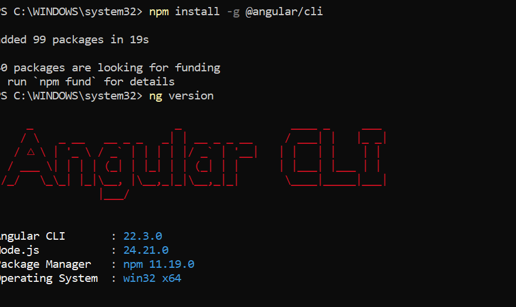
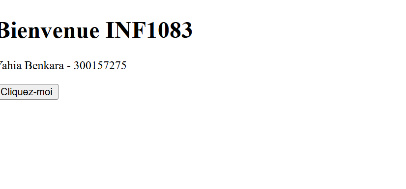
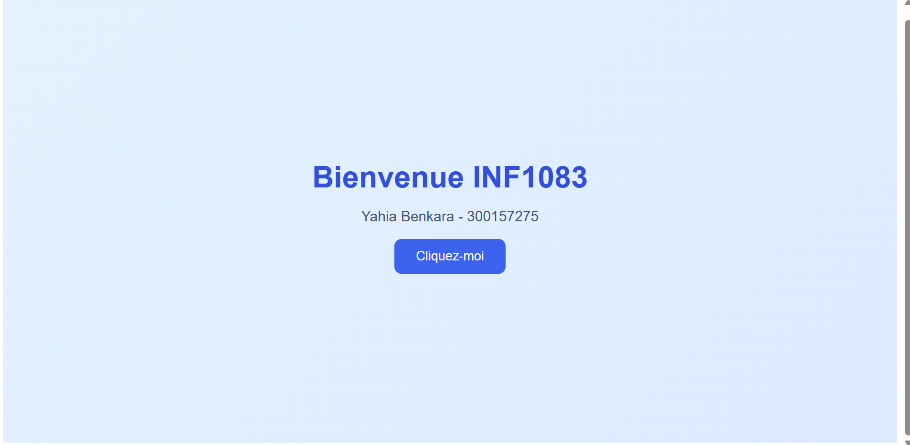
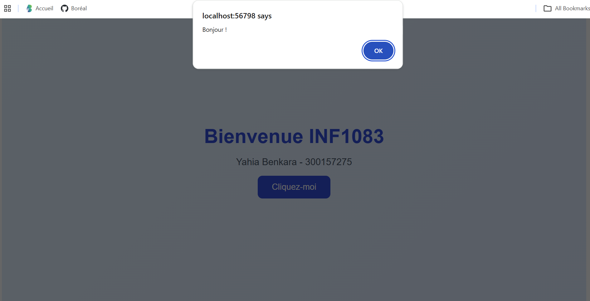

# TP 3 — Introduction à Angular (INF1083)

**Étudiant :** Yahia Benkara  
**Matricule :** 300157275  
**Programme :** Techniques des systèmes informatiques  
**Cours :** INF1083 — Développement d'applications

## Objectif

Créer et tester une application Web Angular, avec un composant `Accueil`, le Data Binding, un événement `(click)`, le routage et une interface CSS personnalisée.

## 1. Environnement de développement

Les commandes `node --version`, `npm --version` et `ng version` permettent de vérifier l'installation.

- Angular CLI : **22.3.0**
- Node.js : **24.21.0**
- npm : **11.19.0**
- Système : **Windows 64 bits**



## 2. Création du projet

Depuis le dossier étudiant `3.Angular/300157275`, création du projet :

```powershell
ng new B300157275 --routing --style=css --skip-git
```

Le projet a été généré avec le routage et les styles CSS. Les options supplémentaires **SSR/SSG** ont été activées lors de la création.

## 3. Composant Accueil

```powershell
cd B300157275
ng generate component accueil
```

Fichiers principaux :

```text
B300157275/
└── src/
    └── app/
        ├── app.ts
        ├── app.html
        ├── app.routes.ts
        └── accueil/
            ├── accueil.ts
            ├── accueil.html
            └── accueil.css
```

Dans `accueil.ts`, la classe expose un titre et une méthode déclenchée par le bouton :

```typescript
export class Accueil {
  titre = 'Bienvenue INF1083';

  saluer() {
    alert('Bonjour !');
  }
}
```

## 4. Data Binding et événement

L'interpolation `{{ titre }}` affiche la valeur TypeScript dans la page. L'événement `(click)` appelle la méthode `saluer()`.

```html
<h1>{{ titre }}</h1>
<p>Yahia Benkara - 300157275</p>
<button (click)="saluer()">Cliquez-moi</button>
```



## 5. Routage Angular

La route principale pointe vers le composant `Accueil` :

```typescript
import { Routes } from '@angular/router';
import { Accueil } from './accueil/accueil';

export const routes: Routes = [{ path: '', component: Accueil }];
```

Le composant racine importe `RouterOutlet` et le modèle `app.html` contient :

```html
<router-outlet></router-outlet>
```

## 6. Personnalisation CSS

Le fichier `accueil.css` définit un arrière-plan bleu clair, un titre bleu, un bouton arrondi et une disposition verticale centrée à l'aide de Flexbox. Le bouton change de couleur au survol.

## 7. Exécution et résultats

Démarrage du serveur de développement :

```powershell
ng serve
```

L'application a été vérifiée dans Chrome sur une adresse locale fournie par Angular. Le titre, le nom, le matricule et le bouton s'affichent correctement.



Le clic sur **Cliquez-moi** affiche la boîte de dialogue **Bonjour !**, confirmant le fonctionnement de l'événement Angular.



## Conclusion

Ce laboratoire m'a permis de créer une application Angular, de générer un composant, d'utiliser le Data Binding et les événements, de configurer le routage et de personnaliser l'interface avec CSS. L'application a été exécutée et testée avec succès dans le navigateur.
