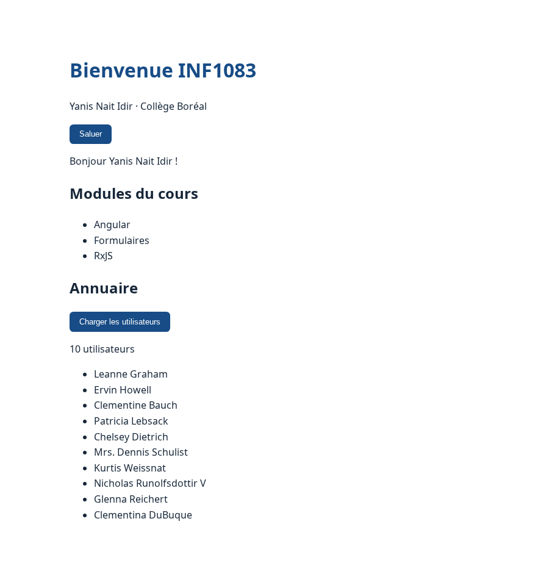

# Accueil Angular

Yanis Nait Idir · INF1083 · 300157374

La route d’accueil affiche le nom, les modules et une salutation interactive. Le bouton de l’annuaire récupère les utilisateurs avec HttpClient.

## Lancement dans PowerShell

Depuis ce dossier étudiant :

```powershell
cd B300157374
npm.cmd install
npm start
```

## Capture du test dans Chromium

Après un clic sur Saluer puis sur Charger les utilisateurs, la page affiche le message personnalisé et les dix entrées du service. Le test a utilisé une copie de la réponse réelle de JSONPlaceholder.


