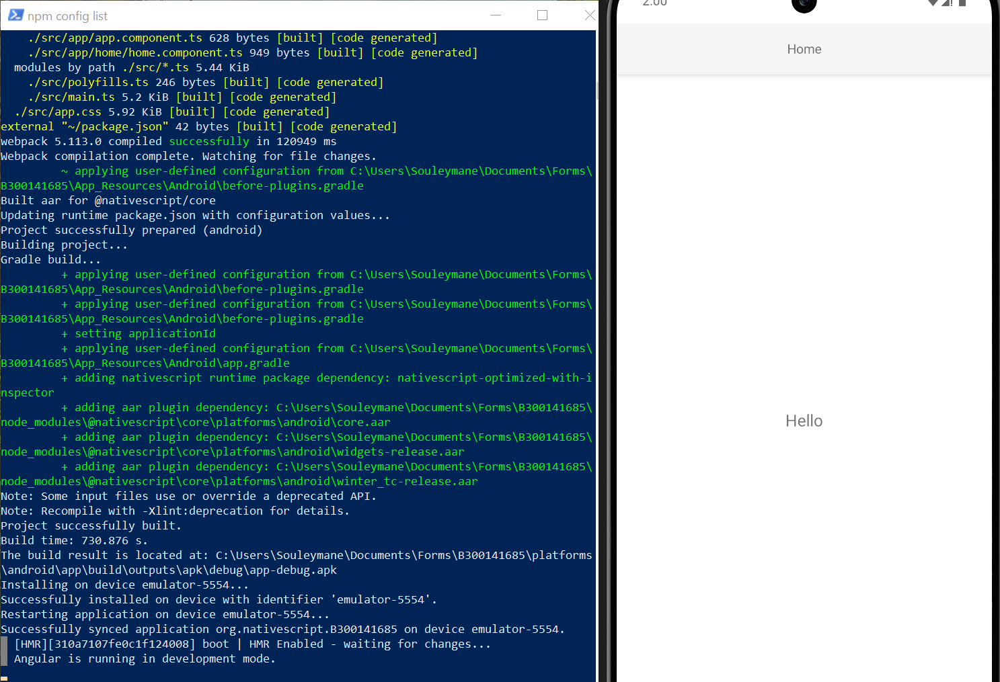
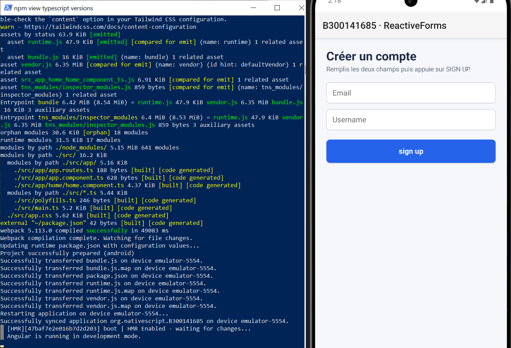
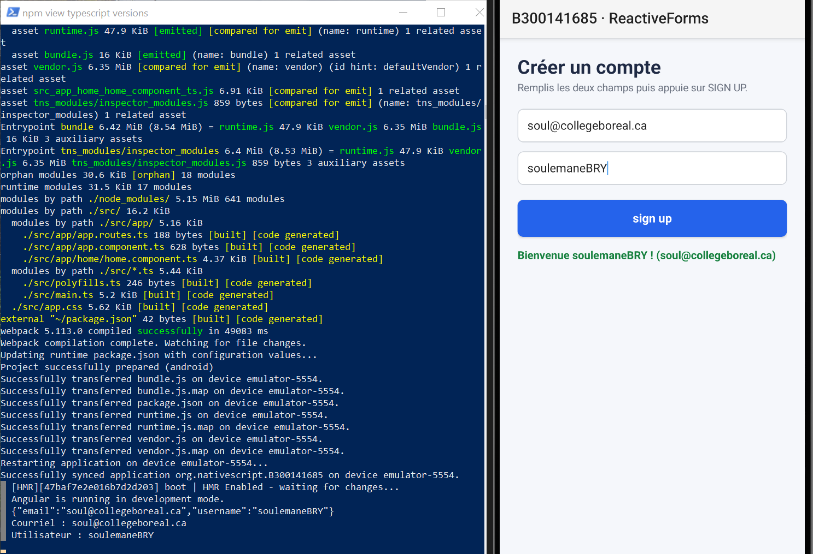
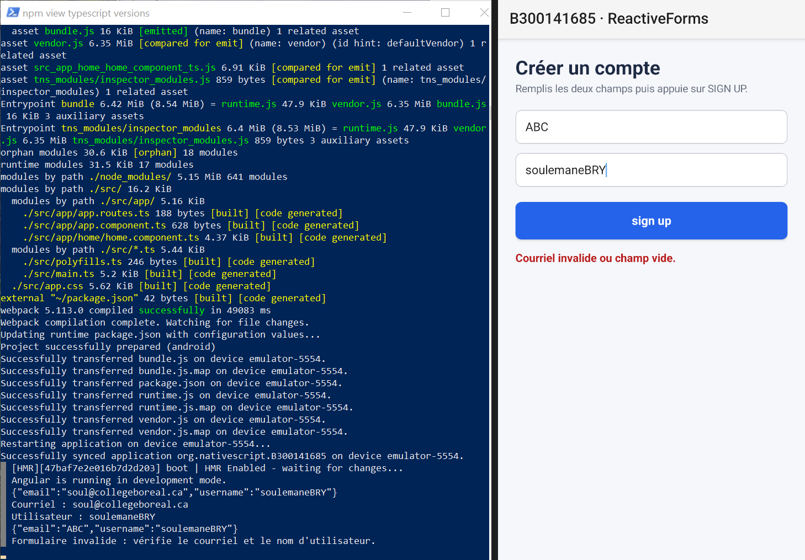

# 🧮 Labo 4.Forms : ReactiveForms avec NativeScript

**Souleymane Barry · 300141685**
INF1083 · Développement d'applications · Collège Boréal
Projet : **B300141685**

---

## 🎯 Objectif

Créer un formulaire d'inscription avec les **ReactiveForms d'Angular** dans une application **NativeScript**, puis **afficher le courriel et le nom d'utilisateur dans la console** quand on appuie sur le bouton *sign up*.

## ✅ Résultat en un coup d'œil

| Critère | Preuve | |
| --- | --- | :-: |
| L'application s'exécute avec succès | [Étape 2](#2️⃣-lancer-lapplication-dorigine) | 🥉 |
| La fonctionnalité originale est complète (formulaire) | [Étape 3](#3️⃣-créer-le-formulaire-reactiveforms) | 🥈 |
| Les champs s'affichent dans la console | [Étape 4](#4️⃣-tester--afficher-les-champs-dans-la-console) | 🥇 |
| Amélioration : validation du courriel et design | [Étape 5](#5️⃣-amélioration--validation-du-courriel) | ⭐ |

## 🧰 Environnement

| Outil | Version |
| --- | --- |
| Système | Windows 10 |
| NativeScript Core / Android | 9.1 |
| Angular | 22 |
| Émulateur | Pixel 8 (Android, `emulator-5554`) |
| Éditeur | Visual Studio Code |

---

## 1️⃣ Créer le projet

```powershell
cd $HOME\Documents
mkdir Forms
cd Forms
ns create B300141685 --template @nativescript/template-blank-ng
```

Le projet est créé à partir du patron **blank-ng** (Angular, *Hello World*). Le message `Project B300141685 was successfully created.` confirme la création.

## 2️⃣ Lancer l'application d'origine

```powershell
cd B300141685
ns run android
```

L'application d'origine s'ouvre sur l'émulateur avec la page **Home** et le texte **Hello**. PowerShell confirme : `Successfully synced application org.nativescript.B300141685 on device emulator-5554`.



## 3️⃣ Créer le formulaire ReactiveForms

Deux fichiers sont modifiés dans `src/app/home/`. Le code complet est dans le dossier [B300141685/src/app/home](./B300141685/src/app/home).

### 📄 Le gabarit : `home.component.html`

Le `<GridLayout>` du patron est remplacé par un `StackLayout` relié au formulaire avec `[formGroup]`. Chaque `TextField` est relié à un contrôle avec `formControlName`, et le bouton appelle `onButtonTap()` grâce à l'**event binding** `(tap)`.

```html
<StackLayout [formGroup]="signUpForm" class="page">
    <Label text="Créer un compte" class="titre"></Label>

    <TextField formControlName="email" hint="Email" keyboardType="email"></TextField>
    <TextField formControlName="username" hint="Username"></TextField>

    <Button text="sign up" (tap)="onButtonTap()"></Button>

    @if (message) {
        <Label [text]="message" [color]="signUpForm.valid ? '#15803D' : '#B91C1C'"></Label>
    }
</StackLayout>
```

### 📄 Le composant : `home.component.ts`

| Élément | Rôle |
| --- | --- |
| `ReactiveFormsModule`, `NativeScriptFormsModule` | Modules nécessaires aux formulaires réactifs |
| `constructor(private formBuilder: FormBuilder)` | Injection du `FormBuilder` |
| `signUpForm: FormGroup` | Le formulaire et ses deux contrôles |
| `ngOnInit()` | Crée les contrôles `email` et `username` avec leurs validateurs |
| `onButtonTap()` | Affiche les valeurs dans la console |

```ts
ngOnInit(): void {
    this.signUpForm = this.formBuilder.group({
        email: ["", [Validators.required, Validators.email]],
        username: ["", Validators.required],
    });
}

onButtonTap() {
    console.log(JSON.stringify(this.signUpForm.value));
    // ...
}
```

Grâce au **HMR** (*Hot Module Replacement*), l'application se met à jour sur l'émulateur dès que les fichiers sont enregistrés.



## 4️⃣ Tester : afficher les champs dans la console

J'ai rempli le formulaire puis appuyé sur **sign up** :

| Champ | Valeur saisie |
| --- | --- |
| Email | `soul@collegeboreal.ca` |
| Username | `soulemaneBRY` |

La console de PowerShell affiche les deux champs :

```text
{"email":"soul@collegeboreal.ca","username":"soulemaneBRY"}
Courriel : soul@collegeboreal.ca
Utilisateur : soulemaneBRY
```

L'application affiche aussi un message vert : **Bienvenue soulemaneBRY ! (soul@collegeboreal.ca)**.



## 5️⃣ Amélioration : validation du courriel

J'ai ajouté le validateur `Validators.email` au champ `email`. Si le courriel n'est pas valide ou si un champ est vide, `signUpForm.valid` vaut `false` :

- la console affiche `Formulaire invalide : vérifie le courriel et le nom d'utilisateur.` ;
- l'application affiche un message rouge : **Courriel invalide ou champ vide.**

Test avec le courriel `ABC` :

```text
{"email":"ABC","username":"soulemaneBRY"}
Formulaire invalide : vérifie le courriel et le nom d'utilisateur.
```



---

## 🛠️ Problèmes rencontrés et solutions

| Problème | Cause | Solution |
| --- | --- | --- |
| `Cannot find connected devices` au premier `ns run android` | L'émulateur n'avait pas fini de démarrer | Attendre l'écran d'accueil Android, puis relancer `ns run android` |
| Compilation bloquée | Un clic dans PowerShell avait activé le mode **Sélection**, qui met la console en pause | Appuyer sur **Échap** et ne plus cliquer dans la console pendant la compilation |
| `Pixel Launcher isn't responding` | Émulateur lent (PC avec 8 Go de RAM) | **Close app**, fermer les programmes inutiles, puis relancer `ns run android` |
| `no space left on device` lors d'un essai précédent | Disque C: plein | Libérer de l'espace (16 Go libres ensuite) |

## 📚 Ce que j'ai appris

- Un **ReactiveForm** est défini dans le composant TypeScript (`FormBuilder`, `FormGroup`) puis relié au gabarit avec `[formGroup]` et `formControlName`.
- Les **validateurs** (`Validators.required`, `Validators.email`) rendent `signUpForm.valid` vrai ou faux automatiquement.
- `signUpForm.value` donne toutes les valeurs du formulaire sous forme d'objet, facile à afficher avec `JSON.stringify`.
- Le **HMR** de NativeScript permet de voir les changements sur l'émulateur sans recompiler toute l'application.

## ✅ Conclusion

L'application **B300141685** affiche un formulaire réactif fonctionnel. Le courriel et le nom d'utilisateur s'affichent dans la console quand on appuie sur **sign up**, et la validation empêche d'envoyer un courriel invalide.
