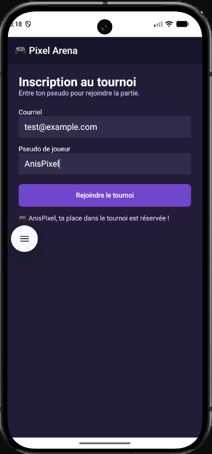
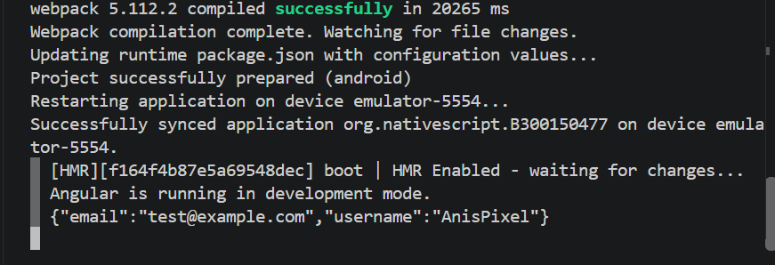

# 🎮 Pixel Arena

**Laboratoire 4.Forms · INF1083-200 · Étudiant 300150477**

Pixel Arena est une application mobile d’inscription à un tournoi de jeux vidéo fictif. Elle illustre l’utilisation des formulaires réactifs d’Angular dans une interface NativeScript.

## Fonctionnalités

- Saisie d’un courriel et d’un pseudo de joueur.
- Validation des champs obligatoires et du format du courriel.
- Affichage d’une confirmation personnalisée après une inscription valide.
- Affichage du courriel et du pseudo dans la console, au format JSON.

## Lancer l’application sur Android

Démarrer un émulateur Android ou connecter un appareil Android. Depuis le dossier qui contient ce README, exécuter les commandes suivantes.

```powershell
cd B300150477
npm install
ns run android
```

## Vérifier le formulaire

1. Saisir `test@example.com` dans le champ **Courriel** et `AnisPixel` dans le champ **Pseudo de joueur**.
2. Appuyer sur **Rejoindre le tournoi**.
3. Vérifier que l’application affiche « 🎮 AnisPixel, ta place dans le tournoi est réservée ! » et que le terminal affiche les valeurs suivantes.

```json
{"email":"test@example.com","username":"AnisPixel"}
```

Pour vérifier la validation, essayer de soumettre le formulaire avec un champ vide ou un courriel mal formé. L’application affiche alors un message invitant le joueur à corriger sa saisie.

## Captures d’écran

### Formulaire et confirmation



### Sortie de la console

