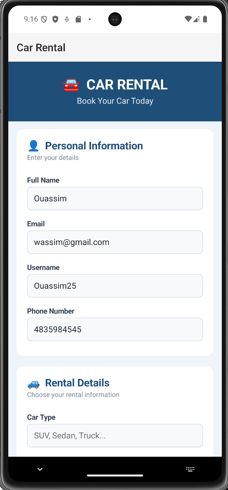
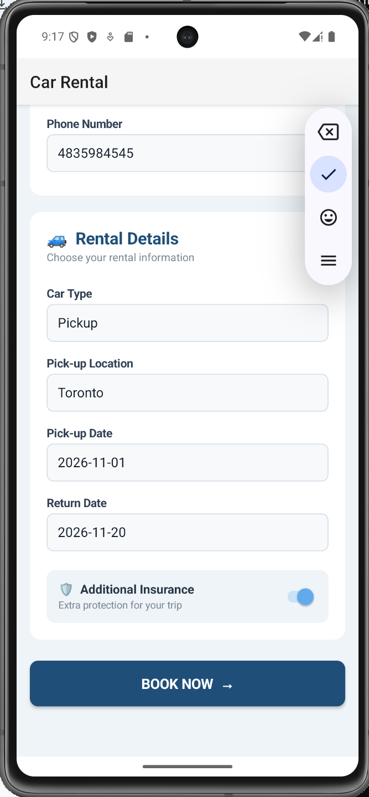
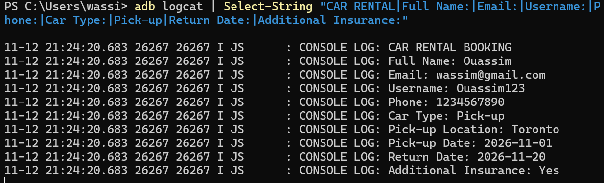

# 🚗 Forms — ReactiveForms avec NativeScript Angular

**Étudiant :** Ouassim Ahmed Benamira  
**Matricule :** 300150564  
**Programme :** TSIQ — Techniques des systèmes informatiques  
**Cours :** INF1083 — Développement d'applications  

---

## 🎯 Objectif

L'objectif de ce laboratoire est de comprendre l'utilisation des **Forms avec Angular et NativeScript**, particulièrement les **ReactiveForms**.

Le laboratoire demande de créer un formulaire contenant au minimum :

- un champ **Email** ;
- un champ **Username** ;
- un bouton permettant de soumettre le formulaire ;
- l'affichage du courriel et du nom d'utilisateur dans la console.

Pour aller plus loin, j'ai personnalisé le projet en créant une application de **location de voiture (Car Rental)** avec plusieurs informations supplémentaires.

---

## 📱 Projet réalisé

Le projet NativeScript utilisé est :

```text
B300150564
```

Il se trouve dans :

```text
4.Forms/300150564/B300150564
```

Le projet est basé sur **NativeScript avec Angular** et utilise les **ReactiveForms**.

---

## 🏗️ Création du projet

La commande utilisée dans le laboratoire pour créer un projet NativeScript Angular est :

```powershell
ns create B300150564 --template @nativescript/template-blank-ng
```

Le projet peut ensuite être ouvert dans Visual Studio Code avec :

```powershell
code .
```

---

## 🧮 ReactiveForms

Pour gérer le formulaire, j'utilise les éléments suivants d'Angular :

```typescript
FormBuilder
FormGroup
ReactiveFormsModule
Validators
```

Ils sont importés depuis :

```typescript
@angular/forms
```

`FormGroup` représente le formulaire complet tandis que `FormBuilder` permet de créer et d'organiser les différents champs.

`Validators.required` permet d'indiquer qu'un champ est obligatoire.

---

## 📝 Formulaire Car Rental

Au lieu de créer uniquement les deux champs demandés, j'ai développé un formulaire plus complet pour une application de location de voiture.

Le formulaire contient :

- 👤 Full Name
- 📧 Email
- 👤 Username
- 📞 Phone Number
- 🚙 Car Type
- 📍 Pick-up Location
- 📅 Pick-up Date
- 📅 Return Date
- 🛡️ Additional Insurance

Les champs sont reliés au `FormGroup` avec `formControlName`.

Par exemple :

```html
<TextField
  formControlName="email"
  hint="Enter your email"
  keyboardType="email">
</TextField>

<TextField
  formControlName="username"
  hint="Enter your username">
</TextField>
```

---

## 👤 Informations personnelles

La première partie de l'application permet à l'utilisateur d'entrer ses informations personnelles.

<p align="center">
  
</p>

<p align="center">
  <em>Figure 1 — Informations personnelles du formulaire Car Rental.</em>
</p>

Cette partie contient notamment les deux champs demandés dans le laboratoire :

```text
Email
Username
```

J'ai également ajouté le nom complet et le numéro de téléphone afin de rendre le formulaire plus réaliste.

---

## 🚙 Informations de location

La deuxième partie permet d'entrer les informations concernant la location du véhicule.

<p align="center">
  
</p>

<p align="center">
  <em>Figure 2 — Informations de location et bouton BOOK NOW.</em>
</p>

L'utilisateur peut indiquer :

```text
Car Type
Pick-up Location
Pick-up Date
Return Date
Additional Insurance
```

Le bouton :

```text
BOOK NOW
```

déclenche l'événement Angular :

```html
(tap)="onBookNow()"
```

---

## ⚙️ Configuration du FormGroup

Le formulaire est créé avec `FormBuilder`.

```typescript
this.bookingForm = this.formBuilder.group({
  fullName: ['', Validators.required],
  email: ['', Validators.required],
  username: ['', Validators.required],
  phone: ['', Validators.required],
  carType: ['', Validators.required],
  pickupLocation: ['', Validators.required],
  pickupDate: ['', Validators.required],
  returnDate: ['', Validators.required],
  insurance: [false],
});
```

Chaque champ de l'interface correspond donc à une valeur du formulaire Angular.

Les champs principaux demandés par le laboratoire sont :

```typescript
email: ['', Validators.required],
username: ['', Validators.required],
```

---

## 🖱️ Soumission du formulaire

Lorsque l'utilisateur appuie sur **BOOK NOW**, la méthode suivante est exécutée :

```typescript
onBookNow() {
  console.log('CAR RENTAL BOOKING');
  console.log('Full Name: ' + this.bookingForm.value.fullName);
  console.log('Email: ' + this.bookingForm.value.email);
  console.log('Username: ' + this.bookingForm.value.username);
  console.log('Phone: ' + this.bookingForm.value.phone);
  console.log('Car Type: ' + this.bookingForm.value.carType);
  console.log('Pick-up Location: ' + this.bookingForm.value.pickupLocation);
  console.log('Pick-up Date: ' + this.bookingForm.value.pickupDate);
  console.log('Return Date: ' + this.bookingForm.value.returnDate);
  console.log(
    'Additional Insurance: ' +
      (this.bookingForm.value.insurance ? 'Yes' : 'No')
  );
}
```

Cette méthode récupère les valeurs du `bookingForm` et les affiche dans la console.

---

## 💻 Résultat dans la console

Le laboratoire demande spécifiquement :

> L'exercice est d'afficher le courriel et l'utilisateur dans la console.

Après avoir rempli le formulaire et appuyé sur **BOOK NOW**, la console affiche notamment :

```text
CAR RENTAL BOOKING
Full Name: Ouassim
Email: wassim@gmail.com
Username: Ouassim123
Phone: 1234567890
Car Type: Pick-up
Pick-up Location: Toronto
Pick-up Date: 2026-11-01
Return Date: 2026-11-20
Additional Insurance: Yes
```

<p align="center">
  
</p>

<p align="center">
  <em>Figure 3 — Valeurs du ReactiveForm affichées dans la console.</em>
</p>

Cette capture confirme que **Email** et **Username** sont correctement récupérés et affichés dans la console, conformément à la consigne du laboratoire.

---

## 📲 Test sur Android

L'application a été testée sur un émulateur Android.

L'appareil a été vérifié avec :

```powershell
adb devices
```

Résultat :

```text
emulator-5554    device
```

L'application NativeScript peut ensuite être exécutée avec :

```powershell
ns run android
```

Le projet a été compilé correctement et l'application **Car Rental** a été exécutée sur l'émulateur.

---

## 📂 Structure du travail

```text
300150564/
├── README.md
├── images/
│   ├── .gitkeep
│   ├── 01-formulaire-informations.png
│   ├── 02-details-location.png
│   └── 03-console-formulaire.png
└── B300150564/
    └── src/
        └── app/
            └── home/
                ├── home.component.ts
                ├── home.component.html
                └── home.component.css
```

---

## ✅ Travail réalisé

Dans ce laboratoire, j'ai :

- ✅ utilisé NativeScript avec Angular ;
- ✅ utilisé les ReactiveForms ;
- ✅ utilisé `FormBuilder` et `FormGroup` ;
- ✅ utilisé `Validators.required` ;
- ✅ créé le champ Email ;
- ✅ créé le champ Username ;
- ✅ relié les champs avec `formControlName` ;
- ✅ utilisé l'événement `(tap)` ;
- ✅ affiché Email dans la console ;
- ✅ affiché Username dans la console ;
- ✅ ajouté plusieurs champs supplémentaires ;
- ✅ créé une interface Car Rental personnalisée ;
- ✅ testé le formulaire sur un émulateur Android ;
- ✅ vérifié les résultats dans la console avec ADB.

---

## 📝 Conclusion

Ce laboratoire m'a permis de comprendre le fonctionnement des **ReactiveForms avec Angular et NativeScript**.

J'ai appris à créer un formulaire avec `FormBuilder` et `FormGroup`, à connecter les champs de l'interface avec `formControlName` et à récupérer leurs valeurs lors d'un événement.

J'ai également personnalisé l'exercice en développant un formulaire de location de voiture plus complet. Le test final confirme que le **courriel et le nom d'utilisateur sont correctement affichés dans la console**, comme demandé dans le laboratoire.

---

<p align="center">
  <b>🚗 INF1083 — Forms | 300150564</b>
</p>